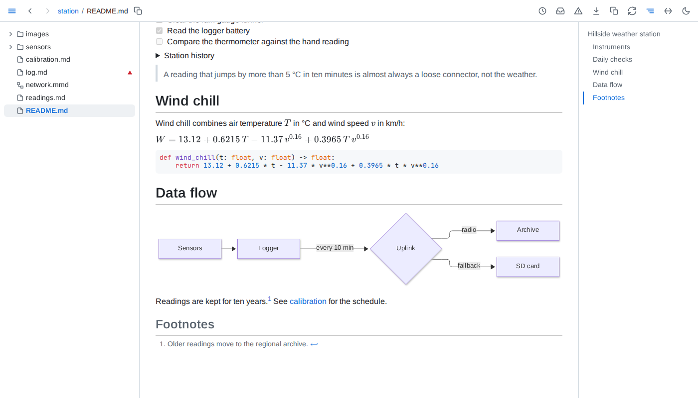
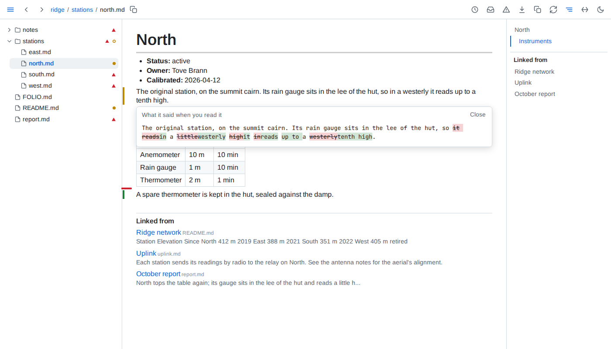

# Folio

[](LICENSE)
[](https://www.npmjs.com/package/@jakubro/folio)
[](#)

**A live view of a folder of markdown and data.** Point Folio at a folder and read it in your browser: every page rendered with GitHub-flavoured markdown, math, highlighted code and diagrams, every page current the moment you save it, and the folder known as a whole - what you have not read yet, which figures no longer match their data, what links where and what is broken.



## Install and run

```sh
npx @jakubro/folio ~/notes
```

Open the address it prints: `http://localhost:8640/`, or the next free port when that one is taken. Folio needs Node.js 22.18 or later; `npm install --global @jakubro/folio` keeps it installed as `folio`.

In Claude Code, two commands install Folio's MCP server and its agent skill as a plugin:

```sh
claude plugin marketplace add jakubro/folio
claude plugin install folio@folio
```

The plugin's tools read the Folio serving the folder Claude Code is opened in; its Folio setting, in `/config`, names another by its address, such as `localhost:8641`, or its socket.

## What Folio does

Folio keeps a model of the whole folder:

- **What is new to you.** Folio remembers what you have read. Reopen a page and every block added, changed or removed since is marked - a table by its rows, a list by its items, code by its lines - the old wording a click away, and the tree points at every document that moved.
- **Data files and data in documents.** CSV, JSON, Parquet, SQLite and other data files open as tables and trees, with each column's spread under its header and, for any filter, what sets its records apart from the rest. A document embeds a table, a chart or a single value from them, or a SQL query across them, and each one redraws when its data changes.
- **Tables that sort and filter.** Tables written in a page, embedded from data or opened from a data file sort by several columns and filter by text, whole values, patterns or several values at once, the filters joined by *and* or *or*. None of it touches the file, and the view lives in the page's address.
- **Figures checked against their data.** Tie a number in your prose to the data it quotes, and Folio flags it the moment the data disagrees.
- **Folder conventions and health.** Declare kinds of documents and rules as queries in a `FOLIO.md`. One health view - and `folio check` in CI - lists every broken link, missing include, failing query and broken rule.
- **History.** Every version git holds, merged with the saves Folio saw, compared block by block, and digests of any day or week.
- **Agents and editors.** An MCP server, a JSON API and a language server give them the same model you read, and an [agent skill](plugin/skills/folio/SKILL.md) teaches agents to write documents that use it.

The folder stays plain markdown: every page still reads on GitHub, and Folio writes into it only what a `FOLIO.md` asks for.



## Documentation

Full documentation is published at **[jakubro.github.io/folio](https://jakubro.github.io/folio/)**.

- [Guide](https://jakubro.github.io/folio/guide/reading/) - every view Folio adds, with pictures
- [Reference](https://jakubro.github.io/folio/reference/command-line/) - every option, address, key and rule, and what Folio reads and writes
- [Architecture](https://jakubro.github.io/folio/architecture/) - how Folio works inside, and why

## License

Copyright (C) 2026 Jakub Roman. Distributed under the [GNU GPL v3](LICENSE).
