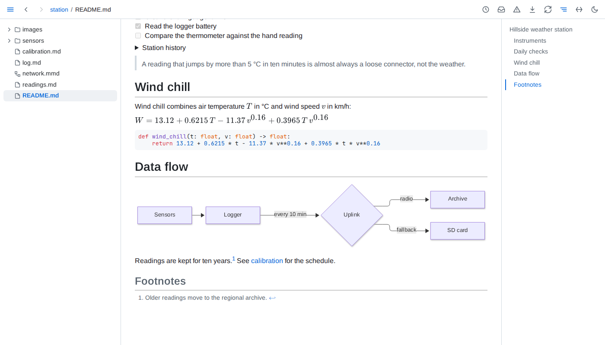
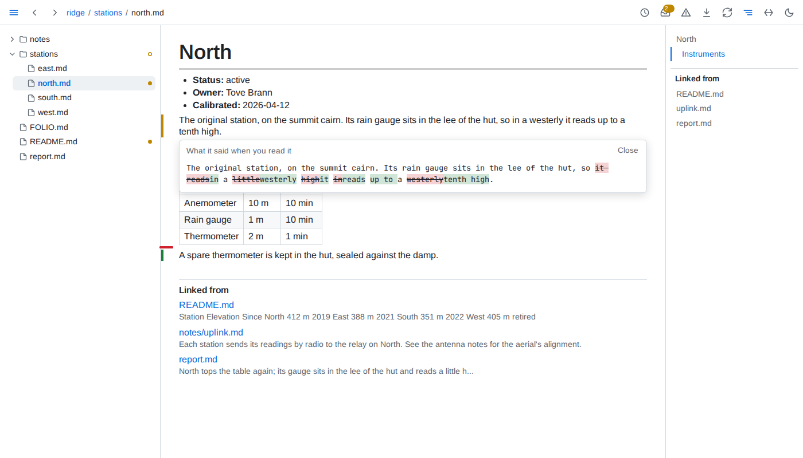

# folio

[](LICENSE)
[](https://www.npmjs.com/package/@jakubro/folio)
[](#)

**A live view of a folder of markdown and data.** Point folio at a folder and read it in your browser: every page rendered with GitHub-flavoured markdown, math, highlighted code and diagrams, every page current the moment you save it, and the folder known as a whole - what you have not read yet, which figures no longer match their data, what links where and what is broken.



## Why folio

A markdown previewer shows you one file. folio keeps a model of the whole folder, so it can tell you about it:

- **What is new to you.** folio remembers what you have read. Reopen a page and every block added, changed or removed since is marked, the old wording a click away, and the tree points at every document that moved.
- **Data, live in your documents.** CSV, JSON, Parquet, SQLite and other data files open as tables and trees. A document embeds a table, a chart or a single value from them, or a SQL query across them, and each one redraws when its data changes.
- **Figures that check themselves.** Tie a number in your prose to the data it quotes, and folio flags it the moment the data disagrees.
- **A folder that keeps its own rules.** Declare kinds of documents and rules as queries in a `FOLIO.md`. One health view - and `folio check` in CI - lists every broken link, missing include, failing query and broken rule.
- **History of everything.** Every version git holds, merged with the saves folio saw, compared block by block, and digests of any day or week.
- **Agents and editors read it too.** An MCP server, a JSON API and a language server give them the same model you read, and an [agent skill](skills/folio/SKILL.md) teaches agents to write documents that use it.

The folder stays plain markdown: every page still reads on GitHub, and folio writes into it only what a `FOLIO.md` asks for.



## Try it

```sh
npx @jakubro/folio ~/notes
```

Open `http://localhost:8640/`. folio needs Node.js 22.18 or later; `npm install --global @jakubro/folio` keeps it installed as `folio`.

## Learn more

Full documentation is published at **[jakubro.github.io/folio](https://jakubro.github.io/folio/)**.

- [Guide](https://jakubro.github.io/folio/guide/) - every view folio adds, with pictures
- [Reference](https://jakubro.github.io/folio/reference/) - every option, address, key and rule, and what folio reads and writes
- [Architecture](https://jakubro.github.io/folio/architecture/) - how folio works and why, for contributors

## License

Copyright (C) 2026 Jakub Roman. Distributed under the [GNU GPL v3](LICENSE).
