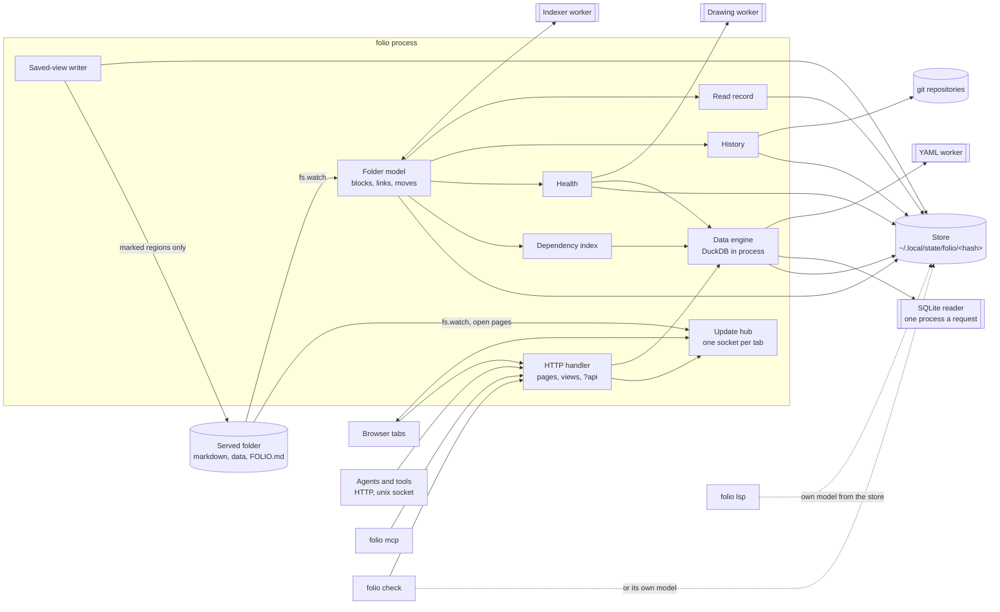
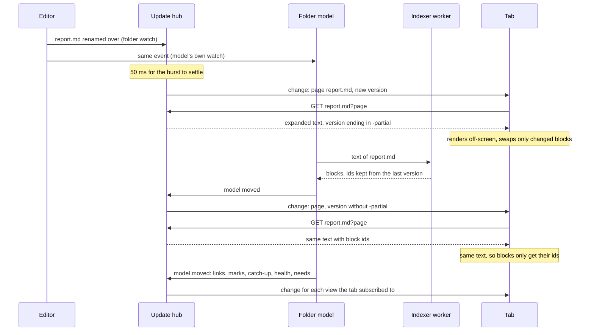
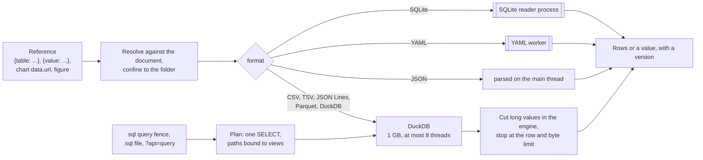
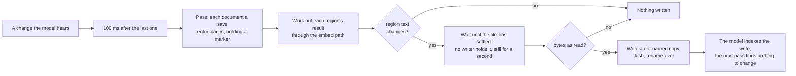

# Architecture

How folio is put together and why, for anyone changing it. One process serves one folder. The browser renders; the server reads files, expands includes and keeps a model of every document in the folder - its blocks, what links to what, what the reader has read, every version seen - and every view and client reads that model.

## Shape



- **The folder is the source of truth.** Everything folio knows is derived from the files and can be rebuilt from them; deleting the store loses only what cannot be derived - what was read and the saves git never saw.
- **One model, many readers.** The pages, the views, the API, `folio mcp` and `folio check` all read the same objects in the same process, so the browser, an agent and a CI gate never disagree about the folder. `folio lsp`, and `folio check` when no folio is running, build their own model from the same store, which makes their start cheap.
- **Nothing blocks a request.** Parsing runs on a worker thread, diagrams are checked on another, YAML on a third, SQLite in a child process and DuckDB on its own threads; a page that is not parsed yet is served without block ids and gets them with a later update.
- **One writer into the folder.** Only the saved-view writer writes into the served folder, only into regions a document marks and only where a `FOLIO.md` allows it.

### A save reaching an open tab



The hub tells, the tab fetches: a change message carries a kind, a path and a version, never content, so every tab reads the same HTTP answers a fresh load would, and a tab that missed messages catches up by sending the versions it holds.

## Runtime and packaging

folio is written in TypeScript for Node.js and published as one npm package whose `folio` command is `dist/cli.js`. esbuild makes four builds into `dist/`:

- **The command** - `cli.js` and the entry points of its worker threads and child process: `index-worker.js`, `yaml-worker.js`, `draw-worker.js` and `sqlite-reader.js`. The server bundles the client modules whose rules it must share with the page - the sanitizer's schema, tied figures, table cells and views, include markers, health problem keys - so server and browser judge alike. DuckDB is a native addon, so it is the package's one runtime dependency and stays out of the bundle.
- **The page** - `page.js`, split into chunks: a page first loads only what every page needs, and the renderer for diagrams, math, highlighted code, frontmatter, inline HTML, charts, data pages, history, digests, health and snapshots is fetched the first time a page needs it. Chunks load through `?asset=`, since a relative URL would land in the served folder's address space.
- **The snapshot script** - `snapshot.js`, one file with no chunks, since a frozen page has no server to load them from.
- **Theme and styles** - `theme.js`, a classic script run before the page draws so the first frame has the right theme, and `page.css`.

Nothing is loaded from a CDN at runtime: every chunk comes from folio itself, and the KaTeX, Arimo and JetBrains Mono fonts are inlined into the stylesheet. KaTeX's main face is the second font in every stack, so a symbol the Arimo and JetBrains Mono subsets lack - a footnote's back-link arrow - still comes from a carried face rather than the machine's.

The server binds to `127.0.0.1` only, and a port already in use is a fatal error rather than a fallback. Its header limit is 1 MB rather than Node's 16 KB, since a table's view travels in the page's address. There is no terminal interface: one log line per request and per update sent.

## Addresses

The served folder's layout is the address space, so every view folio adds is a query string on a path, which no file in the folder can shadow. A folder's address without its trailing slash redirects to the form with one. Only `GET` and `HEAD` are answered.

| Request | Response |
|---|---|
| `/<path>` to a markdown, mermaid, data or `.sql` file | The page shell; the browser fetches and renders the content |
| `/<path>` to an image | The image, revalidated on every load by its modification time and size |
| `/` | The page shell, which renders what needs you; `/?files` renders the root's listing |
| `/<folder>/` | The page shell, which renders the listing |
| `/?asset=<name>` | folio's own script, its chunks and its stylesheet |
| `/?events` | The tab's update socket (WebSocket upgrade) |
| `/<path>?raw` | The file's text with includes expanded, its version in `X-Folio-Version` |
| `/<path>?page` | What the browser renders: the expanded text, its version, where each expanded line came from, and the blocks of every file it was read from that are parsed |
| `/<folder>/?tree` | One folder level: its renderable files, and the folders holding at least one; data files too with `&data` |
| `/<path>?step` | The pages before and after this one in tree order |
| `/<path>?data` to a data file | Its page as JSON: format, size, version, and its rows, value, start or tables; with `&table=<name>`, one table of a database |
| `/<path>?embed=<reference>` to a document | What the reference names, resolved against the document, as JSON: rows, a value, or why not |
| `/<path>?links` | Every link into the page from another document of the folder, with its version |
| `/<path>?used-by` | The documents that include the file or whose embeds and queries read it, and whether the model's first walk has ended |
| `/<path>?model` | The document's blocks in the folder model, the blocks of its page as `?page` places them, and the data files it reads |
| `/<folder>/?model` | How far the folder model has got, how many documents it holds under the folder, the folders it watches and where its store is |
| `/<path>?conventions` | What the folder declares of the document: the declarations applying to it, and its kind and fields |
| `/<path>?provenance=<id>&source=<file>` | Where a block of the page came from - its file, lines and last change, the section an include brought it from, the data files and queries behind it, and each tied figure's state; `&at=<n>` picks one of several places the same block is included |
| `/<path>?read` | Each block of the page with the version shown and, once read, the version read and when, and the page's marks |
| `/?catch-up`, `/?changed` | The page shell, which renders the catch-up list; the list as JSON |
| `/?health`, `/?health-data` | The page shell, which renders the folder's health; every problem as JSON, and with `&since=<version>` only what changed since that version |
| `/?needs-data` | What needs the reader, ranked, and whether the model's first walk has ended |
| `/?stale`, `/?stale-data` | The page shell, which renders the outlived documents; the list as JSON |
| `/<path>?history` | The page shell, which renders the document's history, a version, two versions compared, a block's past or an embed's results, by the rest of the query; also for a document no longer in the folder |
| `/<path>?versions` | The document's versions, newest first, and the embeds whose results are kept |
| `/<path>?version=<id>` | One version's text |
| `/<path>?compare=<a>,<b>` | Two versions' blocks paired |
| `/<path>?block-history=<id>` | Each text a block has had |
| `/<path>?value-history=<reference>` | Each result an embed showed |
| `/?digest`, `/?digest-data&from=<ms>&to=<ms>` | The page shell, which renders a digest; the digest as JSON, `to` defaulting to now and `&since-last` starting where the last digest seen ended, or a week back |
| `/<path>?api=<resource>` | The model API; see below |

Every path is resolved through symlinks and must land inside the served folder; anything else is a 404. A request whose `Host` header is not a localhost name is refused, and the socket upgrade also needs a localhost `Origin`, because any web page can open a WebSocket to localhost. Pages carry a content security policy allowing script only from folio itself. An SVG opened directly is served sandboxed, so it stays an image rather than a document that could run script.

## Model API

`?api=<resource>` answers what the model holds as JSON, from the same objects the pages read - the model, its conventions, health, the read record, the history and the query engine; `/?api` lists the resources and names the served folder. It is refused when the request carries a non-localhost `Origin` or a browser's `Sec-Fetch-Site` of `cross-site` or `same-site`, since a page of another site can make a browser send a GET even though it cannot read the answer, and a query costs. An embed asked through the API is not kept in the embed's value history, which records only what a page showed. `--socket` serves the same handler on a unix socket, made readable and writable by its owner only, and removed on exit; a socket left behind is replaced only after a connection to it fails.

`folio mcp` is a separate process: a JSON-RPC loop on standard input and output that maps each MCP tool onto one resource and fetches it from the running folio over the port or the socket, so it holds no model of its own and an agent sees exactly what the reader's folio sees.

## What is shown

Renderable files are markdown, `.mermaid` / `.mmd`, images, data files and `.sql` files. Only markdown and mermaid files are documents: data files have no blocks, includes or links, are not in the folder model, and are left out of page steps; listings carry them only when asked. Dot-files, dot-folders and `node_modules` are pruned from every walk and never listed; `.gitignore` is not read. A folder is listed only if a walk of its pruned subtree finds a renderable file. Listings walk on demand; symlinked folders are never followed, so a walk cannot loop.

## Rendering

The browser renders. The pipeline is remark with frontmatter, GitHub-flavoured markdown and math, then folio's loose-table pass, then rehype: raw HTML, sanitized against an allow-list of tags and attributes, then heading slugs, KaTeX and highlighting. Slugs are added after sanitizing so anchors match GitHub's. Mermaid renders at `securityLevel: strict`, after the page's text face has loaded, because it sizes each box from its measured text. Mermaid keeps a fill the document gives a node or box but colours its label from the theme, so a label the document leaves uncoloured, lying on a fill the diagram's source names, is drawn in `#333333` or `#cccccc`, whichever reads better on what shows under it, unless mermaid's own colour reads at least as well. In the dark theme diagrams draw without shadows, which on a dark page read as a glow. The full-window viewer draws the diagram's SVG again, scaled: a 1.25 zoom step, 0.25x to 8x of fit, and a 5 px threshold before a press becomes a drag.

A page opened or followed renders off-screen and is swapped in whole. An update to the open page renders off-screen too, then replaces only the top-level blocks whose markup changed: every other block stays the same element, with its diagram drawn and anything another tool added to it, and the block being read keeps its place on screen. Folded sections, the outline and the tree survive either way; a theme switch redraws the whole page. A page prepared while the pointer rests on a link is rendered into a detached document, so its images load only once it joins the page.

## Data

Data files are read in the server; the browser receives rows and values only, never the file.



- **Engine.** CSV, TSV, JSON Lines, Parquet and DuckDB files are read by DuckDB inside folio's process, started the first time anything needs it - a data page, an embed, a query, or the dependency index planning a document's queries once the model's first walk ends - and kept for the life of the process. Its memory is limited to 1 GB, beyond which sorts and joins spill to disk, and it runs on at most eight threads, since each of its file readers holds a buffer per thread - a JSON reader 32 MiB whatever its options - and more threads than the limit holds fail a read of many files; DuckDB does not count the memory one expression takes for a chunk of 2,048 values, so a query building very long values row by row can still take several gigabytes before the time limit lands. Before it answers anything it is confined: it may read only inside the served folder and write only into its own folder in the store, `engine/<pid>-<start>/`, which holds its spill files and the copies it reads; access to anything else, the network and extension installs included, is switched off, and its settings are then locked so no statement can widen them. DuckDB files are attached read-only, under a fresh name per request, and detached after. Every path reaches the engine resolved through symlinks and inside the served folder.
- **SQLite** is read through Node's own SQLite, opened immutable: a reader of a write-ahead-logged database would otherwise create its shared-memory and log files beside it. Immutable reads see only what has been checkpointed into the file. Every SQLite read runs in a child process of its own, one per request and among the three engine jobs, killed at the time limit: a slow view holds the reader inside SQLite, where neither an interruption nor ending a worker thread reaches it. A database's listing reports each table as it is read, so a listing stopped part way keeps the tables it read and names the one it was reading.
- **JSON and YAML** are parsed in the server whole: JSON up to 20 MB on the main thread, YAML up to 2 MB on a worker thread of its own with a 1 GB memory ceiling and a 10 s limit, since YAML parses far slower and an alias can expand without end. The worker measures the value its aliases expand to, counting each shared value once, refuses one past 20 MB or one that contains itself, and answers with the JSON text, so the main thread never walks an expansion. Two parse at a time, each limit starting when its parse does, on threads kept from one parse to the next - starting one takes longer than a small file's parse - and replaced when one runs out of time or memory; the last eight answers are kept per file version, so any number of pages, embeds and queries of one file wait on one parse.
- **Malformed files.** A CSV or TSV that does not read whole is read again leniently, keeping what parses and counting the rows it rejected; a JSON Lines file whose last line is still being written is read from a copy of its complete lines, kept in the engine's folder per version.
- **Queries.** A query is checked and rebuilt before it runs. DuckDB serializes it to its syntax tree, which only a single `SELECT` survives; every table named like a path is resolved against the folder - refused outside it - and bound to a temporary view on the query's own connection that reads the file as its page would: DuckDB files attached read-only, YAML through its JSON, SQLite tables copied once per file version to JSON Lines in the engine's folder, since only an immutable read writes nothing beside a SQLite file - a new version's copy replaces the old one's as soon as no running query reads it. Each process keeps its own engine folder, named by its process id and, where the system tells it, its start time, and the engine's start clears the folders of processes no longer running - an id since taken by another process counting as stopped - so two folio processes serving one folder never remove each other's; an error naming a copy names the file it copies - and `.sql` files planned recursively, five deep at most. A name holding a wildcard is matched by a walk of the folder below its fixed part, symlinked folders not followed and each match resolved and confined as one file is: a table name becomes one view stacking its matches by name, nested a hundred parts deep so no statement grows too deep to parse. CSV, TSV and Parquet matches read alike - one format and, for CSV, one delimiter and header layout - go through one reader per hundred files, since a reader per file holds its buffers and soon passes the memory limit, a CSV reader's buffer sized to its largest file, each row's file named in a column of the reader's own renamed `filename` - by its place in the folder, or for a match reached through a link by a lookup from its target. A JSON, JSON Lines or YAML match is read on its own, since one reader over several makes every file's rows take the shape of the least regular one, and a database's table is a view of its own. YAML matches are read through their copies, made once each however many runs ask, the run waiting for them no longer than its time limit while they go on being made for the next. A reader is handed the list of matches, past a hundred one statement per hundred stacked by name - its alias, column names and sample applying to the whole - unless it is told not to stack by name, and is refused a database among them; the folders walked are watched, so a new match is heard. File-reading table functions are pointed at the resolved file; other table functions are refused. The tree is turned back into SQL and run streaming - wrapped in a select that cuts text and nested values short and turns a blob into its size inside the engine, since a chunk of 2,048 rows of long values would otherwise reach JavaScript whole - stopped at its row limit and at 16 MB, and interrupted 10 s after its turn came - again every 250 ms until it ends, since an interruption landing before the engine starts is lost. An embedded or `.sql` query keeps 10,000 rows, the API's query 5,000, an embed of a data file or a database table 100,000. An embedded query asked for again while it runs, at the same version of everything it reads - as embeds sharing it are after one save - runs once for all of them, and the last 64 runs are kept; a newer version never takes an older run's result. Every engine job - a data page, an embed, a database's listing - has the same limit, counted from when it gets a connection, so time queued behind slow jobs is never its own. At most three engine jobs run at once, below Node's four worker threads, so a burst cannot take the thread an interruption needs. The engine's own confinement stands behind all of this.
- **Documents as tables.** A table named `folio.<name>` or `kind.<name>` in a query is bound, like a file, to a temporary view: the tables are worked out from the model's blocks - structure from each document's own blocks, a kind from the documents its declarations place - written once per version of the table as JSON Lines in the engine's folder, and read with their columns named and typed, so an empty table keeps them; each version is read into a table of the engine once, which every query of that version reads, and a copy and its table go once no running query holds them. Each table has its own revision: a change to a document moves only the structure tables whose rows it changed, a kind only when the document joins or leaves it or one of its field values changes, and the kinds naming a kind by id when that kind's ids move, each document's rows kept while its text holds; a changed declaration moves them all. A query reading them is versioned by the revisions of the tables it names, so its embeds are asked again, and health checks it again, only when one of those moved; a kept result for one is never trusted after a restart.
- **Embeds.** After sanitizing, the renderer turns embed syntax into placeholder elements that carry the reference and the file holding it, so a page cannot forge one, and draws each as diagrams are drawn: a table or value is fetched from `?embed`, a chart's `data.url`s too. Charts are compiled by Vega-Lite and rendered by Vega to SVG, with expressions interpreted rather than compiled, since the page's policy forbids generated code; the chart code is a chunk only a page holding a chart loads.

## Includes

`\{include: <path>}` is replaced by the target file's text on the server, before the browser sees the page, wherever it appears - prose, inline code, code blocks and diagram fences alike; one written with a backslash before its brace is left as written, the backslash dropped, and never resolved. Paths resolve against the including file's folder, or against the served folder when they start with `/`; included files expand their own includes. A path ending in `#<anchor>` takes only that heading's section - the heading and everything up to the next heading of the same or a higher level - and one ending in `#^<id>` only that block; the anchor and the id are found among the file's blocks in the folder model, read for the exact text expanded, so a section follows edits to its file. A part always ends in a line break, even at the end of a file without one, so what follows the include stays a block of its own.

An include that resolves to nothing - a missing file, section or block, a path outside the served folder, or a cycle - travels to the page spelled in private-use characters - its reason, the file and line holding it, then its literal - which markdown reads as no syntax; the page spells the literal back as written before anchors are made, so a heading holding it is named as on the server, and replaces each well-formed run, even one a highlighter split across its spans, by an inline marker holding the literal and named `include-<file>:<line>:<column>`, which health's entry for it points at. A diagram, chart or formula holding such a marker is not drawn, so the marker stays, and a figure holding one is left unchecked; a marker in an attribute is shown again just after its element, the attribute keeping the literal - in an address with its colon escaped, so it is kept as a path, and `?raw` gives the literal alone. A page holding no marker skips the marking walk. A `sql query` fence runs, and health checks every diagram, chart and query, as the page shows it - the document's own fences found in its expanded text and mapped back to the lines of its file. A missing target's file stays a dependency, so restoring it restores the page.

A document may include a section of itself from outside that section; a part is a cycle when any include on the way to it sits inside it, directly or through other files, and is left marked; so is a whole file reached from inside one of its own parts. A path naming an existing file whole, `#` and all, is that file. Each expansion also yields the set of files the page depends on, missing targets included, and that set becomes part of the page's subscription, and, for each file once per place it was included, the expanded lines each of its lines starts and ends on.

## Block sources

Every rendered block knows the file and lines it came from, through any depth of includes. The expansion records which file each expanded line starts with, and which expanded lines each line of each file spans; a block reports the file its first line starts with and that file's lines it covers - a paragraph holding an include in mid-line reports the file around it, a list continued by the including file reports the file it began in, and the footnotes section reports the page's own file, with the id and lines of its own footnote definitions when it has any. Its id is that of the model block holding its first line.

A page never waits for parsing. The server answers with the blocks the model already holds for the exact text it read; a file saved since the model last indexed it, or not indexed yet, is parsed in the background, and its blocks arrive with a later update: the page's version ends in `-partial` until they do, so the tab hears of them as of any change. A file that cannot be parsed has no blocks, and its page is served without ids. The source is added after sanitizing, so an author cannot forge it. An update that only moves a block keeps its element and gives it its new lines.

## Output contract

Other tools - site patches, extensions, scripts in the console - attach to folio's pages through a published contract, so folio needs to know nothing about them.

- **Blocks.** Every rendered block is an element inside `article.markdown-body` carrying four attributes: `data-folio-id`, the block's identity in the folder model, unique within its source file and kept while the block is moved or reworded; `data-folio-source`, the path of the file the block came from, relative to the served folder; `data-folio-lines`, its first and last line in that file, as `12-15`; and `data-folio-version`, a hash of its text in which prose counts a run of whitespace as one space, a table its cells without their padding and a list each item's depth rather than its indentation and the number an ordered list starts at rather than its numbering, code inside an item every character, while code, diagrams and frontmatter count every character, and line endings never count. A block keeps its element across updates that leave it unchanged, so whatever a tool adds to it stays. Folded sections wrap their blocks in a `div.fold`, so tools find blocks with `[data-folio-id]` rather than by position. A file included twice gives two elements the same id and source.
- **Redraws.** After every redraw that adds, changes or removes a block, and after every load, folio dispatches `folio:redraw` on `document`, a `CustomEvent` whose `detail` holds `page`, the page's path; `cause`, `load` when a page is opened, followed or redrawn whole, such as on a theme switch, or `update` when a saved file changed it; and three lists of block elements: `added`, `changed` and `removed`. On an update, a block whose content changed is in `changed` as its new element; its old element is not reported. A block is the same block when its id and its file are, so identical blocks from two files are never confused. A redraw drawn while some of its blocks' ids are still being parsed - a load or an update - is announced once they are, as one event against the blocks shown before it. A block kept in place whose file or id changed is in `changed` under its new identity. On a load, every block of the new page is `added` and every block of the old one `removed`. Removed elements are detached but keep their attributes.
- **Stability.** The attributes, the event's name and its fields change only with a new major version, named in its release notes; new fields may be added in any version.

## Backlinks and block links

A page lists every markdown link to it from another document of the folder, read from the folder model rather than the page: the address of each link, reference links resolved through their definitions, is taken relative to the document holding it, or to the served folder when it starts with `/`, and an address with a scheme or a host leads outside the folder and is left out. Each entry names the linking document, the text around the link as a reader sees it, tags gone and a value embed standing as `...`, and the heading or block it points at as the page shows it - anchors counted over the whole page as the browser counts them, headings in quotes, lists and HTML and those of included files among them, and a heading its author gave an `id` answering to that id and numbering no other, so a part brought in by an include reads as its text - and leads back to the block holding the link. The full list sits below the page; the outline lists the linking documents under it, each leading to the first of its blocks that links here. The model keeps, for every document, the documents linking to it, so the list costs no walk of the folder.

A link to a block is the page's address with `#^<id>`, the block's identity; `^` never appears in a heading's anchor, so the two cannot collide. Landing looks the id up among the page's blocks, so a link follows its block wherever the identity follows it, and lands on the first copy of a block included twice. One set of margin controls serves every block - its link, its past and its provenance: it sits outside the article, beside whichever block the pointer is over, so it never changes a block's element. The read marks and the problem flags are placed the same way.

## Updates

Updates to tabs follow what is open; the folder model watches the whole folder on its own.

| Message | Direction | Carries |
|---|---|---|
| `hello` | server to tab | The build the server runs |
| `subscribe` | tab to server | Everything the tab shows, each with the version it holds |
| `change` | server to tab | A subscribed item's kind, path and new version |
| `ping` | server to tab | Nothing; a tab missing one is dropped |
| `read` | tab to server | Blocks read, by file, id and version, with the versions of their embeds' data |
| `forget` | tab to server | Removed blocks whose mark the reader has seen |
| `presence` | tab to server | The page shown and the block under the pointer |
| `share`, `sharing` | both ways | The switch that pauses sharing with agents, and its state |
| `digested` | tab to server | The end of a digest the tab drew |

- **One socket per tab.** A WebSocket rather than a server-sent event stream: browsers allow six HTTP connections per host, so six tabs each holding a stream would leave none for loading a page.
- **Subscriptions.** A tab subscribes to its page - or its data file, by modification time and size - every embed it shows, by the document holding it and its reference, versioned by the files it reads, its queries' files included, every file the page includes, every local image it shows, every folder expanded in its tree, the links into its page, and its marks, each with the version it holds; a view subscribes to the catch-up list, health, what needs you or the outlived documents. The links, marks and views are refreshed whenever the model moves, the marks and the reader's views also whenever the read record changes, and health whenever health may have moved - not by a watch of their own. A page's or folder's version is a hash of its expanded text or listing; an image's is its modification time and size.
- **Folder watches.** The watch registry reference-counts subscriptions and watches the folder containing each subscribed file, never the file: editors save by writing a temporary file and renaming it over the original, which detaches a watch held on the file itself. A folder's watch is released when its last subscriber leaves, and a missing folder is watched through its nearest existing parent. Changes are debounced for 50 ms, since a save arrives as a burst.
- **Catching up.** On every connect the tab sends the version of everything it shows, and the server answers with a change for anything that moved since. Suspend closes the tab's socket; resume reopens it and catches up through the same path.
- **New builds.** The page shell carries the build of the script it loads, and on every connect the server names the build it serves. A tab that hears a build other than its own reloads, keeping its place: after an upgrade, the script it holds names chunks the server no longer has.
- **Dead connections.** A connection can die without closing, as it does when a machine sleeps. The server pings every 30 s and drops a tab that missed the last ping; a tab that hears nothing for 65 s reconnects, and catches up as on any connect.

## Folder model

The server keeps a model of every markdown and mermaid file a listing could show, each split into its blocks. It is built once folio is serving, so the first page never waits for it, and kept current while folio runs.

- **Blocks.** A block is a top-level block of the file's own text, includes unexpanded: a heading, paragraph, list, table, code block, diagram, quote, math block, HTML block, rule, frontmatter, link definition or footnote. Each records its kind, its first and last line and its text, every heading the page draws from it - read off the page as sanitized, raw HTML included, so its text and anchor are the browser's - each markdown link with the block's text around it and where in the file its address is written, where it holds text no link is read in - code, HTML, math, frontmatter - and what its embeds, charts and figures name and the SQL of its queries; a mermaid file is one diagram block.
- **Parsing.** Files are parsed as the page parses them, loose tables included, on a worker thread, so a long document never holds up a request - started when a document needs parsing and stopped after 10 s idle, which returns the memory parsing a large folder takes. A document that cannot be parsed is logged and left out of the model, and its text is not parsed again until it changes. A worker that dies while parsing a document fails that document alone and the documents waiting behind it go to a new worker; one that dies before it starts listening fails them all, and the model asks again after 10 s. Parses of one document run one at a time, each starting from the blocks the last one left, so a tab is handed the ids the model keeps however fast the saves come.
- **Identity.** Each block has an id unique within its document. When a document changes, a block whose text is unchanged keeps its id wherever it moved. Each remaining block then takes the id of a vanished block of the same kind whose text is similar enough - Dice's coefficient over the character trigrams of the two texts, lowercased and in the form their versions are made from, at least 0.5 - best-scoring pairs first. Anything else, including a block whose kind changed, is a new block. A new block's id is derived from its kind and text, so a model rebuilt from scratch gives every block not edited since it was first indexed the id it had before.
- **Watching.** Every folder the walk reaches is watched - dot-folders, `node_modules` and symlinked folders aside. The first event in a folder starts a 50 ms window, after which every folder heard in it is re-read: new and changed documents are indexed, missing ones dropped, new subfolders walked and watched, removed ones forgotten. A document whose text is unchanged is not parsed again. A symlinked document is re-read when its own folder changes, not when its target's does.
- **Moves.** A document that disappears while a document of the same text appears elsewhere - in one rescan, within ten seconds, or between a stop and the next start - has moved: the new place is indexed from the old one's blocks, so ids hold, and its read record, every page's record of reading it through an include, its saves and its embeds' results move with it; the commits of its old place stay among its versions.

## Store

Everything folio writes, besides the saved views, lives in one folder per served folder: `$XDG_STATE_HOME/folio/<id>/` when that variable holds an absolute path and `~/.local/state/folio/<id>/` otherwise, `<id>` a hash of the served folder's path.

```text
<store>/
  folder.json            the served folder this store is for, and the store's format
  documents/<hash>.json  one document's blocks, in the format they were written in
  reads/                 what the reader has read, one file per document
  history/
    documents/<hash>/    a document's saves.log and each saved text, gzipped
    values/<hash>/       each result an embed of a document showed
    digest.json          where the last digest seen ended
  health/<hash>.json     a document's health result and the stamps of what it read
  views.json             what the saved-view writer last wrote into each document
  writing.json           the copies a write in progress has made beside documents
  sharing.json           whether sharing with agents is paused
  engine/<pid>-<start>/  one process's spill files and the copies its queries read
```

On start folio reads the store, re-reads every document and parses only those whose text changed while it was stopped; documents gone since are dropped. A store whose `folder.json` names another folder has its documents dropped. A document stored in an older format - an upgrade cut short, or an older folio writing into the same store - lends its blocks' ids but is parsed again, since a field it lacks would read as nothing. A deleted store is rebuilt from the files on the next start. The store is outside the served folder unless the served folder holds the state directory, as a home folder holds `~/.local/state`, where it lies in a dot-folder the model and the listings skip.

## Reading

folio keeps what its reader has read, for every browser alike. A block counts as read once at least half of it - or, for a block taller than the window, half the window - has stayed on screen for 1.5 seconds while the tab is shown; a block scrolled past sooner is not. A dwell timer firing more than its own length late slept with the machine and starts again. A block taller than the window carrying a changed mark is read once the share of its height holding the changed lines - the lines between the first and the last that differ from the text read - has been on screen at the end of a dwell; each dwell adds what was then on screen. The tab sends each block it read, by its file, id and version, over its update socket, and sends what it read while suspended once it resumes. The server records a block only at the version the model holds for it, so a read of text already edited away waits for the edit to be drawn and read.

The record is kept per document in `reads/` of the store, and written half a second after a read and when folio stops. The first read of a document also keeps the version of every block it has then, so a block absent from that list arrived later. A read block that disappears keeps its place in the document's order until the reader has seen its removed mark, when the tab sends `forget` and the record drops it; a block never read is dropped when it disappears.

Marks compare the page's blocks with the record of each file they come from, so a block brought in by an include is marked by the file it lives in. A block of a file read before is new when the record does not know it, and changed when it was read at another version; a block known only from the first read is never marked. A read block that is gone is marked after the nearest block before it that is still there, or above the nearest after it, when either is on the page, or wherever its file is the page's own. `?page` carries the marks, and a tab subscribes to them, so a block read in one tab clears in every other. The earlier text shown on demand is the text recorded at the read, compared word by word.

The catch-up list is worked out from the read records alone: each document with a record has its own blocks compared as a page showing it whole would mark them. Each entry is timed by its latest marked change: the model records, for every block, when it took its current text - the file's time when the model indexed that text, kept across versions that leave the block alone - and, for blocks that went, when they went; a changed embed takes the time of the files its data comes from. Every tab subscribes to the list's version, which changes with the model and the read record, and marks the tree from it.

A read also keeps, for each block, the version of every embed's data the tab had drawn in it and the version of each block or heading its links point at, and, for blocks of another file read on a page, which page they were read on. A block's data has changed when `?embed` would now answer another version for one of those embeds; its links have changed when their targets' versions differ or the target is gone. Through the blocks it read of other files, a page counts their changes as its own in the catch-up list - the included part taken to run from the first to the last block read through it, widened over new blocks at its edges, its read blocks since removed counting too; the list also watches the folders of every embedded file a read kept, so a data change reaches it without a page open.

## History

A version is named by its git blob id, so a text folio saved and the same text committed later are recognised as one, whatever saw it first.

- **Saves.** The model hands the history every text it indexes once it has known the document - a save seen while running, or a change made while folio was stopped - and every removal. Each document's saves are a log a save adds one line to, its texts gzipped beside it; the log is written whole only by the sweep - a minute after the first walk ends, then daily - or when it has grown to twice its bound, keeping the last save of each local day for saves older than 30 days and at most 500 a document, and, past 512 MB of gzipped saves in all, dropping the oldest saves of any document but its newest; texts no longer listed are deleted. In its first walk folio also keeps the text of every document it reads that has no saves yet and that the git repository it lies in does not track - each repository's files listed once with `ls-files` - queued ahead of any later save, so such a document's history starts from the text folio first knew even when it is edited at once.
- **Git, read only.** Git is run with optional locks off so that not even its index is refreshed, every config key that names a program to run overridden on its command line, and every path taken literally, so a document named like a pathspec matches only itself. A repository is read only when its git directory lies inside the served folder or is the `.git` of the served folder or a folder above it; a `.git` file whose `gitdir:` points anywhere else is refused, so no other repository's objects can be read. Git is asked with `log --raw` - the latest 50,000 commits, at most 2,000 a document - in the folder holding the file, or the nearest one still there when that folder was removed too, so a file inside a nested repository gets that repository's history, and a blob is read with `cat-file` only when the file's own log names it, so no other file's text can be fetched through a version id. A document's file is resolved through symlinks and refused when it lands outside the served folder; a path that exists is never served as a removed document's history. Each repository's log is read whole, once, and kept until its HEAD, reflog or packed refs change, so a version list costs no process.
- **Merging.** Versions merge in time order, a version seen again at once collapsing into one; git times a commit to the second, so a commit holding a save of that second counts as made just after it, and any other as made at the start of its second, before saves later in it; the file on disk is always the newest version.
- **Comparing.** Both texts are split on the indexer's thread, the newer with the older's blocks as its previous version, so blocks pair exactly as an edit would pair them; a paired block counts as unchanged when its version is, so spacing alone never shows as a change. Comparisons are kept by their two versions, which never change. A block's past walks back from the model's current blocks, splitting each older version with the newer one's blocks, so the id the page shows is followed.
- **Values.** Every `?embed` answer a page asks for is handed to the history, which keeps it when it differs from the last kept result of that reference in that document.

## Dependencies

A document depends on the files its includes name, at any depth, and on the data and query files the embeds and queries of it and of its included documents read, as `?model` names them. folio keeps an index of each document's own reach: what the indexer recorded of each block's includes, embeds, charts and figures, and, for a document holding queries, the files those queries read, worked out on the main thread by expanding and planning them. The index is built a slice at a time between turns of the event loop once the model's first walk ends; afterwards any change to the model marks it stale, and the next question brings it up to date, redoing only the documents whose text changed or whose query files did. What reaches a file is then a walk of the index - the documents reading or including it, and those including them in turn - and costs no reading of the folder. Each read of a document keeps, in its read record, a hash of every file it depends on, each file hashed once per inode, size, modification and change time; the note at the top of the outline lists each dependency whose hash now differs, with its change time. A read with no hashes kept - recorded before folio kept them, or still being hashed - lists each dependency whose change time is later.

## Digests

A digest is built on demand and kept nowhere. Its candidates are the documents folio saw saved or removed in the period, the documents named by `git log --name-only` over the period in every repository the folder holds or lies in - a folder holding `.git` among those the model watches, and the repository around the served folder - and every document whose file time falls in it. Each candidate's state at either end is its newest version by then, as its history lists them, and a document whose two states differ is listed with both, its blocks compared when the page opens its section, as the history compares versions, and kept for every later digest. Values are read from every kept embed history: the result before the period against the last result in it. A document with no version before the period is created only when folio or git saw it come to be or its file's birth time falls in the period; otherwise it was there unseen and is listed as changed with no blocks. Building a digest writes nothing: a GET never changes state. A digest page drawn in a tab sends its end over the update socket, whose origin is checked, and folio keeps the latest such end, never later than the moment it arrived and never moving back, in `history/digest.json` for *since the last digest* to start from.

## Trust

A figure tied to data is an inline `<data value="...">` element. The sanitizer keeps that element and its `value`, as GitHub's drops the tag and keeps the figure; the embed pass then turns it into a placeholder like a `{value: ...}`, keeping the typed text, so a tie is fetched, versioned, redrawn and counted as read exactly as an embed is. The comparison is one shared function, bundled into the server and the page alike: the figure parsed for sign, grouping, decimals, a unit scale and a percent sign, the value scaled to match - both as a fraction and as itself for a percentage - and matched within half a unit of the last typed digit. The indexer records each block's ties beside its references.

Provenance is answered from the model: the block's own lines and the time it took its current text, the include instance of the page's layout that placed it, the data files every reference of it reads with their file times, each tie checked against its data as the page checks it, and what the folder declares of its file.

Health is worked out on request, never in the background, and a request arriving during a check gets the check after it. Each document's result is kept with what it depends on - the documents it links to, the files its expansion read, and the folders holding the files it links to or reads - and a check redoes only the documents whose text changed, those including or linking to them, and those depending on a folder in which a file changed, a folder created being heard through its parent; a document whose part include waited on blocks still parsing is checked again when the model next moves, and one whose folder changed while it was being checked is checked again after. A tab on health also watches the folders its documents reach that the model does not, such as dot-folders. Nothing changed, nothing is checked. Each document's result is also kept in `health/` of the store with the time and size of every file it read or looked for, and a restart takes it back while the document's text and those stamps are unchanged; the rest are checked as new, along with the documents linking to or including one that changed meanwhile, so a restart redoes no diagram or query whose inputs held. Links are checked against the model and the file system - a document the model holds exists without a stat - headings against the anchors the target's page draws, includes through the expansion's record of each include that found nothing or looped, and data kept by the versions of everything the document reads, reused only while those are unchanged and nothing in it was wrong; a document whose check only ran out of time is checked again with every later check, and after half a minute when nothing else asks for one, until it no longer does. Diagrams are parsed and laid out, and charts compiled and run without drawing, on a worker thread of their own, which loads mermaid and Vega only there and stops after 10 s idle; diagrams are laid out on a stand-in page that measures every glyph alike, and a kind whose own valid sample does not lay out there is only parsed, so a valid diagram is never listed for what the stand-in lacks; a diagram's result is kept by its block's version. The problems carry a version that moves only when the list does, and the last hundred moves are kept: a tab holding a version is answered with the problems added and the keys of those gone since, and redraws only the kinds they touch.

## Conventions

A declaration is any document named `FOLIO.md`, so the model already holds it and every edit to it reaches what reads it. It is read from the model's blocks of its text: each code block whose fence's info string is `yaml folio` is parsed as YAML on its own, checked to be a map of the known sections - `kinds`, `rules`, `attention` and `stale` maps, `health`, `save` and `digests` lists - and merged into the file's declaration in order; a fence that fails any check becomes a problem at its line, the parser's own position within the fence replaced by the line in the file, and is left out, and a single bad entry is dropped while the rest of its fence applies. Reads are kept by the document's hash. The declarations applying to a path are those whose folder holds it, ordered from the served folder down; layering them keeps a map of each section by name, a nearer entry replacing the farther one in its place, and appends list entries in that order, each entry remembering the declaration it came from, since its paths are relative to that declaration's folder. Health lists a declaration's problems as part of that document's check.

A kind's `where` patterns become expressions over paths relative to the declaring folder, and its fields are checked as the declaration is read, a kind that fails left out with its problem. A document's kind and fields are worked out on request from the model's blocks of its text - the frontmatter block parsed as YAML, a label found by its line, a section by its heading block, folder and name from the path - and kept until its text or any declaration applying to it changes; an id a link field names - an item's own, a word of prose, or a link's text when its address leads to no document of the kind - is then looked up among the documents of the kind it names, a link's target checked to be one, their ids gathered again only once a change moves the id or kind of one of them. A misfit value is its document's own problem, checked with it; a document naming another kind's documents by id is checked again when that kind's ids move, and every document when a declaration changes.

A rule's query runs as an embedded query does, from its declaration's folder, as part of that declaration's health check, and runs again only once a document table, a data file or the declaration it reads has changed; each row whose `path` lies below that folder becomes a problem at its `path`, `line` and `block`, its message filled from its columns, and rows below a deeper declaration naming the same rule are left to that rule. A problem carries its rule's severity, and the health view groups rule problems by it. Attention and stale queries run the same way, for what needs you and the outlived documents.

What health skips, and what it counts as errors, is applied as problems are gathered, never as they are found: a problem the health entries applying to its document skip is held back from the list, one of a kind they declare an error carries that severity, and any change to those entries judges every problem found again, so a scope lifted brings its problems back without checking anything anew.

## Saved views



The writer runs once the model's first walk has ended, and again 100 ms after the last of any burst of changes the model hears - a document indexed or dropped, or any file in a watched folder - one pass at a time, a change during a pass asking for one more. A pass reads each document a `save` entry places, and each digest document `digests` names, whose text holds a marker, works out every marked region's result through the same embed path a page uses, so results are shared and versioned as embeds are, and renders a grid as a GFM table with pipes escaped and line breaks folded. A document is read and written as bytes, never decoded, so whatever is outside the regions passes through; each region keeps its start line's ending, its body compared without carriage returns, and a result line that a marker or a fence would read is escaped.

When any region's text would change, the write waits until the file has settled: on Linux no process may hold it open for writing, which `/proc` names, a descriptor counted when the kernel places it on the document's own filesystem with the document's inode number and its device and inode then match the document's, so another hard link to it counts too and no file on another mount is looked at - a hung mount cannot stall the check - and unless the file is as folio last wrote it, it must be a second old - a file dated in the future counts as old. Then it reads the file once more and gives up the pass for that document when the bytes moved, writes the new text to a dot-named file beside it - which no listing or model holds - with the document's mode and owner, flushes it and renames it over the document; a document with other hard links, or whose owner the new file cannot take, is written over in place, its old and new text first written to two dot-named files beside it and flushed. Each dot-named file is noted with the writing process in `writing.json` in the store before it is made - the journal itself flushed before it replaces the last - and the pair of an in-place write is noted again, naming the document, once both are on disk. When the writer starts, a dot-named file noted by a process no longer running is removed; before that, a document an in-place write was cut short in - its bytes the new text's start followed by the old text's rest - is written over with the new text, and one holding anything else is left as it is.

A result that moves with every write into its own document is told from one that moves with the folder by counting the changes heard that folio's own writes do not explain - a change in the folder folio just wrote into counts unless the folder, its copies aside, holds just what it held right after the write, and so does one landing beside the document while its results were worked out and its write waited - every name leading to the document left out of both looks: only a pass that heard none since the pass that wrote counts toward the three writes after which the view is stopped. Each declared digest of the current period is a document of the pass too, created first when missing - only once the nearest existing folder of its path, and the path itself when it is a link, resolves inside the served folder; one that cannot be created is listed at its entry and the pass goes on - its `digest` region filled from the same digest the `?digest` page shows, from the period's start to now, every document a `digests` path names left out so no digest lists another; that result is kept for a minute and a later pass is asked for when it expires, and a timer at the period's end asks for the pass that writes a `{day}` or `{week}` document once more. `views.json` in the store keeps, per document, the hash of each region's body as last written and of the whole text, which is how a hand edit is told apart from a result that moved, and when a report of one has been outlived.

## What needs you and outlived documents

`/` is a view, not the root's listing, which moves to `/?files`; following a link to `/` loads it as a page, as other views load. Its list is worked out on request from what the other views already hold: health's problems - those with the severity `error`, and those in documents with a read record - each declaration's attention queries, run as a rule is and kept until a file or document table they read moves, and the catch-up list. A tab on it subscribes to its version, which moves with the model, the read record and health, and watches the folders its attention queries read.

The outlived list is worked out on request from what the model already holds: when each document's text first appeared, as its history dates it, whether the read record knows it, and the documents linking to it, kept by the model for backlinks; a folder's `stale` query runs as attention queries do, from its declaration's folder, and decides for every document below that folder, the nearest declaration first. A tab on the list subscribes to its version, which moves with the model and the read record.

## Editors

`folio lsp` runs the model, the data engine and health in its own process, from the served folder's store, and answers the language server protocol over standard input and output. A document open in the editor is read as the editor holds it: its text is split on the indexer's thread as the model would split it, and its links, includes and ties are checked against the model's blocks of the files they name - the document's own anchors and blocks from the text as typed. Health's findings join only while the buffer equals the file on disk, since their lines are the saved file's. Go to, references and renames find each link's address where the parser read it, which the model records as it indexes a document and a text it does not hold is parsed for, so a rename edits exactly the address that was written: it keeps its form - relative or from the served folder after a slash, between angle brackets or not - and its query and fragment, and one that still leads where it led after the move is left as written. A folder's move is the move of every file under it at once, so addresses between two files it moves stay as they are; renames sent in one request move in turn, each naming its paths as those before it left them. Nothing is written: renames return edits for the editor to apply.

## Presence

Each tab tells its socket, a quarter of a second after the pointer settles or the tab is shown or hidden, the page it shows and the block under the pointer, by source and id, and tells nothing while its socket is closed: presence is kept per tab, in memory, and a tab's goes with its socket, so nothing stale outlives a closed or sleeping tab. The sharing switch is kept in `sharing.json` in the store; a change of it is sent to every tab, and the API answers the reader's own resources with only that sharing is paused while it is. So do the views the pages read the same from - a request without the `Sec-Fetch-Site: same-origin` a browser sets on folio's own pages, which no page script can set, is told only that sharing is paused.

## Health as a command

`folio check` first asks `/?api` on the port or socket and uses that folio only when the root it reports is the folder's real path, polling its health until the first walk has ended. Otherwise it builds the model, the data engine and health in its own process from the same store a running folio keeps, so documents and results whose inputs are unchanged are taken back rather than worked out again, and it waits for what it worked out to be stored before it exits. It prints one problem a line, `path:line severity kind what`, and exits 1 when any problem has the severity `error`, 0 otherwise, and 2 when no health could be worked out.

## Per-tab state

Theme, width, panels and whether the tree lists data files are kept in session storage, so each tab has its own; the last choice made in any tab is also kept in local storage, and a new tab starts from it. A link opened into a new tab hands its opener's choices over through local storage, keyed by the target address and valid for ten seconds. Expanded tree folders and folded sections are kept per tab in session storage, and scroll positions in the history entries. A table's view lives in the tab's memory and in the page's address - `?view=`, base64url JSON naming each table by its block, or by its place among its file's tables when it has none - keyed by its block's file and id - and, while that id is still being parsed, by its file, its columns and its place among that file's tables of the same columns - so a save that redraws the table finds its view again. A view changes the table's elements only: rows are reordered and hidden, cells hidden, and a caption and a footer added, all undone when the view returns to the table as written.

## Snapshots

A frozen page is assembled in the browser: the article as rendered, its tables put back as written, folds opened and controls that need folio removed, the folder's images inlined as data addresses - only what is an image by its own bytes, whatever it was served as; any other picture, a remote one included, becomes its description, and a chart's image mark that cannot travel is left out - a picture's alternative sources removed, so its own image is the one shown; style declarations, `<style>` sheets inside diagrams and attributes such as an SVG paint naming an address dropped, a reference to a part of the page kept, the stylesheet's emptied font sources removed, the stylesheet with its fonts inlined, and `snapshot.js` with the views the page had. The browser downloads it; nothing reaches the server or the folder. Charts are already SVG, so the file needs no chart code.

## Tests

- `test/` holds `node:test` unit tests, one file per server module or client rule - arguments, listings, includes, blocks, the model against a real folder and store, reads, history, health, conventions, saved views, data files of every format, queries, table cells, figures, the editor, the MCP server - each against fixture folders it writes.
- `e2e/` drives headless Chromium against the built command serving fixture folders it writes, one test per documented behaviour. Each file covers one feature area with its own server, folder, state and browser, so the files run in parallel; `e2e/clients.test.ts` drives the API on a socket, `folio mcp`, `folio check` and `folio lsp` as an agent, a CI job and an editor would.
- `visual/` is the screenshot gate, compared at zero colour tolerance. `pages.spec.ts` serves the invented folder `visual/station/` and compares each page kind and panel state against `visual/snapshots/`. `pictures.spec.ts` records each picture the documentation shows into `docs/images/`: those of `visual/ridge/` from a copy given a git history committed on fixed dates, every file dated alike and a browser clock set to a fixed day, so pictures of history, reading and change come out the same on any machine and day. folio carries its own fonts, so no image depends on a font installed on the machine.

## Working on folio

```sh
git clone https://github.com/jakubro/folio.git
cd folio
just install    # dependencies from the lockfile, plus the Chromium build the browser tests drive
just check      # biome, tsc, knip, jscpd, unit tests, build
just e2e        # every documented behaviour in headless Chromium against the built command
just snapshots  # every page, and every picture in the docs, against its recorded image
just --list     # all recipes
```

Development needs [just](https://just.systems/) besides Node.js. `just snapshots` fails naming each image that changed; after a change meant to alter how folio looks, `just update-snapshots` re-records them. Each recipe tees its output to `/tmp/folio--<recipe>.log`. `just site` builds this documentation into `site/dist/`, failing on any broken link, and `just preview` serves it with live reload.

folio is built with [unified](https://unifiedjs.com/) (remark and rehype), [Mermaid](https://mermaid.js.org/), [KaTeX](https://katex.org/), [highlight.js](https://highlightjs.org/), [Vega-Lite](https://vega.github.io/vega-lite/), [yaml](https://eemeli.org/yaml/), [ws](https://github.com/websockets/ws), [DuckDB](https://duckdb.org/) and [vscode-languageserver](https://github.com/microsoft/vscode-languageserver-node), set in [Arimo](https://github.com/googlefonts/Arimo) and [JetBrains Mono](https://www.jetbrains.com/lp/mono/), and tested with [Playwright](https://playwright.dev/), [Biome](https://biomejs.dev/), [Knip](https://knip.dev/) and [jscpd](https://github.com/kucherenko/jscpd).
