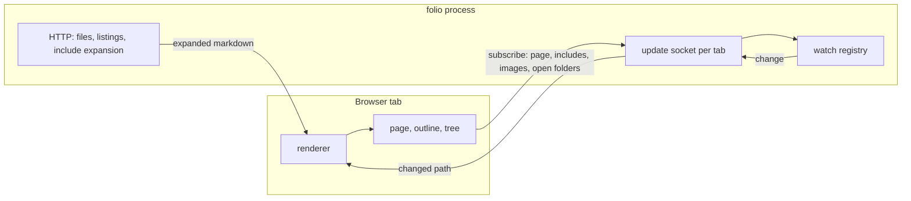

# Architecture

How folio is put together, for anyone changing it. One process serves one folder: the server reads files, expands includes, lists folders, watches what is open and tells each tab what changed; the browser renders.

## Runtime and packaging

folio is written in TypeScript for Node.js and published as one npm package whose `folio` command is `dist/cli.js`. esbuild bundles two things into `dist/`: the command, from `src/cli.ts` and `src/server/`, and the browser's script and stylesheet, from `src/client/`. Nothing is loaded from a CDN at runtime: Mermaid, KaTeX and highlight.js are bundled into the script, and the KaTeX, Arimo and JetBrains Mono fonts are inlined into the stylesheet. KaTeX's main face is the second font in every stack, so a symbol the Arimo and JetBrains Mono subsets lack - a footnote's back-link arrow - still comes from a carried face rather than the machine's.

The server binds to `127.0.0.1` only, and a port already in use is a fatal error rather than a fallback. There is no terminal interface: one log line per request and per update sent.

## Addresses

The served folder's layout is the address space, so every view folio adds is a query string on a path, which no file in the folder can shadow. A folder's address without its trailing slash redirects to the form with one.

| Request | Response |
|---|---|
| `/<path>` to a markdown or mermaid file | The page shell; the browser fetches and renders the content |
| `/<path>` to an image | The image, revalidated on every load by its modification time and size |
| `/<folder>/` | The page shell, which renders the listing |
| `/<path>?raw` | The file's text with includes expanded, its version in `X-Folio-Version` |
| `/<folder>/?tree` | One folder level: its renderable files, and the folders holding at least one |
| `/<path>?step` | The pages before and after this one in tree order |
| `/?asset=<name>` | folio's own script and stylesheet |
| `/?events` | The tab's update socket (WebSocket upgrade) |

Every path is resolved through symlinks and must land inside the served folder; anything else is a 404. A request whose `Host` header is not a localhost name is refused, and the socket upgrade also needs a localhost `Origin`, because any web page can open a WebSocket to localhost. Pages carry a content security policy allowing script only from folio itself. An SVG opened directly is served sandboxed, so it stays an image rather than a document that could run script.

## What is shown

Renderable files are markdown, `.mermaid` / `.mmd` and images. Dot-files, dot-folders and `node_modules` are pruned from every walk and never listed; `.gitignore` is not read. A folder is listed only if a walk of its pruned subtree finds a renderable file. Walks run on demand, with no index; symlinked folders are never followed, so a walk cannot loop.

## Rendering

The browser renders. The pipeline is remark with frontmatter, GitHub-flavoured markdown and math, then folio's loose-table pass, then rehype: raw HTML, sanitized against an allow-list of tags and attributes, then heading slugs, KaTeX and highlighting. Slugs are added after sanitizing so anchors match GitHub's. Mermaid renders at `securityLevel: strict`, after the page's text face has loaded, because it sizes each box from its measured text.

A page renders off-screen and is swapped in whole, so an update keeps the scroll position and the state of the tree, the outline and the folded sections. A page prepared while the pointer rests on a link is rendered into a detached document, so its images load only once it joins the page.

## Includes

`{include: <path>}` is replaced by the target file's text on the server, before the browser sees the page, wherever it appears. Paths resolve against the including file's folder, or against the served folder when they start with `/`; included files expand their own includes. An unresolved path, a path outside the served folder, or a cycle expands to nothing. Each expansion also yields the set of files the page depends on, missing targets included, and that set becomes part of the page's subscription.

## Updates

Watching follows what is open, never the whole folder.

- **One socket per tab.** A WebSocket rather than a server-sent event stream: browsers allow six HTTP connections per host, so six tabs each holding a stream would leave none for loading a page.
- **Subscriptions.** A tab subscribes to its page, every file the page includes, every local image it shows, and every folder expanded in its tree, each with the version it holds. A page's or folder's version is a hash of its expanded text or listing; an image's is its modification time and size.
- **Folder watches.** The watch registry reference-counts subscriptions and watches the folder containing each subscribed file, never the file: editors save by writing a temporary file and renaming it over the original, which detaches a watch held on the file itself. A folder's watch is released when its last subscriber leaves, and a missing folder is watched through its nearest existing parent. Changes are debounced for 50 ms, since a save arrives as a burst.
- **Catching up.** On every connect the tab sends the version of everything it shows, and the server answers with an update for anything that changed since. Suspend closes the tab's socket; resume reopens it and catches up through the same path.
- **Dead connections.** A connection can die without closing, as it does when a machine sleeps. The server pings every 30 s and drops a tab that missed the last ping; a tab that hears nothing for 65 s reconnects, and catches up as on any connect.

## Per-tab state

Theme, width and panels are kept in session storage, so each tab has its own; the last choice made in any tab is also kept in local storage, and a new tab starts from it. A link opened into a new tab hands its opener's choices over through local storage, keyed by the target address and valid for ten seconds. Expanded tree folders and folded sections are kept per tab in session storage, and scroll positions in the history entries.

## Tests

- `test/` holds `node:test` unit tests: argument parsing, path confinement and listings, include expansion, the watch registry's reference counting, the update hub, the HTTP surface, frontmatter and loose tables.
- `e2e/` drives headless Chromium against the built command serving fixture folders it writes, one test per documented behaviour.
- `visual/` is the screenshot gate. It serves the invented folder `visual/station/` and compares each page and panel state against `visual/snapshots/`, and each picture the documentation shows against the file in `docs/images/`, at zero colour tolerance. folio carries its own fonts, so the images depend on no font installed on the machine.
