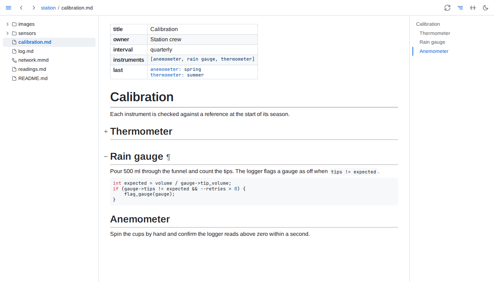
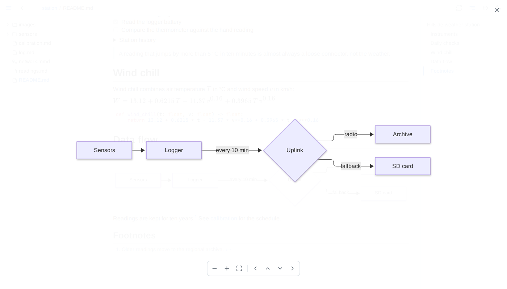

# Guide

What folio adds beyond rendering markdown. Exact rules are in the [reference](reference.md).

## Writing pages

**Frontmatter** - a YAML block at the top of a page shows as a key/value table above it.

**Loose tables** - rows with too many or too few cells, and pipe lines with no divider line, still render as tables.

**Includes** - `{include: path}` is replaced by that file's text before the page renders, so one page can be assembled from several. The path is relative to the file holding it, or to the served folder when it starts with `/`. Saving an included file updates every page that includes it.

**Diagrams** - a ` ```mermaid ` fence, or a whole `.mmd` file, draws as a diagram. One that cannot be drawn shows its source with a red bar; point at it to read the error.

**Math** - `$...$` inline, `$$...$$` on its own line.

## Reading

**Live updates** - save a page, a file it includes or an image it shows, and every tab showing it updates in place, keeping its scroll position. The circular-arrows button pauses a tab while you edit; press it again and the tab catches up.

**Moving around** - <kbd>←</kbd> and <kbd>→</kbd> step to the previous or next page in the tree's order; <kbd>Alt</kbd>+<kbd>←</kbd> and <kbd>Alt</kbd>+<kbd>→</kbd> hide or show the tree and the outline.

**Headings** - point at a heading for two controls: the ¶ after it puts a link to that heading in the address bar, and the one on its left folds the section away. Folds last for the tab.



**Diagrams** - the expand button in a diagram's corner opens it over the whole window: the wheel zooms, dragging pans, <kbd>Escape</kbd> closes.



**Per tab** - theme, full width and panels are chosen per tab. A tab opened from a link starts with the choices of the tab it came from.
