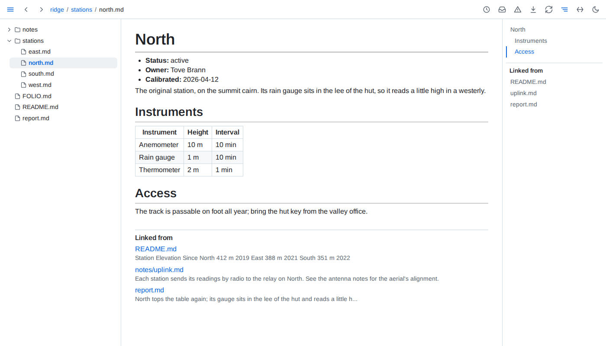
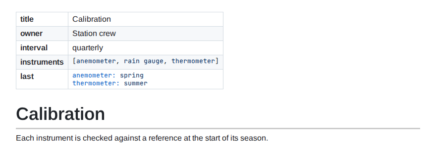
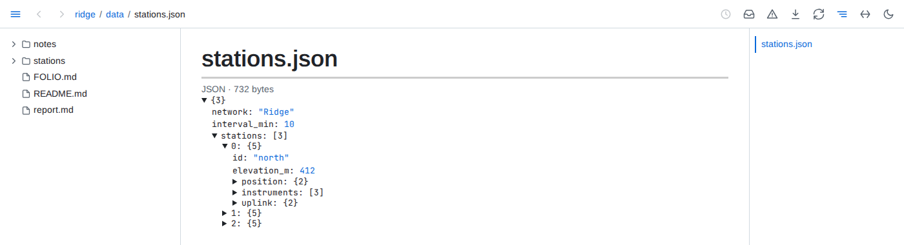
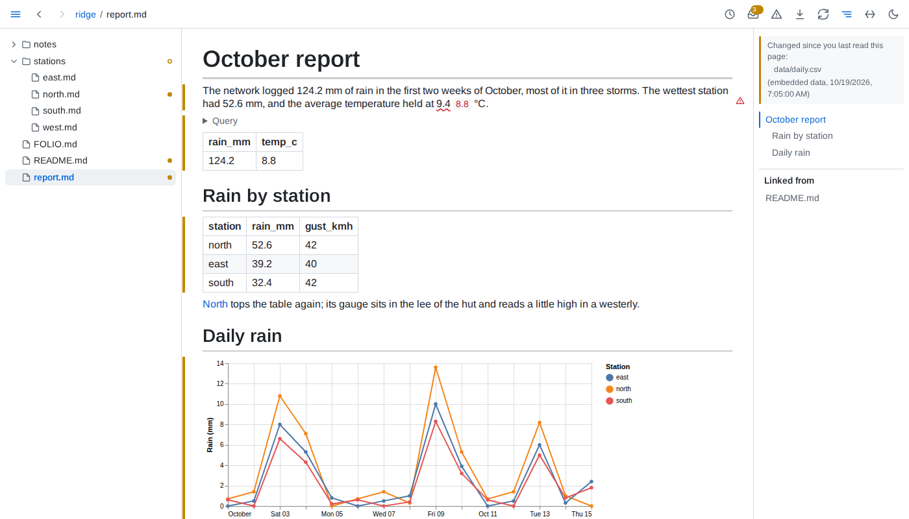
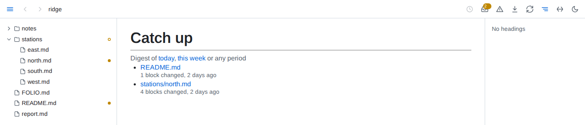
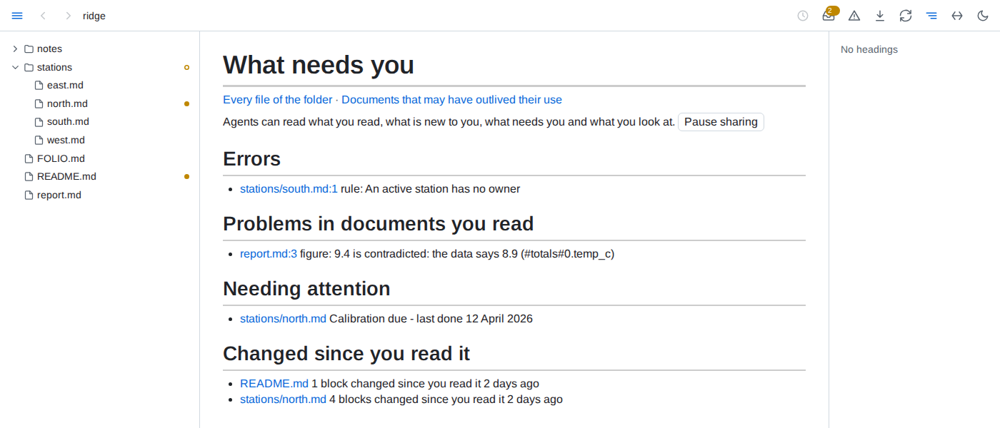
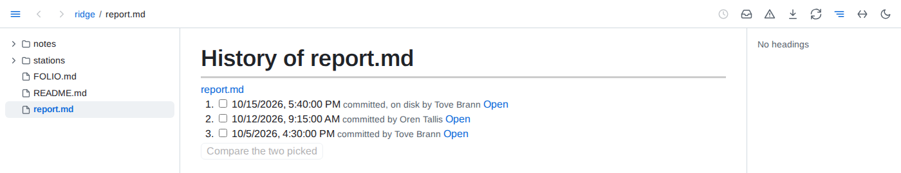
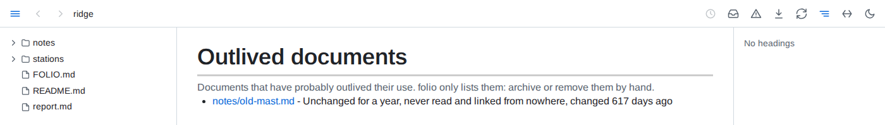
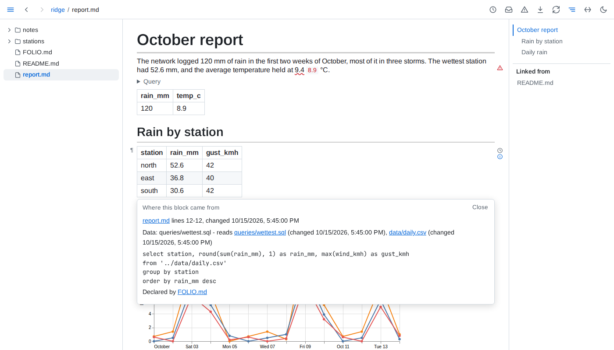

# Guide

What folio gives you on top of rendered markdown, and how to use it. Every option, limit and rule is in the [reference](reference.md).

The pictures show an invented folder: a small network of weather stations, with a page per station, two weeks of readings and a report written from them.

## Reading

**The window** - the folder's tree on the left, the page in the middle, its outline on the right. Following a link swaps only the page, so the tree and the outline stay where they are. <kbd>←</kbd> and <kbd>→</kbd> step through the pages in the tree's order, and <kbd>Alt</kbd>+<kbd>←</kbd> and <kbd>Alt</kbd>+<kbd>→</kbd> hide or show the tree and the outline. Theme, full width and panels are chosen per tab.


**Live pages** - save a file and every tab showing it updates in place, keeping your place in it; only the blocks that changed are redrawn. A page also follows the files it includes and the images it shows. The circular-arrows button pauses a tab while you edit, and catches it up when you press it again.

**Headings and blocks** - point at a heading for its ¶, which puts a link to that heading in the address bar, and for the control on its left, which folds the section away. Point at any other block for the same ¶ in the margin: a link to a block keeps landing on it while the block is moved or reworded.


**Linked from** - below every page, the documents of the folder that link to it, each with the words around the link; the outline lists them too. A link saved anywhere in the folder joins the list at once.



**Diagrams** - a ` ```mermaid ` fence or a whole `.mmd` file draws as a diagram. The button in its corner opens it over the whole window, where the wheel zooms, dragging pans and <kbd>Escape</kbd> closes.


**Freeze** - the download button saves the page as one HTML file, with its diagrams, charts, values and tables as they are now. It opens anywhere, offline and without folio, and its tables still sort and filter.

## Writing

**Frontmatter** - a YAML block at the top of a page shows as a table above it.



**Includes** - `\{include: parts/intro.md}` is replaced by that file's text, so one page can be assembled from several and updates when any of them is saved. `\{include: design.md#retry-policy}` brings in one section, and `#^<id>` copied from a block's ¶ brings in one block. Includes work anywhere, code and diagrams included; one that finds nothing stays as written, marked red. Write `\\{include: path}` to show the text instead.

**Loose tables** - rows with too many or too few cells, and pipe lines with no divider line, still render as tables.

**Math and diagrams** - `$...$` inline and `$$...$$` on a line of its own render as formulas. A diagram that cannot be drawn shows its source with a red bar; point at it to read the error.

## Data

**Data files open as pages** - CSV, TSV, JSON Lines, Parquet, JSON, YAML, SQLite and DuckDB files open in the browser: rows as a table, nested data as a tree that folds, a database as its tables. *Used by* below a file lists the documents that read it. The tree hides data files until you press the table button at its top.



**Tables you can sort and filter** - click a column's header to sort by it, again to reverse, a third time to go back to the order as written. The filter button beside a table's corner filters all rows or one column's and hides columns. None of it touches the file, a save keeps the view, and the view lives in the page's address, so a copied link reopens it.


**Data in a document** - a line reading `{table: queries/wettest.sql}` shows a result as a table, `{value: #totals#0.rain_mm}` puts one value in a sentence, and a ` ```vega-lite ` fence draws a chart from the file its `data.url` names. A ` ```sql query ` fence runs SQL over the folder's data files - any formats, joined - and shows its result below it; named, as ` ```sql query totals `, its result serves a value, table, chart or figure elsewhere on the page as `#totals`. A query kept in its own `.sql` file is used by its path. Each of them redraws when its data changes.

````markdown
The network logged {value: #totals#0.rain_mm} mm of rain.

```sql query totals
select round(sum(rain_mm), 1) as rain_mm, round(avg(temp_c), 1) as temp_c
from 'data/daily.csv'
```

{table: queries/wettest.sql}
````


**Figures checked against their data** - tie a figure in your prose to the value it quotes, `<data value="#totals#0.temp_c">9.4</data> °C`, and folio checks it at the precision you typed it with. A figure the data contradicts is underlined in red with the data's value beside it, and a warning sign marks its block; one that agrees reads as plain text. Keep units outside the tag. On GitHub only the figure shows.

**Documents as data** - the folder's own documents are tables too, with nothing to set up: `select path, text from folio.tasks where not done` lists every open task in the folder, and `folio.documents`, `folio.headings`, `folio.links`, `folio.frontmatter` and `folio.tables` hold the rest of their structure.

## Keeping up

**What is new to you** - folio remembers which blocks you have read, in any browser. Open a page you read before and a green bar marks each block added since, an amber bar each one changed and a red tick each one removed; click an amber bar to see what the block said when you read it. A mark clears once its block has been on screen for a moment. Rewrapping a paragraph or repadding a table marks nothing.


**When the data changes** - a value, table, chart or query result whose data changed since you read it is marked like any changed block, and so is a block an include brings in from a file that changed.



**Catch up** - a dot in the tree marks each document you read that changed since, and an outlined dot each folder holding one. The inbox button counts them and opens the list, newest change first.



**What needs you** - folio's front page: errors in the folder, problems in documents you have read, what the folder's own declarations flag for attention, and what changed since you read it.



**History** - the clock button in the toolbar opens a document's history: every version git has of it, merged with the saves folio saw. Open a version to read it as it was, or pick two and compare them block by block. The clock beside a block lists that block's own past.




**Digests** - what changed in the folder over a day, a week or any period you pick: documents created, changed and removed, each changed block before and after, and every embedded value that moved.


**Outlived documents** - documents unchanged for a year, never read and linked from nowhere, listed so you can archive or remove them. A folder can say what counts as outlived for itself.



## Trust

**Where a block came from** - the ⓘ beside a block opens where it came from: its file and lines and when it last changed, the section an include brought it from, the files and query behind a table, chart or value, whether each figure it ties to data holds, and the declarations applying to it.



**Health** - the warning button lists everything wrong in the folder, in documents you never opened too: contradicted figures, broken links and includes, diagrams and charts that do not draw, failing queries, data that cannot be read, values that do not fit their field and broken rules. Each entry opens its document at the problem, and the list follows as things break and get fixed.


**Folder conventions** - a `FOLIO.md` file says what the folder's documents are and the rules they keep, in ` ```yaml folio ` fences between prose saying why. It applies to its folder and everything below it, and a deeper one adds to it.

````markdown
```yaml folio
kinds:
  station:
    where: stations/*.md
    fields:
      status: {from: label}
      owner: {from: label}
      calibrated: {from: label, type: date}
rules:
  owned:
    query: select path from kind.station where status = 'active' and owner is null
    message: An active station has no owner
```
````

A kind places documents by where they live and reads typed fields from their labelled lines, frontmatter, sections, folder or file name; it becomes a table, here `kind.station`, that any query can read. A rule is a query that should return nothing, and each row it does return is listed in health. Further sections feed *Needing attention* on the front page, decide what counts as outlived, and choose what health checks and what fails `folio check`.

**Views saved into the markdown** - where a declaration's `save` allows it, folio writes a query's result as plain markdown between `<!-- folio view: #name -->` and `<!-- /folio view -->` in a document and keeps it current, so a board or a summary reads the same on GitHub. A declaration's `digests` keeps a digest of each day or week as a document of the folder.

## Agents, editors and CI

**folio check** - prints the folder's health, one problem a line, and exits 1 when one of them is an error, so it can gate a commit or a CI run. It asks the folio serving the folder when one is running, and otherwise works the health out itself.

```text
$ folio check
report.md:3 - figure 9.4 is contradicted: the data says 8.9 (#totals#0.temp_c)
notes/uplink.md:3 - link Links to notes/antenna.md, which is not there
notes/uplink.md:5 - include Includes parts/frequencies.md, which is not there
stations/west.md:5 - field calibrated: before the storms is not a date
stations/south.md:1 error rule An active station has no owner
folio check: 1 error, 4 other problems
```

**Agents** - `folio mcp` is an MCP server whose tools read the running folio: documents and their blocks, queries, health, what changed, history, what you have read and what you are looking at. An agent starts it as a command:

```json
{ "mcpServers": { "folio": { "command": "folio", "args": ["mcp"] } } }
```

The same answers are JSON over HTTP at `?api=`, as in `curl 'http://localhost:8640/?api=health'`, and `--socket` also serves them on a unix socket, for an agent in a container that shares the folder. The button on the front page pauses sharing what you read and look at.

**An agent that writes for folio** - [`skills/folio`](../skills/folio/SKILL.md) in folio's repository is an agent skill. It teaches an agent to write documents that use everything above - includes, block links, embedded data, queries, checked figures, saved views and `FOLIO.md` declarations - and to check its work with `folio check`. Copy the folder into your agent's skills folder, `~/.claude/skills/folio/` for Claude Code.

**Editors** - `folio lsp FOLDER` is a language server for any editor with an LSP client: broken links, missing includes and contradicted figures as you type, go to and references for headings and blocks, a block's provenance on hover, and, on renaming a heading or moving a file, the edits for every link to it.
