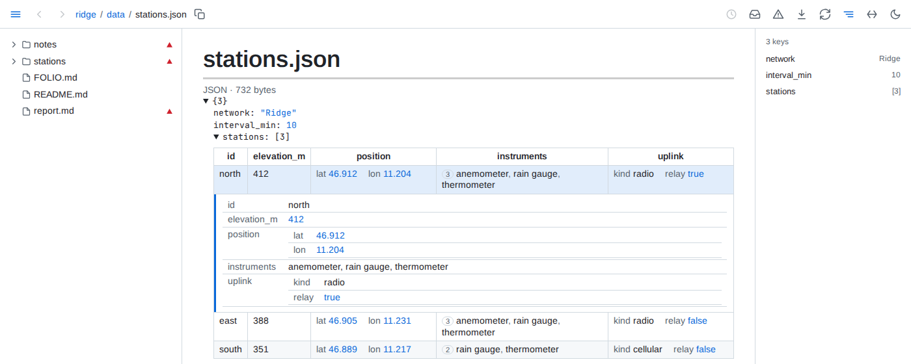
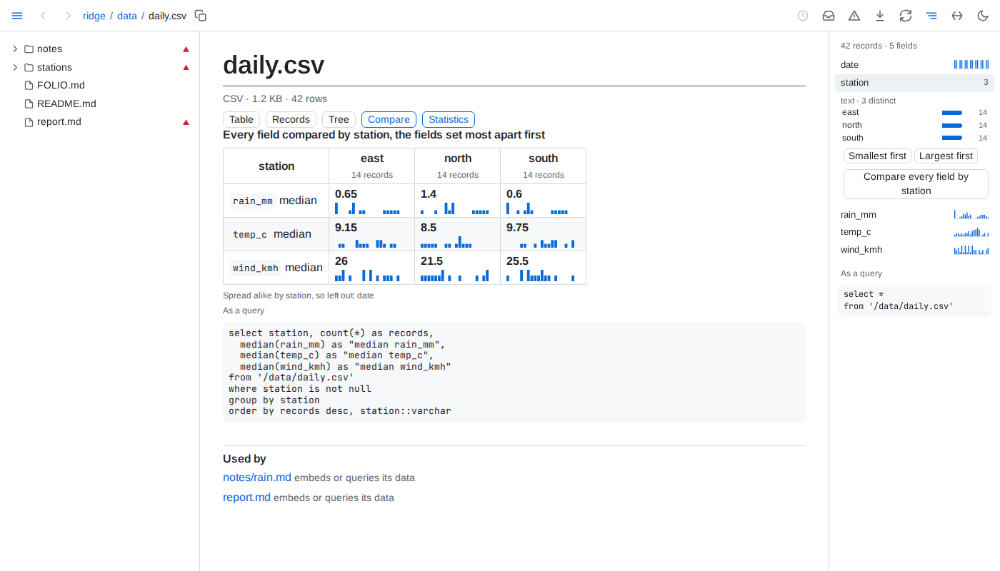
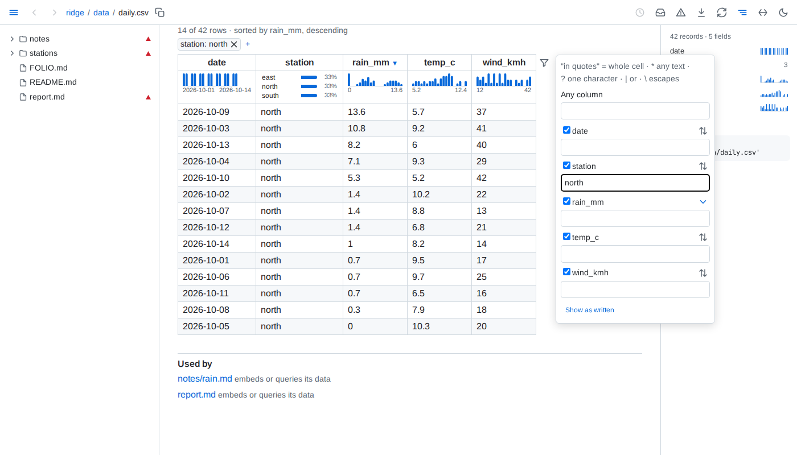
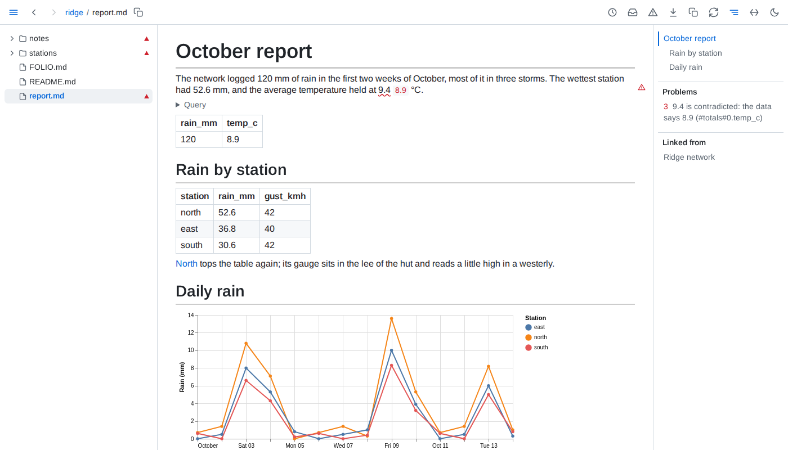
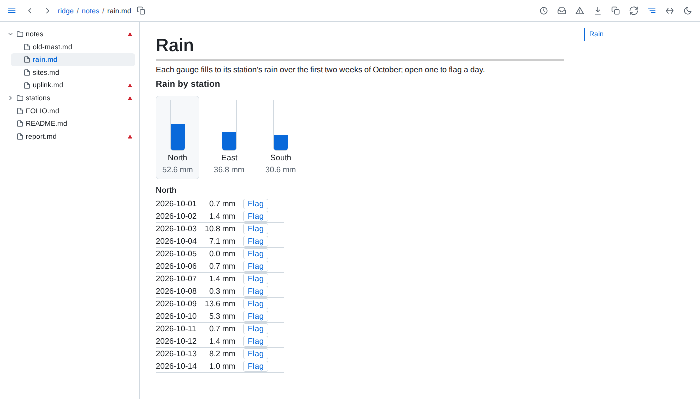

# Data

**Data files open as pages** - CSV, TSV, JSON Lines, Parquet, JSON, YAML, SQLite and DuckDB files open in the browser: rows as a table whose rows open into their records - a long file 200 rows at a time, sorted and filtered over all of it - nested data as a tree that folds with its records as tables, a database as its tables. Under each column's header a strip shows how its values spread over the whole file, the side panel lists the fields, and a value or a bar picked there filters every view to the records holding it, with the filter as a query to copy. A card above a filter's records names what sets them apart from the rest, and a field of a few values compares every other field by its values. *Used by* below a file lists the documents that read it. The tree hides data files until you press the table button at its top.





**Tables that sort and filter** - click a column's header to sort by it, again to reverse, a third time to go back to the order as written; <kbd>Alt</kbd>+click another header to add it as a further level, ordering the rows the levels before it leave equal. The filter button beside a table's corner filters all rows or one column's - text in quotes, `"open"`, keeps only the cells equal to it, `no*` those starting with no and `"open" | "review"` either value, and a column of 12 values or fewer lists them with their counts to pick from, <kbd>Alt</kbd>+click adding one more - and hides columns. The filters show as badges on a strip above the rows, joined by `and` or `or`: a click on the word flips it, a badge drags to another place on the line, and its x removes it. The filter button in a cell's corner filters its column to the cell's value, <kbd>Alt</kbd>+click adding the value to the column's filter. None of it touches the file, a save keeps the view, and the view lives in the page's address, so a copied link reopens it.



**Data in a document** - a line reading `{table: queries/wettest.sql}` shows a result as a table, `{value: #totals#0.rain_mm}` puts one value in a sentence, and a ` ```vega-lite ` fence draws a chart from the file its `data.url` names. A ` ```sql query ` fence runs SQL over the folder's data files - any formats, joined - and shows its result below it; named, as ` ```sql query totals `, its result serves a value, table, chart or figure elsewhere on the page as `#totals`. A query kept in its own `.sql` file is used by its path. Each of them redraws when its data changes.

````markdown
The network logged {value: #totals#0.rain_mm} mm of rain.

```sql query totals
select round(sum(rain_mm), 1) as rain_mm, round(avg(temp_c), 1) as temp_c
from 'data/daily.csv'
```

{table: queries/wettest.sql}
````



**Components** - a ` ```component levels ` fence draws whatever a script in a folder Folio starts with, `folio ~/notes --components ~/notes/components`, makes of the data its fence names - a calendar, a timeline, a form - and the script gets the new rows each time the data changes, keeping its own state. A component may hand Folio markdown - a diagram, a table, a formula - which Folio draws as on a page, as all of its drawing or among its own elements. Besides Folio's own, only the scripts of the folders it starts with run on a page. What the component asks to change leaves the page as an event for a browser extension's content script to carry out, and Folio writes nothing. See [Components](../reference/components.md).

````markdown
```component levels
data:
  readings: data/daily.csv
title: Rain by station
```
````



**Figures checked against their data** - tie a figure in your prose to the value it quotes, `<data value="#totals#0.temp_c">9.4</data> °C`, and Folio checks it at the precision you typed it with. A figure the data contradicts is underlined in red with the data's value beside it, and a warning sign marks its block; one that agrees reads as plain text. Keep units outside the tag. On GitHub only the figure shows.

**Documents as data** - the folder's own documents are tables too, with nothing to set up: `select path, text from folio.tasks where not done` lists every open task in the folder, and `folio.documents`, `folio.headings`, `folio.links`, `folio.frontmatter` and `folio.tables` hold the rest of their structure.
