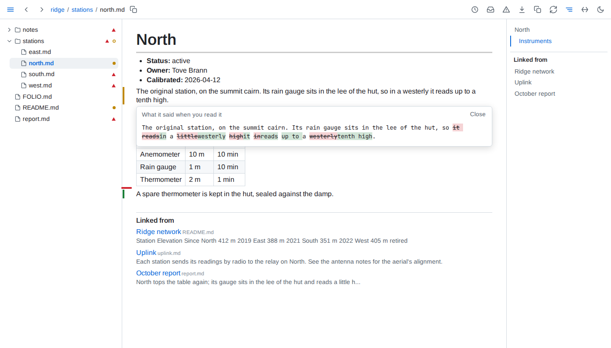
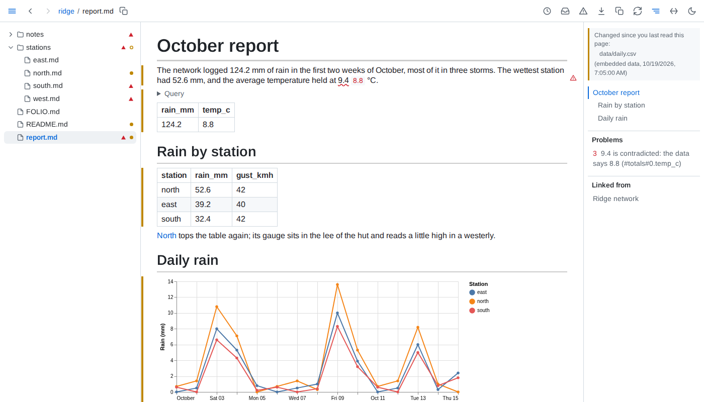
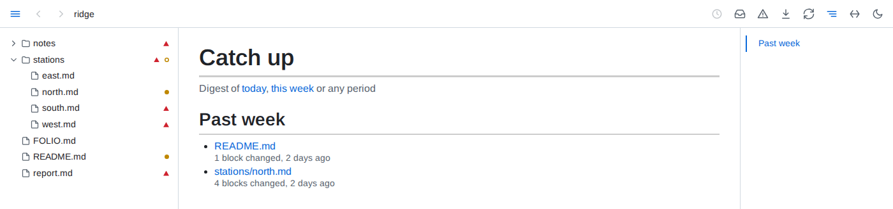
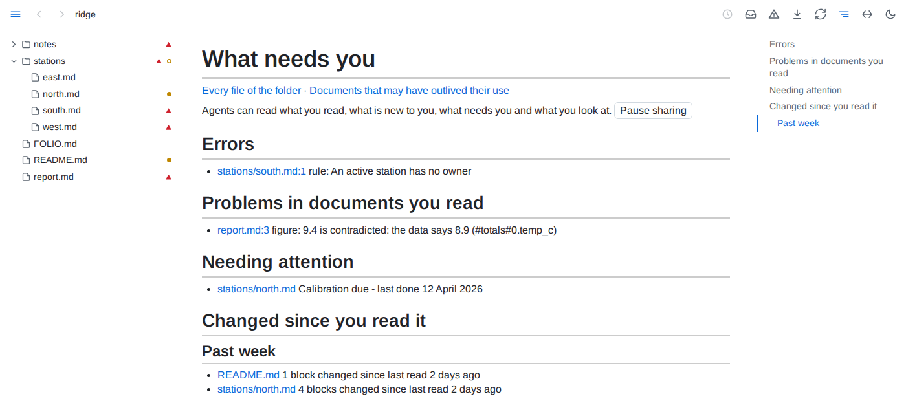
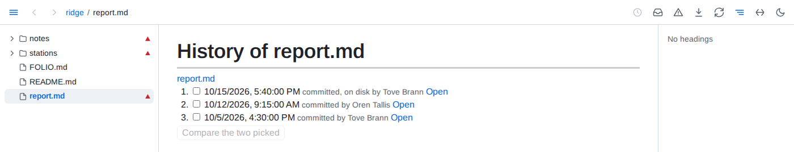
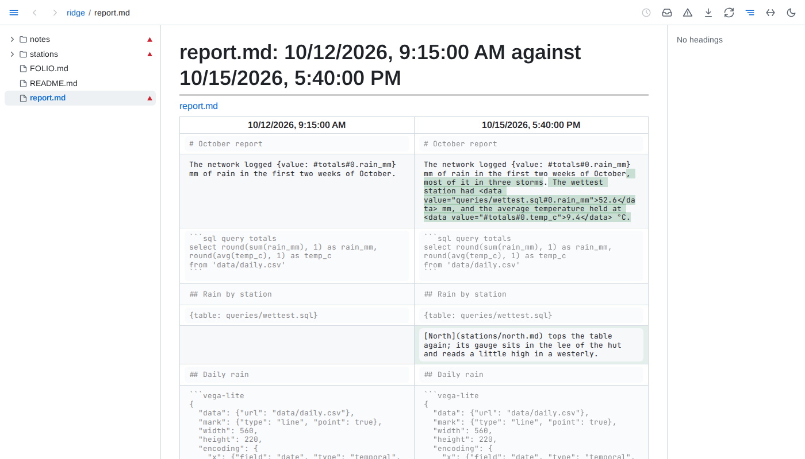
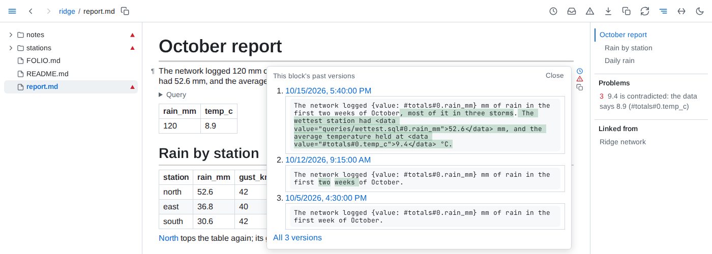
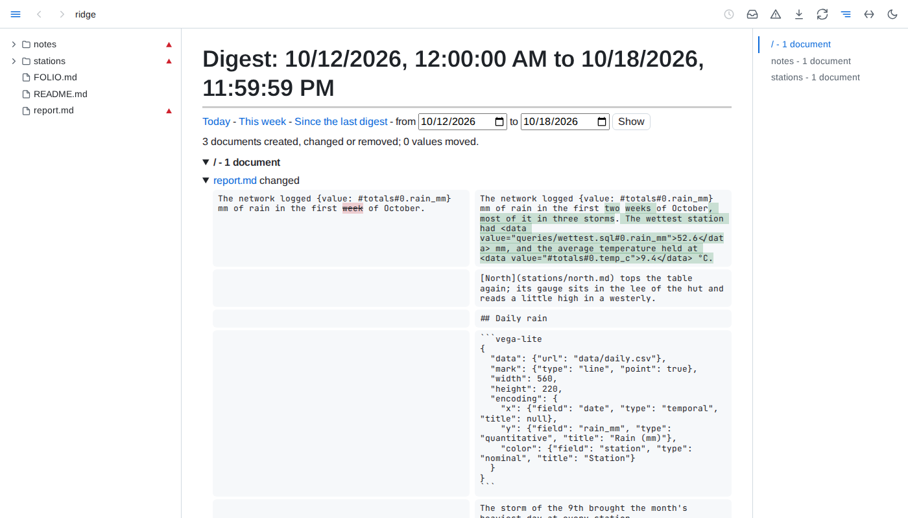
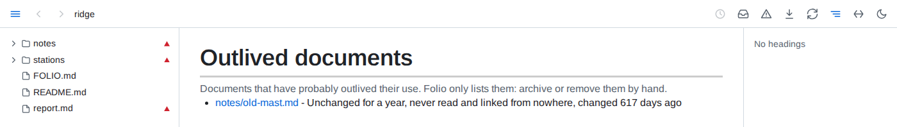

# Keeping up

**What is new to you** - Folio remembers which blocks you have read, in any browser. Open a page you read before and a green bar marks each block added since, an amber bar each one changed and a red tick each one removed; click an amber bar to see what the block said when you read it. In a table, a list or a block of code the bars sit beside each row, item or line that changed, and a changed row tints the cells that changed. A mark fades once what it marks has been on screen for five seconds, counted only while you look, and what it marks counts as read sooner. Rewrapping a paragraph or repadding a table marks nothing.

**When the data changes** - a value, table, chart or query result whose data changed since you read it is marked like any changed block, and so is a block an include brings in from a file that changed.

**Catch up** - a dot in the tree marks each document you read that changed since, and an outlined dot each folder holding one. The inbox button, its tooltip counting them, opens the list, newest change first, grouped by when: since yesterday, the past week, month, quarter and year, and older.

**What needs you** - Folio's front page: errors in the folder, problems in documents you have read, what the folder's own declarations flag for attention, and what changed since you read it.

**Related by meaning** - a folder whose `FOLIO.md` asks for it with `related` gets, under *Linked from*, the passages elsewhere in it closest in meaning to the section you read or the block you point at - a decision restated in another document, linked or not. A small model on your machine works it out; Folio downloads it once, 1.3 GB, when a folder first asks.

**History** - the clock button in the toolbar opens a document's history: every version git has of it, merged with the saves Folio saw. Open a version to read it as it was, or pick two and compare them block by block. The clock beside a block shows its latest versions, and its whole past a click further.

**Digests** - what changed in the folder over a day, a week or any period you pick: documents created, changed and removed, each changed block before and after, and every embedded value that moved.

**Outlived documents** - documents unchanged for a year, never read and linked from nowhere, listed; Folio moves and deletes none of them. A folder can say what counts as outlived for itself.

