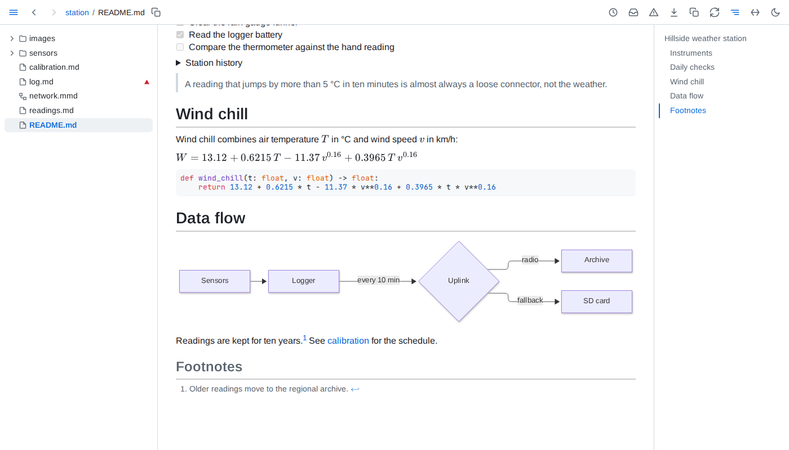
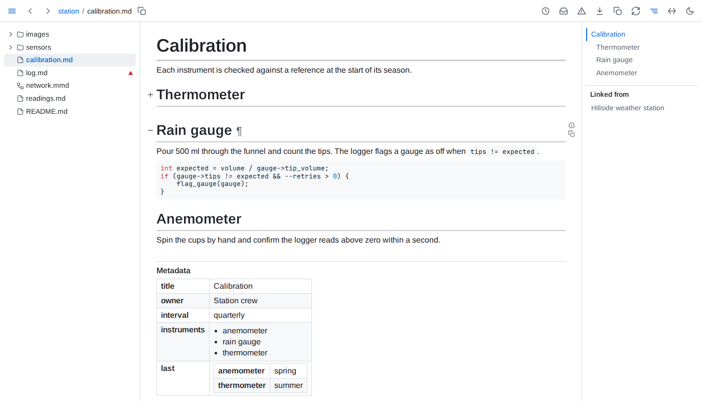
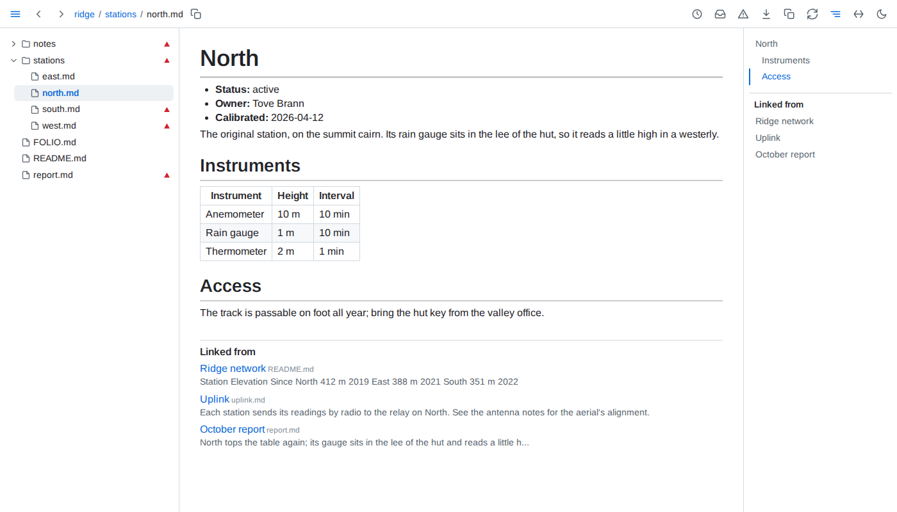
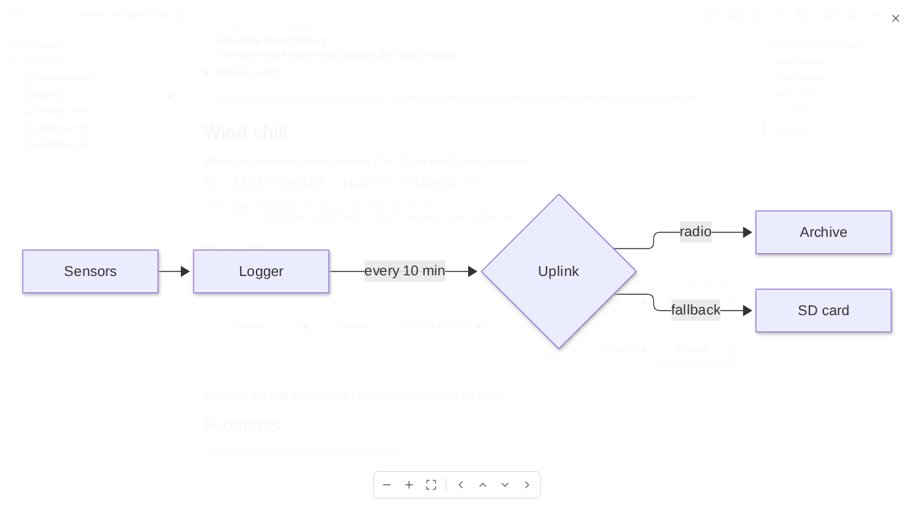

# Reading

This guide covers what Folio adds to rendered markdown, and how to use it. Every option, limit and rule is in the [reference](../reference/command-line.md).

The pictures show an invented folder: a small network of weather stations, with a page per station, two weeks of readings and a report written from them.

**The window** - the folder's tree on the left, the page in the middle, its outline on the right. Following a link swaps only the page, never the tree or the outline; the tree scrolls only to bring the new page's file into view, and a page loaded anew, back or forward across a view included, shows its tree in one step, scrolled as you left it. The outline keeps the heading you are reading in view until you scroll it yourself, and from then stays where you left it until you click one of its entries or open another page. <kbd>←</kbd> and <kbd>→</kbd> step through the pages in the tree's order - in a field, within the field instead - and <kbd>Alt</kbd>+<kbd>←</kbd> and <kbd>Alt</kbd>+<kbd>→</kbd> hide or show the tree and the outline. A double-click on the toolbar gives the page the whole window, and another puts the layout back. Theme, full width and panels are chosen per tab.



**Live pages** - save a file and every tab showing it updates in place, keeping your place in it; only the blocks that changed are redrawn. A page also follows the files it includes and the images it shows. The circular-arrows button pauses a tab while you edit, and catches it up when you press it again.

**Headings and blocks** - point at a heading, or anywhere level with it from the tree to the outline, for its ¶, which puts a link to that heading in the address bar, and for the control on its left, which folds the section away. Any other block shows the same ¶ in the margin: a link to a block keeps landing on it while the block is moved or reworded.



**Linked from** - below every page, the documents of the folder that link to it, each named by its h1 when it has exactly one outside `<details>`, its file name beside it, else by its path, with the words around the link; the outline lists them too. A link saved anywhere in the folder joins the list at once.



**Diagrams** - a ` ```mermaid ` fence or a whole `.mmd` file draws as a diagram. The buttons in its corner open it over the whole window, filling it, where the wheel zooms, dragging pans and <kbd>Escape</kbd> closes, switch it to its source and copy the source; a chart has the same three, and so do a map and a 3D model, which open live and keep on the page the view they are left at.

**Images** - an image not inside a link has the same expand button alone in its corner: an SVG opens filling the window, any other image fitted to it and no larger than its own size.



**Copy as markdown** - the copy button beside the download button copies the page as markdown, as it shows: included sections in place, embedded values filled in, tables and query results as markdown tables in the order their views show them. The copy button in a block's margin copies that block, a heading its whole section.

**Freeze** - the download button saves the page as one HTML file, with its diagrams, charts, values and tables as they are now. It opens anywhere, offline and without Folio, and its tables still sort and filter.
