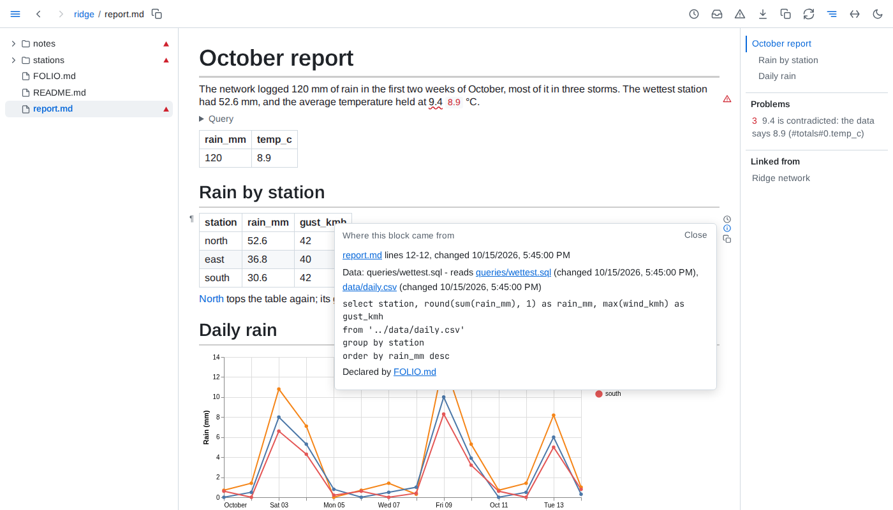
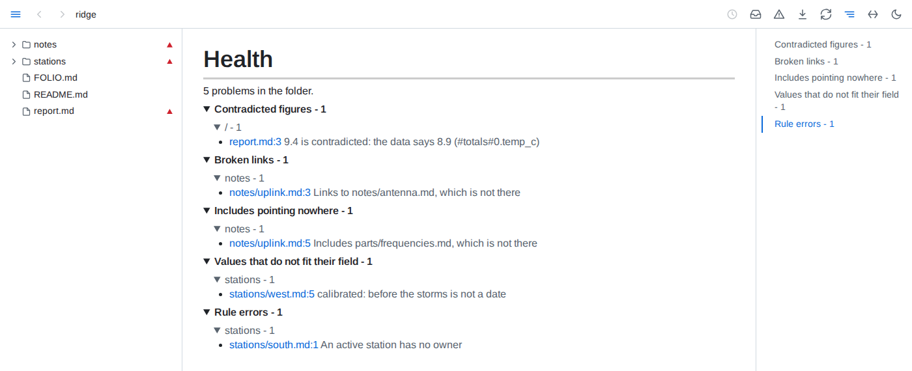

# Trust

**Where a block came from** - the ⓘ beside a block opens where it came from: its file and lines and when it last changed, the section an include brought it from, the files and query behind a table, chart or value, whether each figure it ties to data holds, and the declarations applying to it.



**Health** - the warning button lists everything wrong in the folder, in documents you never opened too: contradicted figures, broken links and includes, diagrams, charts and components that do not draw, failing queries, data that cannot be read, frontmatter that is not YAML, values that do not fit their field and broken rules. Each entry opens its document at the problem, and the list follows as things break and get fixed. A warning sign in the tree marks every file health lists a problem for, and every folder holding one - pointing at a file gives the count - and a document's outline lists its own problems after its headings, each a click from its line.



**Folder conventions** - a `FOLIO.md` file says what the folder's documents are and the rules they keep, in ` ```yaml folio ` fences between prose saying why. It applies to its folder and everything below it, and a deeper one adds to it.

````markdown
```yaml folio
kinds:
  station:
    where: stations/*.md
    fields:
      status: {from: label}
      owner: {from: label}
      calibrated: {from: label, type: date}
rules:
  owned:
    query: select path from kind.station where status = 'active' and owner is null
    message: An active station has no owner
```
````

A kind places documents by where they live and reads typed fields from their labelled lines, frontmatter, sections, folder or file name; it becomes a table, here `kind.station`, that any query can read. A rule is a query that should return nothing, and each row it does return is listed in health. Further sections feed *Needing attention* on the front page, decide what counts as outlived, and choose what health checks and what fails `folio check`.

**Views saved into the markdown** - where a declaration's `save` allows it, Folio writes a query's result as plain markdown between `<!-- folio view: #name -->` and `<!-- /folio view -->` in a document and keeps it current, so a board or a summary reads the same on GitHub. A declaration's `digests` keeps a digest of each day or week as a document of the folder.
