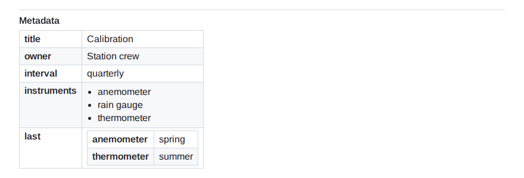
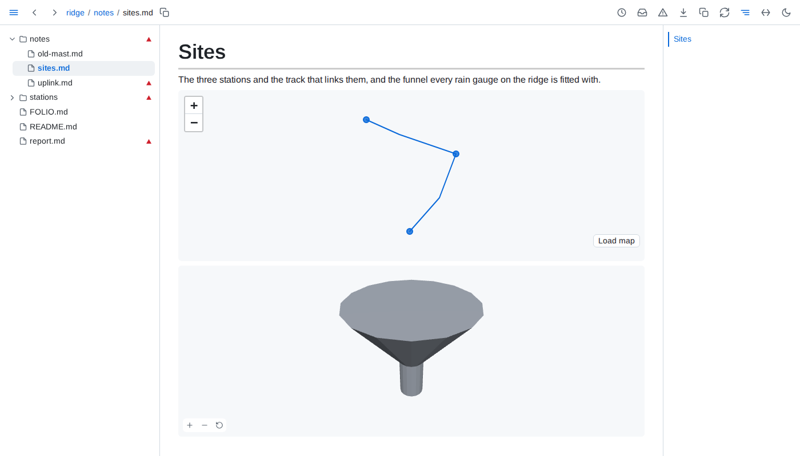

# Writing

**Frontmatter** - a YAML block at the top of a page shows as a table at the page's end, under *Metadata*, so the page opens on its content. A markdown link in a value, `parent: "[plan](plan.md)"`, works as a link in the page does: it opens its target, lists the page under *Linked from* there, and health reports it when it breaks.



**Includes** - `\{include: parts/intro.md}` is replaced by that file's text, so one page can be assembled from several and updates when any of them is saved. `\{include: design.md#retry-policy}` brings in one section, and `#^<id>` copied from a block's ¶ brings in one block. Includes work anywhere, code and diagrams included; one that finds nothing stays as written, marked red. Write `\\{include: path}` to show the text instead.

**Loose tables** - rows with too many or too few cells, and pipe lines with no divider line, still render as tables.

**Math, diagrams and maps** - `$...$` inline and `$$...$$` on a line of its own render as formulas. A ` ```geojson ` or ` ```topojson ` fence draws as a map of its shapes, offline until you press *Load map* for OpenStreetMap's tiles, and an ` ```stl ` fence as a 3D model you turn by dragging. A diagram that cannot be drawn shows its source with a red bar; point at it to read the error.


