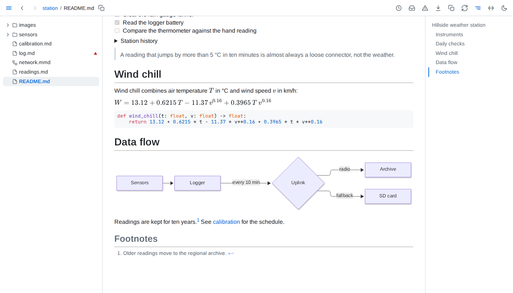

# Folio

A live view of a folder of markdown and data, in your browser. Folio renders every page with GitHub-flavoured markdown, math, highlighted code and diagrams, keeps each one current as you save, and knows the folder as a whole: what links where, what changed since you last read it, which figures no longer match their data, and what is broken.



## Install and run

Folio needs Node.js 22.18 or later.

```sh
npx @jakubro/folio ~/notes
```

Open the address it prints: `http://localhost:8640/`, or the next free port when that one is taken. Without a folder, Folio serves the current directory; `--port` picks another port, and <kbd>Ctrl</kbd>+<kbd>C</kbd> stops it. To keep it installed:

```sh
npm install --global @jakubro/folio
folio ~/notes
```

Folio reads your folder and writes into it only what a `FOLIO.md` there asks for. What it remembers - its model of the folder, what you have read, the versions it saw - lives in `~/.local/state/folio/`.

## Guide and reference

- The [guide](guide/reading.md) shows what Folio adds, from live pages and data in documents to catching up on what changed.
- The [reference](reference/command-line.md) lists every option, address, key and rule.
