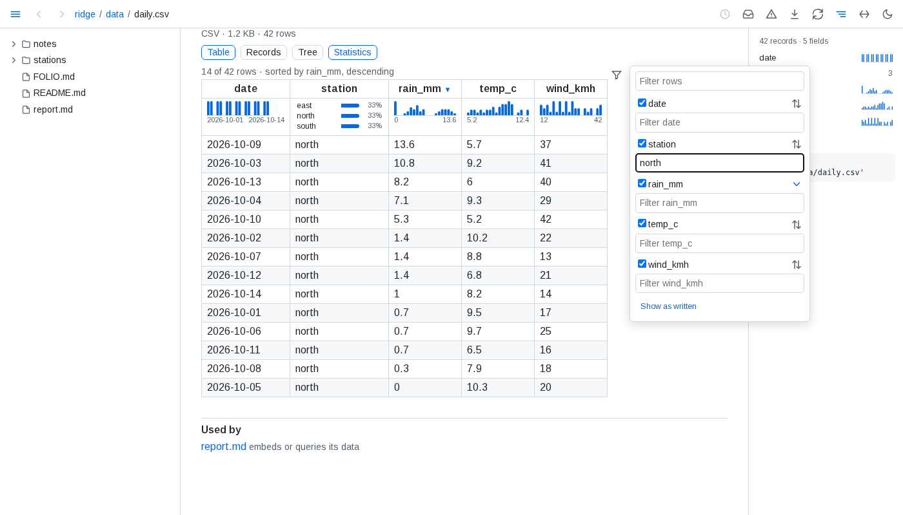
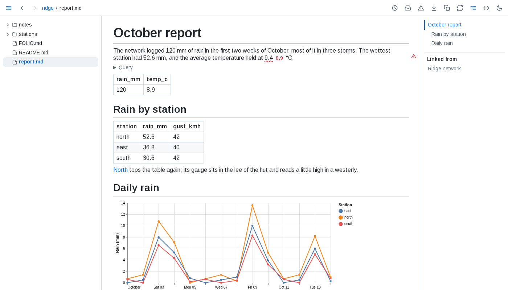
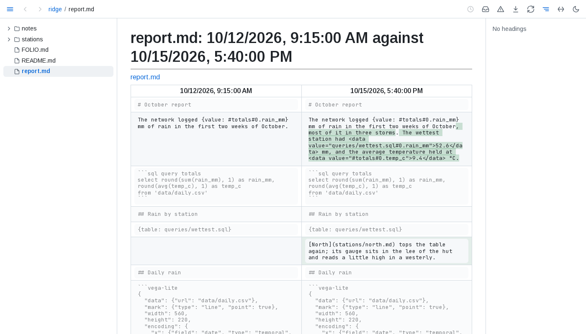
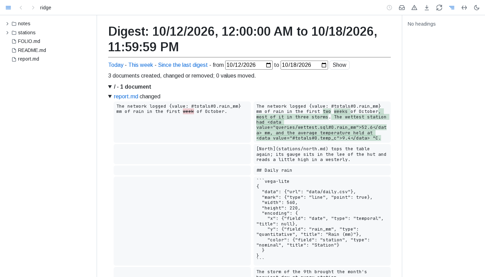
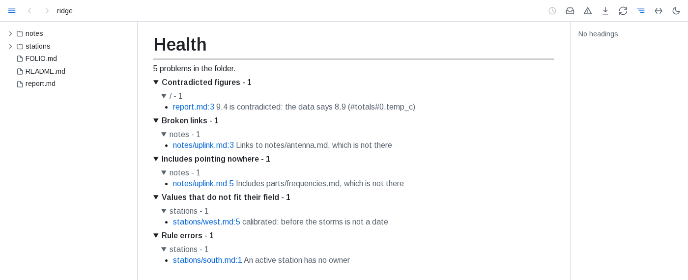

# Reference

## Command line

```text
folio [FOLDER] [--port N] [--socket PATH]... [--verbose]
folio check [FOLDER] [--port N | --socket PATH]
folio lsp [FOLDER]
folio mcp [--port N | --socket PATH]
folio [COMMAND] --help
folio --version
```

| Argument | Default | |
|---|---|---|
| `FOLDER` | the current directory | The folder to serve, check or edit. A folder named `mcp`, `check` or `lsp` is given as `./mcp`, `./check` or `./lsp` |
| `--port N`, `--port=N`, `-p N` | `8640` | The port, 1 to 65535. Serving without it, folio moves past a taken 8640 to the next free port above it - unless a folio on a port it passes already serves the folder, which folio names before it exits 1. A port given is never left for another. `check` and `mcp` given neither a port nor a socket ask the folio serving their folder, wherever it serves - see below |
| `--socket PATH` | none | Also serve on a unix socket at that path - given again, on several, which only its owner may open - for a client that cannot reach the port, such as a container sharing the folder. A socket left by a folio no longer running is replaced; the socket goes when folio stops |
| `--verbose` | off | Also print every request and every update sent to a tab |
| `-h`, `--help` | | Print the commands, options and examples, or with a command, its arguments, options, exit codes and examples, and exit 0 |
| `--version` | | Print folio's version and exit 0 |

folio prints `folio serving <folder>`, then `at http://localhost:<port>/` - followed by ` - port 8640 is taken` or ` - ports 8640 to <port - 1> are taken` when it moved past them - and `and on <socket>` for each `--socket`. While it reads the folder it shows a progress line, then a line saying how many documents it read and how long it took. After that it prints a line for each page a tab opens, naming it - a tab that reconnects does not open its page again - and one for each problem: a request answered with an error, with the reason when folio failed to answer it, an address with nothing behind it, a file it cannot index or store. Each line after the summary, the progress line aside, is timed in UTC. On a terminal, problems are coloured by severity; printed to a pipe or to a service's journal, the same lines carry no colour and no progress line.

`folio check` prints the folder's health, one problem a line in aligned columns - `path:line`, then the severity `error`, `warning` for a rule's warning, or `-` for any other problem, then the kind and what is wrong - and a count, each severity and the count coloured on a terminal, and exits 1 when any problem is an error: a rule's violation unless the rule is a warning, or a problem of a kind of check a health entry declares an error. Otherwise it exits 0, whatever else is listed; when no health can be worked out at all, it says why and exits 2. It asks the folio serving that folder when one answers - on the port or socket given, or without either wherever a folio serving exactly that folder serves, else 8640 - and otherwise works the health out itself from folio's stored state, which a later check or start reuses: a check of a folder whose files have not changed since takes seconds. Meanwhile, on a terminal, one live line says what it is doing - the documents read so far, then the documents checked out of those it checks again, or, waiting on a running folio, whether that folio is still reading the folder or checking health - and is gone before the problems print; printed to a pipe, there is none.

`folio lsp` is a language server on standard input and output, for an editor to start as a command; see *Editors*. On standard error, which an editor keeps in its log of the server, it prints `folio lsp serving <folder>` and `on standard input and output`, the live line `folio check` shows while it reads the folder - on a terminal only - then `ready: read <n> documents in <s> s`, and a timed line when an editor connects and when it leaves, the editor named as it names itself.

`folio mcp` is an MCP server on standard input and output whose tools read the folio running on the port or socket given, for an agent to start as a command. Given neither, they read the folio serving the agent's folder, looked up again at every tool call: the nearest folder at or above one of the roots the agent's client names - the first root that leads to one - or, with no roots, at or above the folder `folio mcp` started in; when no folio serves any of them, the folio on 8640. It speaks MCP 2025-06-18, and 2025-03-26 or 2024-11-05 to a client asking for one of them, whose messages for its tools are alike; asked for any other version, it answers with 2025-06-18. A line that is not JSON, not a message object, or a request lacking `jsonrpc: "2.0"`, a method, or params that are an object, is answered with a JSON-RPC error; a notification or a reply gets no answer, a batch the replies to its requests, and the server stays up. On standard error it prints `folio mcp reading the folio at <address>` - or `on <socket>`, or `serving the agent's folder` given neither, followed by `found the folio at <address>` or `no folio serves <folders> or a folder above it; reading the folio at http://localhost:8640/`, again whenever that changes - then whether a folio answers there and which folder it serves - with none, it says so and keeps running, so a folio started later is read - a timed line when an agent connects and when it leaves, named as it names itself, and, at a tool call, a line when that folio stopped answering, answers again or serves another folder. Standard output carries the protocol alone, for both commands.

| Error | Exit status |
|---|---|
| One line naming what is wrong, then the usage: more than one folder, a folder given to `mcp`, an invalid port, an unknown option, one missing its value or a value given to one that takes none, `--verbose` given to a command other than serving, an empty socket path, more than one socket or a port and a socket together given to `check` or `mcp` | 2 |
| `Not a folder: <path>`, for a folder that does not exist or is not a folder | 2 |
| `Port N is already in use.`, or a socket path in use or holding something else | 1 |
| `<folder> is already served at http://localhost:<port>/`, serving without `--port` when a folio on 8640 or a taken port after it serves the folder; `No port is free from 8640 up.` | 1 |

## Addresses

Every file's address is its path in the folder, so links between files work as they do on disk.

| Address | Shows |
|---|---|
| `/<path>` to a markdown or mermaid file | The rendered page |
| `/<path>` to an image | The image |
| `/<path>` to a data or `.sql` file | Its page: rows, tree or tables; for a query, its text and result |
| `/` | What needs you: every error, the problems in documents you have read, the rows of the folder's attention queries, and the documents you read that changed since, in that order, following every change live |
| `/?files` | The served folder's own listing |
| `/<folder>/` | The folder's listing; the address without its closing slash redirects to it |
| Any other address | folio's not-found page, with a 404: the address, a link to the history of a document that lived there - wherever it moved since - and the documents of the folder with the same file name. Saving a document at the address turns the page into it. An address with a query that names nothing answers a plain-text 404 |
| `/<path>?raw` | The file's text with its includes expanded |
| `/<path>?table=<name>` to a database | One table of the database, 200 rows at a time |
| `/<path>?filter=<filter>` to a data file | Its page showing only the records a field's value or range keeps, as picked in its statistics |
| `/<path>?view=<views>` | The page with its tables' views - sort, filters, hidden columns, rows shown - as they were when the address was copied |
| `/<path>?conventions` | What the folder declares of the document, as JSON: the declarations applying to it, in the order they layer, and its kind and fields |
| `/<path>?model` | The file's blocks in folio's model of the folder, as JSON: each block's id, kind, lines and the start of its text |
| `/<folder>/?model` | Whether the model is complete, and how many documents it holds under the folder |
| `/?stale` | Documents that have probably outlived their use, oldest change first, each with why, following every change live; folio only lists them |
| `/?stale-data` | The same as JSON |
| `/?needs-data` | What needs you as JSON: each item's source - `error`, `problem`, `attention` or `changed` - document, line and what is wrong, and whether folio has finished reading the folder |
| `/?catch-up` | The catch-up list: every document read before whose blocks changed since, newest change first |
| `/?changed` | The catch-up list as JSON |
| `/?health` | Everything wrong in the folder, grouped by kind and by folder |
| `/?health-data` | The same as JSON: each problem's kind, document, line, block and what is wrong, and whether folio has finished reading the folder |
| `/<path>?history` | The document's versions, newest first, with a choice of two to compare |
| `/<path>?history&at=<version>` | One version of the document, read only |
| `/<path>?history&compare=<older>,<newer>` | Two versions block by block, side by side |
| `/<path>?history&block=<id>` | Each text one block has had, newest first |
| `/<path>?history&embed=<reference>` | Each result an embed of the document has shown, newest first |
| `/<path>?versions` | The document's versions as JSON, and the embeds whose results are kept |
| `/<path>?used-by` | The documents that include the file, or embed or query its data, as JSON, and whether folio has finished reading the folder |
| `/?digest` | A digest of today; `&period=week` of this week since Monday, `&period=since-last` since the last digest was built, `&from=<date>&to=<date>` of those days |
| `/?digest-data&from=<ms>&to=<ms>` | A digest as JSON; `&since-last` in place of `from` |
| `/<path>?provenance=<id>&source=<file>` | Where a block of the page came from, as JSON: its file, lines and when it last changed, the section an include brought it from, the data files and queries it is computed from, and the state of each figure it ties to data |
| `/<path>?read` | Each block of the page with the version shown and, once read, the version read and when, and what is marked new, changed or removed, as JSON |

What needs you also holds the switch that pauses sharing with agents: while paused, the API tells them sharing is paused rather than what you read, what is new to you, what needs you or what you look at, and `?read`, `?changed`, `?needs-data`, `?stale-data` and `?page` answer the same to anything but folio's own pages in a browser. folio tells its pages by the `Sec-Fetch-Site: same-origin` header a browser adds to their requests, so a program on this machine that sends the header itself is answered as a page: the pause holds back the API, MCP and any tool asking through them, not a program passing itself off as a page. The switch is folio's, kept across restarts and shared by every browser.

## Model API

Everything folio knows of the folder reads as JSON at `?api=<resource>` on a path, over the port and the socket alike. The API only reads: it answers `GET` and `HEAD` alone, a query in it is one `SELECT` as anywhere else, and nothing it answers is recorded as seen. A request from another site's page - an `Origin` that is not a localhost address, or a browser marking it cross-site or same-site - is refused with 403, as is a foreign `Host`. While sharing is paused, `reads`, `changes`, `needs`, `presence` and `stale` answer only `{"paused": true}` and a message saying so; everything else answers as before. A missing or malformed argument answers 400, a path naming no document 404 for a resource that reads one, and `document` 503 while folio has not read that document yet, each with the reason as text. `/?api` lists every resource.

| Resource | Answers |
|---|---|
| `/<folder>/?api=documents` | Every document under the folder, with its kind when a declaration places it |
| `/<path>?api=document` | A document's blocks - id, kind, lines, the start of its text - its blocks as its page places them through includes, its kind and fields, and the data files it reads |
| `/<path>?api=provenance&block=<id>` | Where one block of the page came from, as its ⓘ shows it; `&source=<file>` for a block an include brought in |
| `/<folder>/?api=query&sql=<select>` | The result of one `SELECT`, run from the folder as a query in it runs: its columns, its first 5,000 rows and the files it read; a query that fails says why, naming files by their place in the folder |
| `/<path>?api=embed&reference=<reference>` | What a reference written in the document names, as its embed would show it |
| `/<path>?api=kinds` | The declarations applying at the path, and the kinds, rules and health entries they layer to |
| `/?api=health` | Everything wrong in the folder, as the health view lists it, each problem with its severity where it has one |
| `/?api=needs` | What needs you, as the landing page lists it: each item's source, document, line and what is wrong |
| `/?api=presence` | What you are looking at now: the page in each open tab, and the block under the pointer with the start of its text, the most recent first; a hidden tab shows nothing |
| `/?api=stale` | Documents that have probably outlived their use, each with when its file last changed and why |
| `/?api=changes` | The catch-up list: every document read before whose blocks changed since, newest change first |
| `/?api=reads`, `/<path>?api=reads` | Every document read, with when it was last read; for a document, each block with its version, the version and time it was read, and what is marked new, changed or removed |
| `/<path>?api=history` | A document's versions, newest first; `&version=<id>` gives a version's text, `&block=<id>` each text a block has had, `&reference=<reference>` each result an embed has shown |
| `/<path>?api=used-by` | The documents including the file, or whose embeds and queries read it |
| `/?api=digest` | Every document created, changed or removed in a period, and every value that moved; the last day unless `&from=<ms>&to=<ms>` names one |

The MCP server's tools are the same resources, each named `folio_` and the resource, `used-by` as `folio_used_by`: `folio_documents`, `folio_document`, `folio_provenance`, `folio_query`, `folio_embed`, `folio_kinds`, `folio_health`, `folio_needs`, `folio_presence`, `folio_stale`, `folio_changes`, `folio_reads`, `folio_history`, `folio_used_by` and `folio_digest`. A tool takes the path as `path` - or `folder` for `folio_documents` and `folio_query`; `folio_health`, `folio_needs`, `folio_presence`, `folio_stale`, `folio_changes` and `folio_digest` take none - and the resource's other arguments by their names, `folio_digest`'s `from` and `to` as whole milliseconds, and answers the resource's JSON as text, or an error with folio's reason. Each tool has a title, a description saying what it answers, when to use it rather than another tool, what it reveals of the reader and what each field of its answer means, described arguments, and all four hints: it only reads, destroys nothing, changes nothing when called again, and calls no service beyond folio. The server's introduction routes questions to tools, and a call made while no folio answers says how to start one.

## Editors

`folio lsp FOLDER` serves the protocol editors share, so any editor with a client for it - VS Code, Neovim, or a JetBrains IDE through a generic client such as LSP4IJ - gets folio's knowledge of the markdown files under the folder. It builds its own model of the folder from the store a running folio keeps, so a folder folio already serves opens in seconds.

- **Problems** - as you type: links to a file, heading or block that is not there, includes that find nothing, and figures their data contradicts; once the file is saved, also the diagrams, charts, queries, fields, rules and views health finds in it.
- **Go to** - from a link's address to the file and heading or block it names, from an include to its file and section, from a tied figure to its data file.
- **References** - on a heading or any block, every link in the folder to it.
- **Hover** - a block's provenance, as its ⓘ shows it: its lines and last change, the data and queries behind it, its figures and its kind.
- **Rename** - renaming a heading offers, as one edit to preview, the heading and every link and include naming its anchor - and those naming another heading of the page whose anchor the new name renumbers; moving or renaming a document, picture, data file or folder in the editor offers every link, picture, include, embed and tied figure naming a file or folder it moves, and for a document its own relative links and links to itself, each only where it no longer leads where it did, and only its address - a title, query and fragment are kept; a path with a space is written as it is in an include, embed or figure and between a link's angle brackets, and percent-encoded in any other link. A `#`, `?` or character reference in a link's new path is percent-encoded, and outside angle brackets so is a parenthesis left unbalanced - escaped with a backslash in a kept query or fragment. Renames the editor sends together move in the order it names them. Links, embeds and figures in code, inline code included - a span running across lines, though not past a backslash-escaped backtick - are left alone; includes, which expand in code too, are not. The editor applies the edits; folio writes nothing.

## Keyboard and mouse


| Input | Action |
|---|---|
| <kbd>←</kbd> / <kbd>→</kbd> | Previous / next page in the tree's order. After a click into a block wider than the page, they scroll that block instead |
| <kbd>Alt</kbd>+<kbd>←</kbd> / <kbd>Alt</kbd>+<kbd>→</kbd> | Hide or show the tree / the outline |
| A double-click on the toolbar, outside its buttons and links | Hide the tree and the outline and turn full width on; again to put back the layout it replaced. Changing the tree, outline or width by hand forgets that layout, so a page maximized by hand goes back to the starting one - tree and outline shown, full width off. The tab keeps the layout to go back to through a reload and hands it to a tab opened from a link |
| <kbd>+</kbd> or <kbd>=</kbd>, <kbd>-</kbd> | Zoom the diagram viewer in, out |
| Arrows, drag | Pan the diagram viewer |
| Wheel | Zoom the diagram viewer about the pointer |
| <kbd>Escape</kbd> | Close the diagram viewer, a provenance or earlier-text panel, or a table's filter panel |
| <kbd>Enter</kbd> or <kbd>Space</kbd> on a table header | Sort by that column, again to reverse, a third time to go back to the order as written |
| Opening a link in a new tab or window | The new tab starts with this tab's theme, width and panels |
| The toolbar's download button | Save the page as one self-contained HTML file |
| The toolbar's copy button, on a markdown or diagram page | Copy the document as markdown, as the page shows it: includes filled in, `{value: ...}` as its value, `{table: ...}` and a query's result as markdown tables, every table as its view sorts, filters and hides it, folded rows included; charts, diagrams, maps, models and frontmatter as written. A diagram file copies its source |
| The copy button below a block's ⓘ, while the pointer is on the block | Copy that block the same way; a heading copies its section, down to the next heading of its level or above, a quote loses one `>` level and an alert its marker. Code blocks, diagrams, charts, maps and models have their own copy instead, and rules none |
| A drawn diagram's, chart's, map's or model's corner, while the pointer is on it | A switch between the drawing and its source, which a save keeps showing, and a copy of the source; a diagram also opens in the full-window viewer |
| A code block's copy button, in its top-right corner while the pointer is on the block | Copy the code as shown, includes filled in, without its fences or final line break |

## Files

| Kind | Extensions |
|---|---|
| Page | `.md`, `.markdown` |
| Diagram | `.mermaid`, `.mmd` |
| Image | `.png`, `.jpg`, `.jpeg`, `.gif`, `.svg`, `.webp`, `.avif`, `.bmp`, `.ico` |
| Query | `.sql` |
| Data | `.csv`, `.tsv`, `.jsonl`, `.ndjson`, `.parquet`, `.json`, `.yaml`, `.yml`, `.sqlite`, `.sqlite3`, `.db`, `.duckdb` |

Other files are neither listed nor served. Data and query files are listed only while the tree's table button is pressed. Dot-files, dot-folders and `node_modules` are never listed, and a folder is listed only when something inside it can be shown.

## Data files



- **Tables** - CSV, TSV, JSON Lines and Parquet show 200 rows at a time, and the page says how many rows the file holds; below them, `N of M shown` and a button add the next 200 to every view, an open record staying open. A sort or filter of a longer file's table - from its headers, its panel's text filters, or the side panel - orders and filters the whole file, and shows its first 200 rows in that order, more following in it, rows of equal values in the file's order: blanks last either way, text written as a number by its value before other text, text without regard to case, and text found anywhere in a column's values as the cell shows them, ignoring case. The Records view's filter searches the whole file too. Such a table never folds. A file that takes more than a second to read whole shows its first rows at once and says it is still counting until it is counted. A file of 200 rows or fewer shows them all. A TSV is read with tabs between fields, and a CSV with whichever of comma, semicolon, tab or bar its header line uses most outside quotes, or the one a spreadsheet's first-line `sep=` names; lines starting with `#` before the header are skipped; the header and each column's type are detected. A row with fewer fields than the header is filled with empty cells, and one with more adds columns. A JSON Lines file whose last line is cut short, as one still being written is, shows its complete lines and says the last is left out.
- **Nested** - JSON up to 20 MB and YAML up to 2 MB - YAML reads many times slower, on a thread of its own with a 10-second limit - show as a tree, open two levels deep; a branch shows 1,000 entries at a time, with a button for the next, and the entries of a list longer than that start folded. A list of records starts as a table, with switches to Records and the tree; a list of more than 5,000 records starts as the tree, and its table shows its first 5,000 and says so. Inside the tree, a list of records, or a map whose entries are records of much the same fields, shows as a table, the map's keys first; past 5,000 records it says how many it shows of how many, with a button for 1,000 more. A YAML file of several documents is a list of them; a YAML set is the list of its members, and binary data shows as its size. A value nested more than 1,000 levels deep is not shown; the page says so and shows the file's start. YAML `<<` merge keys are merged, and anchors may be reused up to 10,000 times, as long as the value they expand to stays within 20 MB. A larger file shows its first 64 KB as text.
- **Records** - a nested value in a cell reads as its keys and values without quotes, its empty fields left out, at most three lines; a column grows to about 28 em, keeps an id up to 40 characters on one line and never stands a sentence a word to a line. A click on a row opens its whole record beneath it - a field to a line, nested lists as tables whose rows open the same way, the empty fields named together - and a second click closes it. Records filling under half their cells open as Records: each record a line or three of only the fields it holds, a field holding one value in every record said once above; Table, Records and Tree are a click apart. A table or a query's result in a document draws its cells the same way, and its rows open their records alike.
- **Statistics** - under each header of a file's or a database table's table, a strip spreads the column over every record of the whole file: numbers and dates as a histogram from the lowest value to the highest, a long-tailed column on a log scale; 12 values or fewer as the 3 most common with their shares and how many more; one value as `all <value>`; others as their distinct count, or `all distinct`; and the share missing where cells are empty, `<1%` below one in a hundred. A bar's count and range show on hover. A file the engine cannot read whole is not counted, and the strips and the panel say so and why. The Statistics switch beside the view switch hides the strips on every table of the page, and shows them again. The side panel lists every field with a small histogram or its distinct count, and a bar of how full it is where it has gaps; a field opens into its histogram or its 8 most common values with their counts, with buttons that sort its column smallest or largest first in the Table view, and scrolls its column into view. A value or a histogram bar, in the panel or under a header, filters the page to the records holding it: a bar above the rows names the filter, counts `N of M records` and clears it; the strips and the panel count only those records, a table hides the columns they leave empty, and the panel shows the filter as `select * from '/<path>' where ...` with a copy button - in a ` ```sql query ` fence it gives the same records - for a file of rows, a database table and a JSON or YAML file holding a list of records. The filter lives in the page's address, so back undoes it; one filter applies at a time. A JSON or YAML list of records is counted in the browser; a document of keys lists its top-level keys in the panel, each leading to its place, and its lists of 20 records or more get the strips.
- **Comparisons** - with a filter on a file's or a database table's records, a card above them says what sets the records where it holds apart from the other records: up to 6 fields, the most differently spread first, each with the value whose share differs most or its median, here and elsewhere, and a small chart of both in the accent and grey its legend names. A value's finding becomes the filter on a click. Fields the filter all but fixes to one value - for a number, one bar of its histogram - are named apart, and fewer than 20 records on either side compare nothing. In the side panel a field of 2 to 8 values, a number's included, offers to compare every field by it - within the filter when one is on: the Compare view beside Table, Records and Tree has a column per value with its count and a row per field, the most different first, the share of its most different value or its median with a small histogram on one scale across the columns; it names apart the fields the grouping all but fixes, one value to each column and not the same one in all, and those spread alike in every column, and shows itself as a query grouping by the field, with a copy button, which in a ` ```sql query ` fence gives the same numbers. A comparison reads the whole file once and answers at once when asked again; one the time limit stopped runs again.
- **Databases** - SQLite and DuckDB files list their tables and views - a DuckDB table outside the `main` schema as `schema.table`, also how a reference names it - each with its row count, its columns and its first 10 rows; a link opens one table, 200 rows at a time, as a file's are. A sort or filter of a table showing only some of its rows orders and filters the whole table. A table that cannot be read shows its reason in place of its rows; the others still show. Reading a database stops after 10 seconds: a SQLite database shows the tables read by then, says the one being read was stopped and those after it were not read; a DuckDB table that runs out of time says it was stopped. Whole numbers too large for a double show exactly, and stay whole numbers in a query of the table, as they do written into a query. On its page and in an embed, a `.db` file is told apart by its first bytes; a query goes by its extension. SQLite files are opened read-only and immutable, so changes still in a write-ahead log and not yet checkpointed into the file are not shown.
- **Errors** - a file that does not read whole shows its error above what does read: a CSV or TSV file the engine's whole message and how many rows of the whole file were left out, however many it shows; a JSON Lines file the message and what parses; a Parquet file the message alone; a JSON file the first line of its error, and a YAML file its error with the line and column.
- **Updates** - an open data page redraws when its file changes, keeping each table's view, the view shown - Table, Records, Tree or Compare, a comparison counted again - as many rows as it showed, up to 5,000, the records open in Table and Records, and each branch of the tree open or folded as it was. A theme switch leaves the page as it is; its address opened anew shows its first view and rows.
- **View addresses** - a page address carrying a table's view may run to 1 MB.

## Embedded data



- **Table** - a paragraph or list item that is only `{table: path}` or `{table: path#part}`, at any depth, shows the data as a table that sorts, filters and folds. A list of records is one row per record; a map of records one row per entry, its key first; any other map one row per key.
- **Value** - `{value: path#part}` anywhere in a paragraph, heading, list or table cell, outside code, shows one value: a scalar, or the cell of a one-row, one-column table. ` | <format>` after it, the pipe set apart by spaces, formats a number with a [d3-format](https://d3js.org/d3-format) specifier such as `.1%` or `,.0f`.
- **Chart** - a ` ```vega-lite ` fence holding a Vega-Lite description in JSON or YAML draws as a chart; every `data` with a `url`, at any depth, is read from the folder by that reference. A description that cannot be drawn stays as written, marked red, with the reason below it.
- **Figure** - `<data value="path#part">figure</data>` anywhere in a paragraph, heading, list or table cell, outside code, ties the typed figure to one value, read as for *Value*. A number is matched within half a unit of its last typed digit; commas between thousands, a sign and any text before the number such as a currency mark, in either order, are allowed, `k`, `K`, `M`, `B` or `bn` after it scale it, and a figure ending in `%` reads a value between -1 and 1 as a fraction and any other as already in percent. A date - `2026-10-15`, `2026-10-15 14:30`, `2026-10-15T14:30+02:00`, `15 Oct 2026`, `October 15, 2026`, `Oct 2026` or `15/10/2026` - matches a date in the data on the parts typed, read as UTC; a time typed with an offset is compared in that offset, and a slashed date reads day first unless its second number can only be a day. A contradicted one shows the data's date written the same way. A range such as `29-56%` is not checked: the page shows it as typed, with the reason on hover, and health never counts it. Anything else matches only the same text. A contradicted figure is underlined in red with the value beside it, at the figure's precision and in its form; a figure whose data cannot be read is marked red with the reason on hover.
- **References** - `path` resolves as an include does: against the file holding the embed, or the served folder when it starts with `/`. The part after the last `#` names a database's table, or a path into the file's data: keys, or row and list positions from 0, joined by dots - a key holding dots is matched whole. A tabular file's data is its list of rows. An embed of a data file or a database table reads up to 100,000 rows, of a query 10,000.
- **Missing** - an embed whose file or part is not there shows the reference and why, marked red; the rest of the page draws.

## Queries

- **Where** - a fence whose info string is `sql query`, optionally followed by a name, runs as a query; any other `sql` fence stays code. A `.sql` file is a query too: its page shows the query and its result, and a reference to it - `{table: queries/busy.sql}`, a chart's `data.url`, or `from 'busy.sql'` in another query - uses its result.
- **Results** - an unnamed query shows its result as a table below its fence, which folds away under *Query*. `#<name>` refers to a named query of the same document in an embed, a chart's `data.url` or a figure - not inside another query - and a part follows its own `#`: `{value: #top#0.city}`. A named query shows its result below its fence too.
- **Files** - a table named like a path, in quotes, is a data file: it resolves as an embed reference does, against the file holding the query, and `'file#table'` names a database's table. `read_csv`, `read_json`, `read_ndjson`, `read_parquet` and their variants read only files of the folder named in quotes. A name holding `*` or `?` is a pattern - `**` crosses folders, `*` and `?` stay in one - and reads every data file it matches, thousands as readily as two, stacked by column name as `union all by name` stacks them, with each row's file in a `filename` column, its path in the served folder; a matched file's own `filename` column is kept as `filename_1`, and a pattern matching nothing is an empty table. A pattern matching a SQLite or DuckDB file fails, naming the file, unless it names a table after a `#`, which each database it matches is then read by. A reader given a pattern reads every match, stacked by column name - its own `filename = true` adds each file's full path - and fails when there is none, until a match appears, or when one is a database. In a pattern named as a table, each JSON, JSON Lines and YAML file keeps its own shape: a file of plain values beside files of records adds a `json` column rather than turning the records into values. Matches are only files inside the served folder: one reached through a symlink leading out is left out, and symlinked folders are not followed. A file matching later, or one removed, is followed as any other file the query reads. `range`, `generate_series` and `unnest` also run; no other table function does.
- **Documents** - the folder's documents are tables too, with nothing to declare: `folio.documents` (path; filename, the file's name without its folder; its one h1 as title, null with no h1, an empty one or several; and kind), `folio.headings` (path, line, level, text, anchor - every heading the file's own text draws, in a quote or raw HTML too), `folio.links` (path; line; url, the address as written; target, the path it leads to; fragment; and context, the text around it), `folio.tasks` (path, line, done, text), `folio.frontmatter` (path, key, value, a value that is not text as JSON) and `folio.tables` (path, line, row, header and cells as lists). Each declared kind is `kind.<name>`: a row per document of the kind, its path and a column per field, so no field is named `path` - text and links as text, numbers as doubles, dates as dates, or as timestamps when any holds a time - a time written with an offset moved to UTC - lists as lists. A field two declarations type apart is text, each document's value as its own declaration reads it. Content an include brings into a page - headings, links, tasks, tables, labels and sections - counts in the file holding it, never in the page including it. They join with data files and each other, and show as a table, chart or value like any query.
- **Limits** - one `SELECT` statement only; `PIVOT`, `COPY`, `ATTACH` and anything that would change a file are refused before running. A reference outside the served folder, through a symlink or not, and a web address are refused. A query stops after 10 seconds of running, not counting time spent waiting for its turn, as at most three engine reads run at once - a data page or embed reading through the engine stops after 10 seconds too; a result keeps its first 10,000 rows, and no more than 16 MB of them, and says so; a single value longer than 20,000 characters - fewer when a result has more than ten columns, down to 1,000, and on a data page a nested value only past 100,000 - is cut short with an ellipsis, and a binary value shows as its size. The engine uses at most 1 GB of memory across everything it runs: a sort or join past that spills to disk, and a query needing more for one value fails with DuckDB's out-of-memory error. Each shows its reason in place, and the page never waits for a query.
- **Updates** - an embed, chart or query result redraws on every open page when a file it reads - its data file, a `.sql` file, or any file its query reads - is saved, created or removed, and, when its query reads the folder's documents, when a change reaches a document table it reads; nothing else on the page redraws, and a table keeps its view. A redraw already under way runs once more when it ends, so a file written continuously is followed without a blank moment. An embed above the line being read keeps that line where it is. A file no open embed reads runs nothing.
- **Dependencies** - a document's `?model` lists, under `data`, every data and query file its embeds, charts and queries read.

## Reading


- **Read** - a block counts as read once at least half of it, or half the window for a taller block, has stayed on screen for 1.5 seconds while the tab is shown. A block scrolled past sooner is not read, and nothing counts as read across a sleep of the machine. A block taller than the window that is marked changed counts as read only once the part of it holding the change has been on screen. A block marked by its rows, items or lines is read a part at a time: each counts as read once its own mark has been on screen for 1.5 seconds, the others stay marked, and a reload brings none back.
- **Versions** - folio keeps the version read of each block. In prose a run of whitespace counts as one space, so rewrapping a paragraph keeps its version, and a table's cell padding and divider widths count for nothing, so compacting or repadding a table keeps it too; a list's indentation counts only where it changes how its items nest, its numbering only in the number an ordered list starts at, and code inside an item counts every character but trailing spaces; in code, diagrams and frontmatter every character counts. Line endings, LF or CRLF, never count.
- **Marks** - on a page whose file was read before, a green bar beside a block added since, an amber bar beside a block whose version changed since it was read, and a red tick where a read block was removed. A block never read is not marked when it changes. A table written in markdown, a list and a code block shown as code are marked by their parts instead: a bar beside each row, each item - the innermost whose own text changed - or each run of adjacent lines added or changed, a changed row's changed cells tinted until it is read, and a tick where a row, item or line read was removed; a row or item that only moved is not marked. A change no part tells - rows only reordered, a code fence's language, the number a list starts at - marks the block whole, as do diagrams, charts, maps, models, math, query results and tables drawn from data. The marks follow their rows through sorting, a row filtered out shows none, and the fold button of a long table counts the marked rows it hides. A mark clears once its block, or the tick, counts as read; a block whose earlier text is open does not count meanwhile. Clicking an amber bar shows the text as read against the text now, words removed struck through and words added highlighted; clicking a tick shows the removed text. <kbd>Escape</kbd> closes it.
- **Catch up** - a document counts as changed once any block it shows is marked. The tree puts a dot after each such document and an outlined dot after each folder holding one, expanded or not; the toolbar's inbox button counts them. The catch-up list orders them by when their latest marked change happened, newest first - a save that changes no block moves nothing - each with how many blocks are marked and that time, under the first of these that holds it: *Since yesterday*, from the midnight that began yesterday in the browser's time zone, then *Past week*, *Past month*, *Past quarter* and *Past year*, within 7, 30, 90 and 365 days, and *Older*; a period with no change is left out. What needs you groups the documents changed since you read them the same way. A document never read, or created since, is not listed. The list and the marks follow every change and every read live.
- **Through what a page depends on** - a block brought in by an include is marked by the file it lives in, and its change also lists the including page in the catch-up. A block holding an embed, chart or query result is changed when the data it showed changed since it was read; its mark says which embeds. A note at the top of the outline names each included, embedded or queried file whose content changed since the page was last read - one put back with an older time counts, one only touched does not - with when the change reached the folder. A link to a block or heading whose target changed since the linking block was read is underlined in a wavy amber line, and one whose target is gone in a wavy red line; reading the linking block again clears it. A change to a file nothing depends on marks nothing elsewhere.
- **Linked from** - below a page, every markdown link to it from another document of the folder, reference links included, one entry each, by the linking document's path and then its order: the document by its h1 when it has exactly one, else by its path; the heading or block the link points at, when it names one, as the page names it; and the words around the link as a reader sees them, an embedded value or an include standing as `...`. Each entry leads to the block holding the link. The outline lists each linking document once - by its h1, else its file name - leading to its first linking block. A link with a scheme or a host is never listed. The list follows every save.
- **Used by** - the page of a document, a data file or a query file lists below it the documents including it, at any depth, and those whose embeds or queries read it. While folio is still reading the folder after it starts, the list is not known: `?used-by` says so, and the page shows no list until it is, asking again every 2 seconds.
- **Provenance** - the ⓘ below a block's clock, shown while the pointer is on the block - a heading, which keeps its own link mark, shows the ⓘ alone - opens where the block came from: its file, lines and when its text last changed; for a block an include brought in, the section of the file it came from, or that it is the whole file, told apart for each place the same block is included; for a table, chart, value or query, every data file it reads, with when each last changed, and its query; for a block tying figures to data, each figure as matching, contradicted or unchecked, with the data's value or why it could not be read. A block holding a contradicted figure, data or a query that cannot be read, a diagram that cannot be drawn or an include that is missing carries a red warning sign in that place instead, shown without pointing at it; it opens the same. <kbd>Escape</kbd> closes it.
- **Health** - the warning button in the toolbar opens everything wrong in the folder, in every document whether opened or not: figures their data contradicts; links to a file that is not there, or to a heading or block a document no longer has, a link out of the served folder or to the web never counted; includes that find nothing, and includes that lead back to themselves, listed at each include of the loop; diagrams that do not parse, or parse but cannot be laid out - a diagram of a kind the check cannot lay out without a browser is parsed only; charts that cannot be drawn; queries that fail; data an embed, chart or tied figure reads that is missing or cannot be read, a figure left unchecked on purpose - a range, or one holding a missing include, which is listed once, as an include - never counted; declarations that cannot be read, values that do not fit their field, saved views not written as asked, and the violations of the folder's rules, grouped by severity. A data file no document reads is not checked. Each kind lists its documents by folder, a kind with more than 20 folding them; each entry opens its document at the block holding the problem. The view follows every save and every change to the data its documents read. The tree carries no mark of it, and the button no count.
- **Where** - the record is shared by every browser and kept in folio's own state, never in the folder, so it survives restarts. A document moved or renamed - the same text leaving one place and appearing in another, while folio runs or while it is stopped - keeps its record.

## History



- **Versions** - a document's versions are the commits touching it in the git repository the file belongs to - the nearest one above it, a nested repository included, even when that repository's top folder lies above the served folder, though never one a `.git` file points to elsewhere; at most 2,000 a document, from the latest 50,000 commits of its repository - merged with the saves folio keeps of what it saw while running, and the file as it is now. A text saved and committed later is one version, timed by when it was first seen. Git's commit messages are not shown; a version is known by its time and, for a commit, its author. A removal shows as a version of its own. A document no longer in the folder keeps its history at its old address. A document moved or renamed within the folder keeps its history, the commits from its old place included.
- **Saves** - folio keeps every save for 30 days, then the last save of each day, by the local calendar, and at most 500 saves a document; past 512 MB of kept saves on disk, compressed, the oldest saves of any document go first, a document's newest save always kept. Old saves are thinned a minute after folio's first walk of the folder ends and once a day, so between sweeps a document may hold up to twice its bound. Saves are kept from when folio first knew the document; a file no git repository tracks has only these, starting from its text when folio first saw it.
- **Past versions** - render read only, with includes and embeds as written rather than filled from today's files.
- **Compare** - blocks are paired by identity, as folio pairs them across an edit; changed blocks show words removed and added, and unchanged blocks are greyed.
- **A block's past** - the clock beside a block lists the texts that block has had, newest first, from the newest 200 versions, each linking to its version.
- **Values** - each result an embedded value, table, chart's data or query showed is kept when it differs from the one before, while a page shows it: a value that changed while no page showed it keeps only the result shown next. A table keeps its first 200 rows and its row count; 1,000 results are kept per embed.

## Digests



- **Period** - today runs from midnight, this week from Monday's midnight, a range from its first day's midnight to its last day's end, all in the browser's time zone; *since the last digest* starts where the latest digest you opened ended - a digest ending today counts as ending when you opened it, and an earlier digest moves it on only when it ends later than the latest one, never back - or a week back when none was. Only a digest page seen in a tab moves it; fetching `?digest-data` moves nothing.
- **Documents** - created, changed or removed in the period, grouped by folder: each document's state at the period's start and end is its newest version by then, from git and folio's saves as in its history, and each changed block shows its text before and after with words removed and added marked, compared when the document's section first opens. A document whose text changed but no block's version did says so when opened. A document with no version at the period's start is created when folio or git saw it come to be, or its file was born in the period; otherwise it is changed, its earlier text not kept. One removed by its end is removed.
- **Values** - every embedded value, table or query result whose result moved in the period, as before -> after: before is the result shown last before the period, or the first shown in it; one shown only once in the period has not moved. A table shows as its row count and, when that held, the first cell that changed, as row, column and value. Results are only those kept while a page showed them.
- **Busy periods** - more than 50 changes, counting documents and moved values, open with every folder and document folded, each document compared only once opened; a document with more than 10 changed blocks folds once drawn.
- **Open and freeze** - a changed document leads to its two versions compared, a created or removed one to its version at the period's end or before its removal; the download button freezes the digest as one HTML file. Building a digest writes nothing into the folder.
- **Written into the folder** - a declaration's `digests` asks for a digest kept as a document: a list of entries, each with `path` - a markdown file relative to the declaration's folder - and `period`, `day` or `week`, by the local calendar. `{day}` in the path names the day, as `2026-10-15`, and `{week}` the ISO week, as `2026-W42`, so each period gets a document of its own and earlier ones stay as they were last written; a path naming neither is one document that moves on to each new period. A path under a dot-name or `node_modules` is a problem of the declaration, and a path leading out of the served folder through a link, or one whose document cannot be created, is not written and is listed at its entry under *Saved views not written as asked*, the other views written as ever. folio creates the period's document with a title and a saved view marked `<!-- folio view: digest -->`, and keeps that region current - listing each document created, changed or removed in the period, grouped by folder and linked, and each value that moved, as before -> after; no summary is written, and no digest lists a digest document. The region names its period on its first line and is worked out at most once a minute; a path naming `{day}` or `{week}` has its region written once more just after its period ends, so its last changes are kept, and a digest of an earlier period found under a `save` entry is left as it is; otherwise it behaves as any saved view: a hand edit is replaced and reported, and nothing outside the region changes. With no `digests` entry, no digest is ever written.

## Conventions



- **Declarations** - a folder declares its conventions in a file named `FOLIO.md`, in capitals: a page like any other, whose ` ```yaml folio ` fences each hold a YAML map of sections - `kinds`, `rules`, `health`, `attention`, `stale`, `save` and `digests` - between prose saying why. Editors and GitHub highlight such a fence as YAML. Every `yaml folio` fence of the file is read, in order, and a file may hold any number; a plain ` ```yaml ` fence, or any other, is an example, and a file named `folio.md` is an ordinary page.
- **Layering** - a declaration applies to its folder and everything below it. A deeper one adds to those above: a kind or rule it names again replaces the one above in its place, and its health entries follow theirs. Paths a declaration names are relative to its own folder.
- **Kinds** - `kinds` maps a kind's name to `where` - a path pattern relative to the declaration's folder, or a list of them, where `**` crosses folders and `*` and `?` stay in one, so `*.md` names only the folder's own files - and `fields`. A document is of the first kind placing it, kinds of the nearest declaration first; a kind declared again nearer replaces the one above.
- **Fields** - each field names where its value is read with `from`: `frontmatter` (a key of the YAML frontmatter), `label` (a line `**Label:** value`, `**Label**: value` or `Label: value` starting any line of a paragraph or a list item, numbered or not, so labels may stack line under line; its label matched ignoring case), `section` (the text under a heading, up to the next heading of its level or above), `folder` (the name of the folder holding the document) or `name` (the file's name without its extension, or the first group of `pattern` matched against it). `key` names the key, label or heading when it differs from the field's name. `type` is `text` - from a label or section, the plain text a reader sees, without markup or HTML tags -, `number`, `date` (an ISO date or time), `link` - a markdown link, or with `to: <kind>` an id naming the document of that kind whose `id` field, or the field `by` names, holds it - or `list`, its items each of type `of`, written as list items or set apart by commas. A list of links takes every link in each item, and with `to`, every id of that kind written anywhere in the line, so notes beside them, line break tags and closing punctuation stay notes; a link with `to` into the folder must lead to a document of the kind, or name one by the id its text holds, and a link to the web is taken as written. An item naming nothing is listed in health - prose, and a lone word without a digit where every id of the kind holds one, only when nothing else in its line is a link or an id; in a list written one item a line, each item is a line of its own, an indented line carries its item on and any other line is a note - a document's own id never names it, and a line opening with an `empty` text names nothing. `empty` names texts written for no value, such as `None`. A field is read from the document's own text: a label or section an include brings in belongs to the file holding it. A value that does not fit its type is listed in health under *Values that do not fit their field*, at its line. A `where` naming a folder as it is, with no wildcard, places nothing and is listed with the declaration's problems, as is a health entry's. Documents are only read: nothing is written into them.
- **Rules** - `rules` maps a rule's name to its `query`, which should return no row, its `message` - `{column}` in it takes each row's value of that column; the rule's name by default - and its `severity`, `error` (the default) or `warning`. The query runs from the declaration's folder and reads data files and the folder's documents as any query does; every row it returns whose `path` lies below the declaration's folder is a violation, listed in health under *Rule errors* or *Rule warnings* at that `path`, and at its `line` or `block` when it returns them; rows reading alike are listed apart. Health lists a rule's first 10,000 rows, and past them says at the rule's own line how many it returned. A rule declared again in a deeper declaration judges the documents below that folder in its place. A rule whose query fails, or that returns no `path` column, is listed at its own line with the rule's severity. Violations come and go with every change to what the rule reads.
- **Health** - `health` is a list of entries, each with `where` - path patterns relative to the declaration's folder - and `skip`, `error` or both: `all`, or kinds of check among `figure`, `link`, `include`, `loop`, `diagram`, `chart`, `query`, `data`, `declaration`, `field`, `rule` and `view`. A problem whose document a skipping entry places is left out of the health view; one of a kind an `error` entry names there counts as an error, which fails `folio check` - with no such entry, only the violations of a rule whose severity is `error` are errors. Deeper declarations add entries for their own folders. Only health changes: the documents are served, indexed, queried and caught up on as before.
- **Attention** - `attention` maps a name to a `query` and a `message`, as a rule does: every row the query returns needs the reader, listed under *Needing attention* in what needs you at the row's `path`, its message filled from the row's columns. A query that cannot run, or returns no `path`, is listed among the errors.
- **Stale** - `stale` is a map holding a `query`: below the declaration's folder, the documents it names by `path` are the ones that have outlived their use, in place of the default - a document whose text has not changed for a year - by its last commit or the save folio first saw it in, its file's time only when there is neither, since a checkout resets file times - never read and linked to from no other document. The nearest declaration holding one decides for each document, and a document it names leaves the list once read or edited in the past year, or linked to; a query that cannot run, or returns no `path`, is listed itself.
- **Digests** - `digests` names digest documents folio writes and keeps current; see *Digests*.
- **Save** - `save` is a list of entries, each with `where` - path patterns relative to the declaration's folder - naming the documents folio may write views into. Nothing else is written but the digest documents `digests` declares.
- **Live** - an edit to a declaration applies at once.
- **Broken** - a fence that is not YAML, is not a map, names a section other than those seven or gives one the wrong shape is listed in health under *Declarations that cannot be read*, at its line, and left out; the file's other fences still apply.
- **Inspect** - a block's ⓘ names the declarations applying to its file, in the order they layer, and its kind and each field's value; `?conventions` gives the same.

## Saved views

- **Marking** - in a document a declaration's `save` places, a line `<!-- folio view: REF -->` - a byte order mark before it on the first line is no part of it - and a later line `<!-- /folio view -->` mark a region, and folio writes there what `REF` names - a reference as an embed writes it: a data file or a part of it, a `.sql` file, or `#name` for a query of the document - as plain markdown between blank lines: a table, or a single value as text. On GitHub and in an editor the comment lines do not show and the result reads as ordinary markdown.
- **Kept current** - the region is rewritten whenever the result changes, as an embed redraws, and only then. Nothing outside the marked regions ever changes, byte for byte, whatever the file's encoding; a region is written with the line ending of its start line. A result line that would read as a marker or open a code fence is written with a backslash before it, so it shows as it reads and stays inside its region. A result's line breaks, a carriage return alone included, are written as the region's line ending. The file is written whole under a new name, flushed to disk and renamed into place, so no reader sees half of it, keeping its mode and owner; a file with another hard link, or an owner folio cannot give a new file, is written over in place, keeping its links, so a reader may briefly see it half written. Nothing is written through a link leading out of the served folder.
- **Edits** - folio writes a file only once it has settled - no other program holds it open to write it, which folio can tell on Linux, and it has not changed for a second, unless folio wrote it last; a file dated in the future counts as still - and reads it again just before writing, writing nothing when it changed meanwhile and working the views out again on the new text. A hand edit inside a region is replaced by the next write; the edited text stays among the document's versions, and health lists that a hand edit was replaced until the document next changes. Line endings alone never count as a hand edit.
- **Broken** - a region whose result cannot be read is left as it was, and health lists why under *Saved views not written as asked*, as it lists a start line with no end line and a document folio cannot write; the other documents are written as ever. A view whose query reads its own document and whose result changes with every write into it, while nothing else changes, is written three times, then left as it is and listed there too.
- **Where** - what folio last wrote is kept in its own state, never in the folder. A copy left beside a document by a folio stopped while writing is removed when folio starts again, and a write over a document in place that it cut short is finished then - unless the document changed since, when it is left as it is.

## Markdown


- **Syntax** - GitHub-flavoured markdown: tables, task lists, strikethrough, footnotes and bare links, plus `$...$` and `$$...$$` math, and GitHub's ``$`...`$`` form of inline math, which reads a dollar sign written `\$` inside it; a ``$`...`$`` broken across lines is a dollar sign, code and a dollar sign, neither of which opens a formula. Fenced code is highlighted for the language named after the fence.
- **Colours** - inline code that is wholly one colour - `#RRGGBB`, `rgb(R, G, B)` with each part 0 to 255, or `hsl(H, S%, L%)` with H 0 to 360 and S and L 0 to 100 - is followed by a small swatch of it. Short hex, names and alpha forms stay plain code, as does code in a block.
- **Maps** - a ` ```geojson ` fence holding GeoJSON, or a ` ```topojson ` fence holding a TopoJSON topology, draws as a map of its shapes, fitted to them: areas and lines in the accent colour, points as dots, a shape's properties listed when it is clicked. The map asks the network for nothing until *Load map* adds OpenStreetMap's tiles under the shapes, with their attribution; a map keeps its tiles until the page reloads. A fence that is not JSON, or holds no GeoJSON or topology, shows its source under a line saying why.
- **3D models** - a ` ```stl ` fence holding an ASCII STL model (`solid ... endsolid`) draws as the model, turned by dragging, with zoom in, zoom out and a reset to the first view. A fence that is not ASCII STL, or a browser without WebGL, shows the source under a line saying why.
- **Alerts** - a quote at the top level of the page whose first line is only `[!NOTE]`, `[!TIP]`, `[!IMPORTANT]`, `[!WARNING]` or `[!CAUTION]`, in any case, shows as a callout: the kind's icon and name over the rest of the quote, its edge in the kind's colour. A marker followed by text on its line, an unknown kind, or a quote inside a list or another quote stays a plain quote.
- **Headings** - anchors are named as GitHub names them, and GitHub's `#user-content-` form also works.
- **Blocks** - `#^<id>` names any block by its identity, as the ¶ in its margin gives it. Such a link lands only in folio.
- **Links** - a link to another site opens in a new tab.
- **HTML** - `<details>`, `<kbd>`, `<mark>`, `<sub>`, `<sup>`, `<abbr>`, `<u>`, `<small>`, `<cite>`, `<dfn>`, definition lists, figures and tables with merged cells render as elements, and may carry `class` and `style`. Scripts, event handlers and `javascript:` links are removed.
- **Frontmatter** - shows as one table row per key, values exactly as written, lists and maps as highlighted YAML. Frontmatter that is not a valid YAML map shows as a YAML block above the page.
- **Loose tables** - extra cells widen the table under empty header cells, missing cells are left empty, and two or more lines starting or ending with a pipe form a table even without a divider line - headerless when there is none. A single pipe line, and pipes in code, stay as written.
- **Table views** - every table but frontmatter sorts, filters, hides columns and folds in the view. Sorting up puts numbers - thousands set apart in groups of three by commas, spaces or underscores, a sign, `%` or a currency sign allowed; `3 4` and `1,5` are text - before text and compares text with its digits as numbers; sorting down reverses that order; empty cells stay last either way. Filters match text anywhere in a visible cell, ignoring case. A table of more than 100 rows shows its first 50 until asked for the rest, except a data page's table of a longer file, which loads 200 at a time. A table drawn with a header row, unless it sits inside another table, keeps that row in sight just below the toolbar while its rows scroll past beneath it, its cells over their columns when the table scrolls sideways, until the header leaves with the last row; the sort and filter button and its panel stay beside it, and a frozen page pins it to the window's top edge. Printed, or in a browser without scroll-driven animations, the header stays in place. Columns are counted through merged cells, a cell spanning several standing in each, so sorting and hiding pick the column it shows under. A view lasts through saves of the file, the panel of the table being changed staying open and its field keeping focus, and lives in the page's address as `?view=`: every change of view is a new history entry, except keys typed into a filter within a second of each other, which share one. An address naming a table or column that no longer exists restores what still applies.
- **Includes** - `\{include: path}` resolves against the including file's folder, or the served folder when the path starts with `/`, and expands at any depth. It is replaced everywhere: in prose, inline code, code blocks and diagram fences alike. A page updates when any file it includes is saved or created.
- **Part includes** - `\{include: path#anchor}` brings in the section under that heading, up to the next heading of the same or a higher level; `\{include: path#^id}` brings in one block, by the id its ¶ link carries. A document may include a section of itself.
- **Unresolved** - an include whose file, section or block is not there, whose path leads outside the served folder, or that would hold itself stays exactly as written, marked red, wherever it stands - code included; pointing at it says which. One in a link's address or an HTML attribute is shown, marked, just after its element, and the address keeps it as written; a diagram, chart or formula holding one is not drawn, so its source shows with the mark, and a figure holding one is left unchecked. Each mark is named by the file, line and column of the include, and a file included twice names its second mark apart. Each is listed in health, whose entry lands on the mark.
- **Path** - an include's path holds no brackets, braces, quotes or commas, so a YAML flow map such as `{include: ["a.*"], exclude: []}` is text, not an include.
- **Escaped** - a backslash before the brace, `\\{include: path}`, shows `\{include: path}` as written: never resolved, never marked, never listed. On GitHub the backslash shows in code.

## Security and limits

folio is a reader: it serves files and writes only its model of the folder, what you have read, the versions it saw, its health results, its data engine's spill files and the port it serves on, kept in `~/.local/state/folio/` - `$XDG_STATE_HOME/folio/` when that variable holds an absolute path - and rebuilt from the files whenever they are missing. The one exception is a folder that asks for it: a `save` declaration lets folio write query results into the regions a document marks for them, and a `digests` declaration lets it write the digest documents it names, and nowhere else. That store is outside the served folder, with one exception: a served folder that contains `~/.local/state`, such as your home folder, holds the store in that hidden folder.

- **Localhost only.** The server binds to `127.0.0.1` and refuses any request whose `Host` header is not a localhost name, so a page on another site cannot reach it through a DNS name pointing at your machine. The live-update socket also requires a localhost `Origin`. The model API refuses a request another site's page sends, and `--socket` serves it on a unix socket only its owner may open.
- **One folder.** Every path is resolved through symlinks and must land inside the served folder; anything else is not found. Dot-folders and `node_modules` are never listed.
- **Git, read only.** History comes from `git log` and `git cat-file` in the repository a document belongs to - which may lie above the served folder, the one place folio reads outside it, but only when its git directory is inside the served folder or is the `.git` of a folder holding it, so a `.git` file pointing elsewhere lends no other repository - with optional locks off, so no repository is written, and with every setting that could run a program - a filesystem monitor, a signature checker, an external diff, a pager, hooks - overridden on the command line, so no repository's config runs anything. Paths are passed literally, never as patterns, and a version's text is read only for a blob the document's own log names. A symlink is followed only to a file inside the served folder.
- **Queries only read.** The data engine may read only inside the served folder and write only its spill files into folio's store; a query is one `SELECT`, and the engine's settings are locked before any query runs.
- **No script from content.** Markdown may carry inline HTML, but scripts, event handlers and other executable markup are stripped before a page is drawn, and diagrams render with mermaid's strict security level.
- **One folder per process.** Serve another folder by starting folio again on another port.
- **Reading, not editing.** Pages are edited in your own editor; folio shows the result.
- **Linux-first.** Developed and tested on Linux; on other systems folio cannot tell whether another program still holds a file open before writing a saved view into it, and waits for the file to be still instead.
