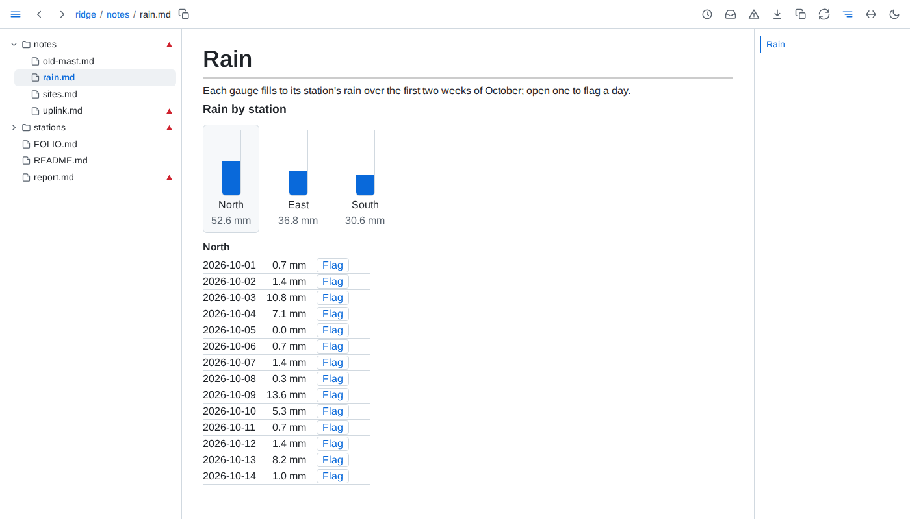

# Components



- **Fence** - a ` ```component <name> ` fence draws with the component of that name. It holds a YAML map: `data` names each entry and the reference it reads, written as `{table: ...}` writes one - a file, `file#part`, a `.sql` file or `#name`, a query named on the same page - resolved against the document's folder, or the served folder when it starts with `/`; every other key is an option, handed to the component as written. An empty fence is a component with no data and no options. GitHub and editors show the fence as YAML.

  ````markdown
  ```component levels
  data:
    readings: data/daily.csv
    totals: '#totals'
  title: Rain by station
  ```
  ````

- **Components folders** - `folio FOLDER --components PATH`, given again for several, names the folders components come from, each inside the served folder, a folder named twice counting once; `folio check` and `folio lsp` take the same option to check component fences against them. A component named `levels` is `levels.js` at the top of a components folder: a name is letters, digits, `_` and `-`, and the first folder named that holds it is the one drawn. Only these scripts run on a page, and only `.js` files: TypeScript, JSX and frameworks compile in the folder's own build, each component into one file that imports nothing. `/?component=<name>` serves a component's script, and `/?components` lists every component, the script it is drawn from and any script of the same name a later folder holds.
- **Script** - an ES module whose default export is called with an element to draw into and a context, and may return `update` and `destroy`, either of them left out, or a text of markdown - see *Markdown*:

  ```js
  export default function levels(element, { data, options, theme, act }) {
    const list = document.createElement("ul")
    const show = (rows) =>
      list.replaceChildren(
        ...rows.map((row) => Object.assign(document.createElement("li"), { textContent: row.station })),
      )

    show(data.readings)
    element.append(list)

    return {
      update({ data }) {
        show(data.readings)
      },
      destroy() {},
    }
  }
  ```

  | Context | Holds |
  |---|---|
  | `data` | Each entry by its name: a table's or a query's rows as records, a JSON or YAML file's or a part's value as written |
  | `options` | Every key of the fence but `data`, as YAML reads it |
  | `theme` | `light` or `dark` |
  | `act(action, details)` | Sends an action off the page - see *Actions* - and answers with a promise |
  | `markdown(text)` | Draws markdown as the page draws it - see *Markdown* - and answers with a promise of an element to place |

- **Drawn** - a component draws in a shadow root of its own. Folio's colours, as the CSS variables `--bg`, `--fg`, `--muted`, `--faint`, `--border`, `--subtle`, `--hover` and `--accent`, its faces `--sans` and `--mono`, and the page's text font and colour reach it, in either theme; Folio's styles do not, so a component styles its own tables, lists and headings, and nothing Folio does to its own markup - table views, word wrapping, read marks - touches the component's. A component draws only once its page is shown, never for a page prepared while the pointer rests on a link to it.
- **Markdown** - markdown a component hands over draws as the same markdown draws on the page, in its styles and theme: diagrams, tables that sort and filter, highlighted code, math, Vega-Lite charts with their values inline, maps and 3D models, and links that open in place. A text the default export or `update` returns is drawn as the component's whole output. `markdown(text)` answers with an element to place among the component's own: a click on its drawing reaches the component's handlers with the element clicked, such as a diagram's box, so the component wires its own links where mermaid draws none, and calling it again with new markdown answers a new element. A drawing goes once its element, placed, leaves the component, so a component hides an element it means to show again. An include, a `{table: ...}` or `{value: ...}` reference, a figure, a query, a component fence and a chart reading a file read nothing and show as a reference that cannot be read shows, with *Markdown from a component takes no includes, data references or queries.*; a fence that does not draw fails as on a page. Folio's drawing has no block ids.
- **Keys** - a key pressed inside a component is the component's own: while it holds the focus, the arrow keys do not step to the previous or next page and <kbd>Alt</kbd> with an arrow opens and closes no panel, though it still never leaves the page.
- **Live** - when a file an entry reads changes, the component's `update` gets the new context as soon as an embed would redraw, so it keeps its own state; one without `update` is drawn again. A saved script draws every component of its name on every open page again with the new code, `destroy` called first, and a script that appears where none was draws the fences waiting for it. A theme switch, or an edit to the fence, draws the component again. More rows than an embed reads add the note *Drawn from the first rows of a longer result.*
- **Actions** - `act(action, details)` dispatches `folio:action` at once, bubbling from inside the component's block, so a handler still holds the reader's click and may open a tab. Its `detail` is `{id, component, action, details}`, the details copied as plain data, so a browser extension's content script, running in a script world of its own, reads them intact. A handler takes the action by calling `preventDefault()` while the event is handled, and answers later by dispatching `folio:answer` on `document` with `detail` `{id}` once it is done or `{id, reason}` when it is not. `act` resolves on `{id}` and rejects with the reason; an action no handler takes rejects at once with *Nothing on this page carries out \<action>.*, and details that cannot be copied reject before anything is dispatched. Folio itself carries out no action and writes nothing. This handler, pasted into the console of a page showing `levels` or run as a content script, carries out its `flag`: it refuses a day without rain, and copies a flagged day's reading to the clipboard.

  ```js
  document.addEventListener("folio:action", (event) => {
    const { id, component, action, details } = event.detail

    if (component !== "levels" || action !== "flag") {
      return
    }

    event.preventDefault()
    const { station, day } = details
    const answer = (detail) => document.dispatchEvent(new CustomEvent("folio:answer", { detail }))

    if (!day.rain_mm) {
      answer({ id, reason: `No rain fell at ${station} on ${day.date}.` })
      return
    }

    navigator.clipboard.writeText(`${day.date},${station},${day.rain_mm}`).then(
      () => answer({ id }),
      (error) => answer({ id, reason: error.message }),
    )
  })
  ```

- **Errors** - a fence without a name, one whose YAML is not a map of `data` and options, a name no components folder holds, an entry whose reference reads nothing, a script that fails to load or has no default export, and a script that throws while it draws or updates each show the fence's YAML, marked red, with the reason below it; a component already drawn shows again, its state kept, once its data reads again. A fence holding an include that finds nothing is not drawn, its mark shown in its YAML.
- **Health** - lists a fence that cannot be read or names no component, a name no components folder holds - saying when none was named - a name more than one folder holds, naming the one drawn, and each entry whose data cannot be read; a script's own errors show only on the page.
- **Around it** - the corner of a drawn component switches between the drawing and the fence's YAML, which a save keeps showing, and copies the YAML; copying its block copies the whole fence. A frozen page keeps the drawing as last shown - what Folio drew for it and shadow roots inside it too, a canvas as its picture, a field, a text area and a choice as they were left - without its script, its frames, its handlers or its links to script. The block is marked changed since read when its data changes, as an embed's is.
