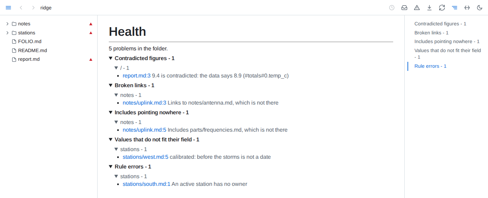

# Conventions



- **Declarations** - a folder declares its conventions in a file named `FOLIO.md`, in capitals: a page like any other, whose ` ```yaml folio ` fences each hold a YAML map of sections - `kinds`, `rules`, `health`, `attention`, `stale`, `save`, `related` and `digests` - between prose saying why. Editors and GitHub highlight such a fence as YAML. Every `yaml folio` fence of the file is read, in order, and a file may hold any number; a plain ` ```yaml ` fence, or any other, is an example, and a file named `folio.md` is an ordinary page.
- **Layering** - a declaration applies to its folder and everything below it. A deeper one adds to those above: a kind or rule it names again replaces the one above in its place, and its health entries follow theirs. Paths a declaration names are relative to its own folder.
- **Kinds** - `kinds` maps a kind's name to `where` - a path pattern relative to the declaration's folder, or a list of them, where `**` crosses folders and `*` and `?` stay in one, so `*.md` names only the folder's own files - and `fields`. A document is of the first kind placing it, kinds of the nearest declaration first; a kind declared again nearer replaces the one above.
- **Fields** - each field names where its value is read with `from`: `frontmatter` (a key of the YAML frontmatter), `label` (a line `**Label:** value`, `**Label**: value` or `Label: value` starting any line of a paragraph or a list item, numbered or not, so labels may stack line under line; its label matched ignoring case), `section` (the text under a heading, up to the next heading of its level or above), `folder` (the name of the folder holding the document) or `name` (the file's name without its extension, or the first group of `pattern` matched against it). `key` names the key, label or heading when it differs from the field's name. `type` is `text` - from a label or section, the plain text a reader sees, without markup or HTML tags -, `number`, `date` (an ISO date or time), `link` - a markdown link, or with `to: <kind>` an id naming the document of that kind whose `id` field, or the field `by` names, holds it - or `list`, its items each of type `of`, written as list items or set apart by commas. A list of links takes every link in each item, and with `to`, every id of that kind written anywhere in the line, so notes beside them, line break tags and closing punctuation stay notes; a link with `to` into the folder must lead to a document of the kind, or name one by the id its text holds, and a link to the web is taken as written. An item naming nothing is listed in health - prose, and a lone word without a digit where every id of the kind holds one, only when nothing else in its line is a link or an id; in a list written one item a line, each item is a line of its own, an indented line carries its item on and any other line is a note - a document's own id never names it, and a line opening with an `empty` text names nothing. `empty` names texts written for no value, such as `None`. A field is read from the document's own text: a label or section an include brings in belongs to the file holding it. A value that does not fit its type is listed in health under *Values that do not fit their field*, at its line. A `where` naming a folder as it is, with no wildcard, places nothing and is listed with the declaration's problems, as is a health entry's. Documents are only read: nothing is written into them.
- **Rules** - `rules` maps a rule's name to its `query`, which should return no row, its `message` - `{column}` in it takes each row's value of that column; the rule's name by default - and its `severity`, `error` (the default) or `warning`. The query runs from the declaration's folder and reads data files and the folder's documents as any query does; every row it returns whose `path` lies below the declaration's folder is a violation, listed in health under *Rule errors* or *Rule warnings* at that `path`, and at its `line` or `block` when it returns them; rows reading alike are listed apart. Health lists a rule's first 10,000 rows, and past them says at the rule's own line how many it returned. A rule declared again in a deeper declaration judges the documents below that folder in its place. A rule whose query fails, or that returns no `path` column, is listed at its own line with the rule's severity. Violations come and go with every change to what the rule reads.
- **Health** - `health` is a list of entries, each with `where` - path patterns relative to the declaration's folder - and `skip`, `error` or both: `all`, or kinds of check among `figure`, `link`, `include`, `loop`, `diagram`, `chart`, `component`, `query`, `data`, `declaration`, `frontmatter`, `field`, `rule` and `view`. A problem whose document a skipping entry places is left out of the health view; one of a kind an `error` entry names there counts as an error, which fails `folio check` - with no such entry, frontmatter that is not YAML and the violations of a rule whose severity is `error` are the errors. Deeper declarations add entries for their own folders. `skip: all` also keeps off what needs you every attention row naming a document the entry places, and the error of an attention query declared in a `FOLIO.md` it places. Nothing else changes: the documents are served, indexed, queried and caught up on as before.
- **Attention** - `attention` maps a name to a `query` and a `message`, as a rule does: every row the query returns needs the reader, listed under *Needing attention* in what needs you at the row's `path`, its message filled from the row's columns. A query that cannot run, or returns no `path`, is listed among the errors.
- **Stale** - `stale` is a map holding a `query`: below the declaration's folder, the documents it names by `path` are the ones that have outlived their use, in place of the default - a document whose text has not changed for a year - by its last commit or the save Folio first saw it in, its file's time only when there is neither, since a checkout resets file times - never read and linked to from no other document. The nearest declaration holding one decides for each document, and a document it names leaves the list once read or edited in the past year, or linked to; a query that cannot run, or returns no `path`, is listed itself.
- **Digests** - `digests` names digest documents Folio writes and keeps current; see [Digests](digests.md).
- **Save** - `save` is a list of entries, each with `where` - path patterns relative to the declaration's folder - naming the documents Folio may write views into. Nothing else is written but the digest documents `digests` declares.
- **Related** - `related` is a list of entries, each with `where` - path patterns relative to the declaration's folder - naming the documents whose blocks Folio relates by meaning; see [Related by meaning](reading.md).
- **Live** - an edit to a declaration applies at once.
- **Broken** - a fence that is not YAML, is not a map, names a section *Declarations* does not list or gives one the wrong shape is listed in health under *Declarations that cannot be read*, at its line, and left out; the file's other fences still apply.
- **Inspect** - a block's ⓘ names the declarations applying to its file, in the order they layer, and its kind and each field's value; `?conventions` gives the same.
