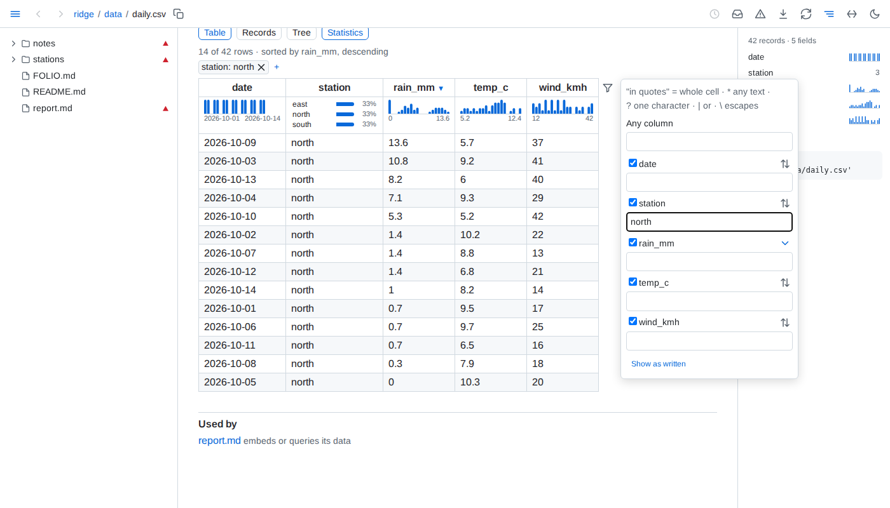

# Data files



- **Tables** - CSV, TSV, JSON Lines and Parquet show 200 rows at a time, and the page says how many rows the file holds; below them, `N of M shown` and a button add the next 200 to every view, an open record staying open. A sort or filter of a longer file's table - from its headers, its panel's text filters, its cells' filter buttons, or the side panel - orders and filters the whole file, and shows its first 200 rows in that order, more following in it, by every level of the sort, rows equal in all of them in the file's order: blanks last either way, text written as a number by its value before other text, text without regard to case, and each filter read as a table's filter is - text found anywhere in a column's values as the cell shows them, in quotes equal to a whole value, with `*` or `?` a pattern of the whole value, and values separated by `|` - ignoring case. Its filters combine as the strip joins them. The Records view's filter searches the whole file too, every character matching as itself. A column filter's list of values counts the whole file, through the rest of the strip. Such a table never folds. A file that takes more than a second to read whole shows its first rows at once and says it is still counting until it is counted. A file of 200 rows or fewer shows them all. A TSV is read with tabs between fields, and a CSV with whichever of comma, semicolon, tab or bar its header line uses most outside quotes, or the one a spreadsheet's first-line `sep=` names; lines starting with `#` before the header are skipped; the header and each column's type are detected. A row with fewer fields than the header is filled with empty cells, and one with more adds columns. A JSON Lines file whose last line is cut short, as one still being written is, shows its complete lines and says the last is left out.
- **Nested** - JSON up to 20 MB and YAML up to 2 MB - YAML reads many times slower, on a thread of its own with a 10-second limit - show as a tree, open two levels deep; a branch shows 1,000 entries at a time, with a button for the next, and the entries of a list longer than that start folded. A list of records starts as a table, with switches to Records and the tree; a list of more than 5,000 records starts as the tree, and its table shows its first 5,000 and says so. Inside the tree, a list of records, or a map whose entries are records of much the same fields, shows as a table, the map's keys first; past 5,000 records it says how many it shows of how many, with a button for 1,000 more. A YAML file of several documents is a list of them; a YAML set is the list of its members, and binary data shows as its size. A value nested more than 1,000 levels deep is not shown; the page says so and shows the file's start. YAML `<<` merge keys are merged, and anchors may be reused up to 10,000 times, as long as the value they expand to stays within 20 MB. A larger file shows its first 64 KB as text.
- **Records** - a nested value in a cell reads as its keys and values without quotes, its empty fields left out, at most three lines; a column grows to about 28 em, keeps an id up to 40 characters on one line and never stands a sentence a word to a line. A click on a row opens its whole record beneath it - a field to a line, nested lists as tables whose rows open the same way, the empty fields named together - and a second click closes it. Records filling under half their cells open as Records: each record a line or three of only the fields it holds, a field holding one value in every record said once above; Table, Records and Tree are a click apart. A table or a query's result in a document draws its cells the same way, and its rows open their records alike.
- **Statistics** - under each header of a file's or a database table's table, a strip spreads the column over every record of the whole file: numbers and dates as a histogram from the lowest value to the highest, a long-tailed column on a log scale; 12 values or fewer as the 3 most common with their shares and how many more; one value as `all <value>`; others as their distinct count, or `all distinct`; and the share missing where cells are empty, `<1%` below one in a hundred. A bar's count and range show on hover. A file the engine cannot read whole is not counted, and the strips and the panel say so and why. The Statistics switch beside the view switch hides the strips on every table of the page, and shows them again. The side panel lists every field with a small histogram or its distinct count, and a bar of how full it is where it has gaps; a field opens into its histogram or its 8 most common values with their counts, with buttons that sort its column smallest or largest first in the Table view - with <kbd>Alt</kbd>, as the sort's last level, or turning its level to that direction - and scrolls its column into view. A value or a histogram bar, in the panel or under a header, filters the page to the records holding it: a bar above the rows names the filter, counts `N of M records` and clears it; the strips and the panel count only those records, a table hides the columns they leave empty, and the panel shows the filter as `select * from '/<path>' where ...` with a copy button - in a ` ```sql query ` fence it gives the same records - for a file of rows, a database table and a JSON or YAML file holding a list of records. The filter lives in the page's address, so back undoes it; one filter applies at a time. A JSON or YAML list of records is counted in the browser; a document of keys lists its top-level keys in the panel, each leading to its place, and its lists of 20 records or more get the strips.
- **Comparisons** - with a filter on a file's or a database table's records, a card above them says what sets the records where it holds apart from the other records: up to 6 fields, the most differently spread first, each with the value whose share differs most or its median, here and elsewhere, and a small chart of both in the accent and grey its legend names. A value's finding becomes the filter on a click. Fields the filter all but fixes to one value - for a number, one bar of its histogram - are named apart, and fewer than 20 records on either side compare nothing. In the side panel a field of 2 to 8 values, a number's included, offers to compare every field by it - within the filter when one is on: the Compare view beside Table, Records and Tree has a column per value with its count and a row per field, the most different first, the share of its most different value or its median with a small histogram on one scale across the columns; it names apart the fields the grouping all but fixes, one value to each column and not the same one in all, and those spread alike in every column, and shows itself as a query grouping by the field, with a copy button, which in a ` ```sql query ` fence gives the same numbers. A comparison reads the whole file once and answers at once when asked again; one the time limit stopped runs again.
- **Databases** - SQLite and DuckDB files list their tables and views - a DuckDB table outside the `main` schema as `schema.table`, also how a reference names it - each with its row count, its columns and its first 10 rows; a link opens one table, 200 rows at a time, as a file's are. A sort or filter of a table showing only some of its rows orders and filters the whole table. A table that cannot be read shows its reason in place of its rows; the others still show. Reading a database stops after 10 seconds: a SQLite database shows the tables read by then, says the one being read was stopped and those after it were not read; a DuckDB table that runs out of time says it was stopped. Whole numbers too large for a double show exactly, and stay whole numbers in a query of the table, as they do written into a query. On its page and in an embed, a `.db` file is told apart by its first bytes; a query goes by its extension. SQLite files are opened read-only and immutable, so changes still in a write-ahead log and not yet checkpointed into the file are not shown.
- **Errors** - a file that does not read whole shows its error above what does read: a CSV or TSV file the engine's whole message and how many rows of the whole file were left out, however many it shows; a JSON Lines file the message and what parses; a Parquet file the message alone; a JSON file the first line of its error, and a YAML file its error with the line and column.
- **Updates** - an open data page redraws when its file changes, keeping each table's view, the view shown - Table, Records, Tree or Compare, a comparison counted again - as many rows as it showed, up to 5,000, the records open in Table and Records, and each branch of the tree open or folded as it was. A theme switch leaves the page as it is; its address opened anew shows its first view and rows.
- **View addresses** - a page address carrying a table's view may run to 1 MB.
