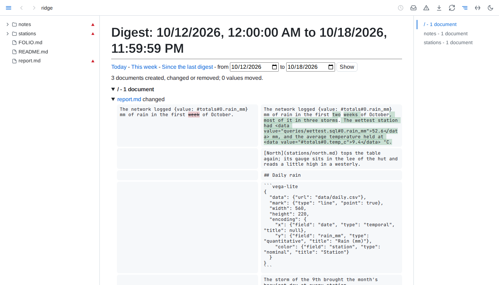

# Digests

- **Period** - today runs from midnight, this week from Monday's midnight, a range from its first day's midnight to its last day's end, all in the browser's time zone; *since the last digest* starts where the latest digest you opened ended - a digest ending today counts as ending when you opened it, and an earlier digest moves it on only when it ends later than the latest one, never back - or a week back when none was. Only a digest page seen in a tab moves it; fetching `?digest-data` moves nothing.
- **Documents** - created, changed or removed in the period, grouped by folder: each document's state at the period's start and end is its newest version by then, from git and Folio's saves as in its history, and each changed block shows its text before and after with words removed and added marked, compared when the document's section first opens. A document whose text changed but no block's version did says so when opened. A document with no version at the period's start is created when Folio or git saw it come to be, or its file was born in the period; otherwise it is changed, its earlier text not kept. One removed by its end is removed.
- **Values** - every embedded value, table or query result whose result moved in the period, as before -> after: before is the result shown last before the period, or the first shown in it; one shown only once in the period has not moved. A table shows as its row count and, when that held, the first cell that changed, as row, column and value. Results are only those kept while a page showed them.
- **Busy periods** - more than 50 changes, counting documents and moved values, open with every folder and document folded, each document compared only once opened; a document with more than 10 changed blocks folds once drawn.
- **Open and freeze** - a changed document leads to its two versions compared, a created or removed one to its version at the period's end or before its removal; the download button freezes the digest as one HTML file. Building a digest writes nothing into the folder.
- **Written into the folder** - a declaration's `digests` asks for a digest kept as a document: a list of entries, each with `path` - a markdown file relative to the declaration's folder - and `period`, `day` or `week`, by the local calendar. `{day}` in the path names the day, as `2026-10-15`, and `{week}` the ISO week, as `2026-W42`, so each period gets a document of its own and earlier ones stay as they were last written; a path naming neither is one document that moves on to each new period. A path under a dot-name or `node_modules` is a problem of the declaration, and a path leading out of the served folder through a link, or one whose document cannot be created, is not written and is listed at its entry under *Saved views not written as asked*, the other views written as ever. Folio creates the period's document with a title and a saved view marked `<!-- folio view: digest -->`, and keeps that region current - listing each document created, changed or removed in the period, grouped by folder and linked, and each value that moved, as before -> after; no summary is written, and no digest lists a digest document. The region names its period on its first line and is worked out at most once a minute; a path naming `{day}` or `{week}` has its region written once more just after its period ends, so its last changes are kept, and a digest of an earlier period found under a `save` entry is left as it is; otherwise it behaves as any saved view: a hand edit is replaced and reported, and nothing outside the region changes. With no `digests` entry, no digest is ever written.
