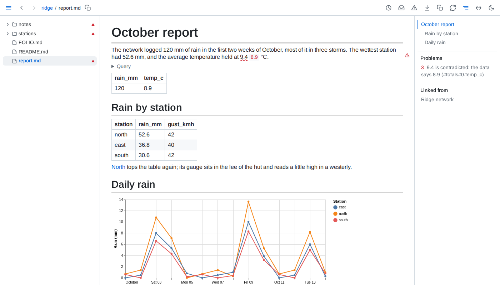

# Embedded data



- **Table** - a paragraph or list item that is only `{table: path}` or `{table: path#part}`, at any depth, shows the data as a table that sorts, filters and folds. A list of records is one row per record; a map of records one row per entry, its key first; any other map one row per key.
- **Value** - `{value: path#part}` anywhere in a paragraph, heading, list or table cell, outside code, shows one value: a scalar, or the cell of a one-row, one-column table. ` | <format>` after it, the pipe set apart by spaces, formats a number with a [d3-format](https://d3js.org/d3-format) specifier such as `.1%` or `,.0f`.
- **Chart** - a ` ```vega-lite ` fence holding a Vega-Lite description in JSON or YAML draws as a chart; every `data` with a `url`, at any depth, is read from the folder by that reference. A description that cannot be drawn stays as written, marked red, with the reason below it.
- **Figure** - `<data value="path#part">figure</data>` anywhere in a paragraph, heading, list or table cell, outside code, ties the typed figure to one value, read as for *Value*. A number is matched within half a unit of its last typed digit; commas between thousands, a sign and any text before the number such as a currency mark, in either order, are allowed, `k`, `K`, `M`, `B` or `bn` after it scale it, and a figure ending in `%` reads a value between -1 and 1 as a fraction and any other as already in percent. A date - `2026-10-15`, `2026-10-15 14:30`, `2026-10-15T14:30+02:00`, `15 Oct 2026`, `October 15, 2026`, `Oct 2026` or `15/10/2026` - matches a date in the data on the parts typed, read as UTC; a time typed with an offset is compared in that offset, and a slashed date reads day first unless its second number can only be a day. A contradicted one shows the data's date written the same way. A range such as `29-56%` is not checked: the page shows it as typed, with the reason on hover, and health never counts it. Anything else matches only the same text. A contradicted figure is underlined in red with the value beside it, at the figure's precision and in its form; a figure whose data cannot be read is marked red with the reason on hover.
- **References** - `path` resolves as an include does: against the file holding the embed, or the served folder when it starts with `/`. The part after the last `#` names a database's table, or a path into the file's data: keys, or row and list positions from 0, joined by dots - a key holding dots is matched whole. A tabular file's data is its list of rows. An embed of a data file or a database table reads up to 100,000 rows, of a query 10,000.
- **Missing** - an embed whose file or part is not there shows the reference and why, marked red; the rest of the page draws.
