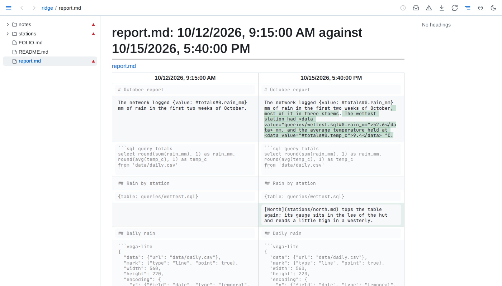

# History

- **Versions** - a document's versions are the commits touching it in the git repository the file belongs to - the nearest one above it, a nested repository included, even when that repository's top folder lies above the served folder, though never one a `.git` file points to elsewhere; at most 2,000 a document, from the latest 50,000 commits of its repository - merged with the saves Folio keeps of what it saw while running, and the file as it is now. A text saved and committed later is one version, timed by when it was first seen. Git's commit messages are not shown; a version is known by its time and, for a commit, its author. A removal shows as a version of its own. A document no longer in the folder keeps its history at its old address. A document moved or renamed within the folder keeps its history, the commits from its old place included.
- **Saves** - Folio keeps every save for 30 days, then the last save of each day, by the local calendar, and at most 500 saves a document; past 512 MB of kept saves on disk, compressed, the oldest saves of any document go first, a document's newest save always kept. Old saves are thinned a minute after Folio's first walk of the folder ends and once a day, so between sweeps a document may hold up to twice its bound. Saves are kept from when Folio first knew the document; a file no git repository tracks has only these, starting from its text when Folio first saw it.
- **Past versions** - render read only, with includes and embeds as written rather than filled from today's files.
- **Compare** - blocks are paired by identity, as Folio pairs them across an edit; changed blocks show words removed and added, and unchanged blocks are greyed.
- **A block's past** - the clock beside a block opens, in the ⓘ's pop-up beside the clock and in place of what it showed, the 3 newest texts that block has had, each linking to its version, and *All N versions*, the block's own history page: every text it has had, newest first, from the newest 200 versions. Ctrl-click or middle-click the clock to open that page in a new tab; the clock again, its close button or <kbd>Escape</kbd> closes the pop-up.
- **Values** - each result an embedded value, table, chart's or component's data or query showed is kept when it differs from the one before, while a page shows it: a value that changed while no page showed it keeps only the result shown next. A table keeps its first 200 rows and its row count; 1,000 results are kept per embed.
