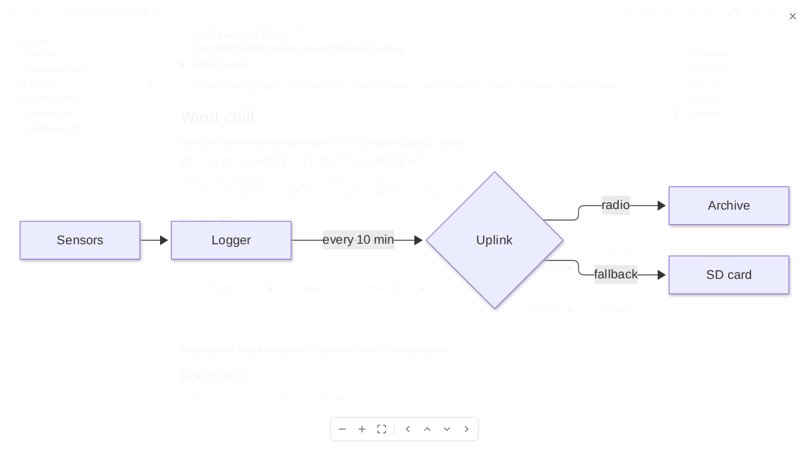

# Keyboard and mouse

| Input | Action |
|---|---|
| <kbd>←</kbd> / <kbd>→</kbd> | Previous / next page in the tree's order. In a text field or a date picker, they move through it instead, and after a click into a block wider than the page, they scroll that block |
| <kbd>Alt</kbd>+<kbd>←</kbd> / <kbd>Alt</kbd>+<kbd>→</kbd> | Hide or show the tree / the outline |
| A double-click on the toolbar, outside its buttons and links | Hide the tree and the outline and turn full width on; again to put back the layout it replaced. Changing the tree, outline or width by hand forgets that layout, so a page maximized by hand goes back to the starting one - tree and outline shown, full width off. The tab keeps the layout to go back to through a reload and hands it to a tab opened from a link |
| <kbd>+</kbd> or <kbd>=</kbd>, <kbd>-</kbd> | Zoom a diagram, chart or image in the full-window viewer in, out |
| Arrows, drag | Pan a diagram, chart or image in the full-window viewer |
| Wheel | Zoom a diagram, chart or image in the full-window viewer about the pointer, and a map or model there; over a map or model on the page, scroll the page |
| <kbd>Escape</kbd> | Close the full-window viewer, a provenance or past-versions pop-up, an earlier-text panel, a filter's list of values, or a table's filter panel |
| A click into a column's filter, or <kbd>↓</kbd> / <kbd>↑</kbd> in it, then a click or <kbd>Enter</kbd> on a value | Open the column's list of values, move through it, and filter by the value chosen, written in quotes; <kbd>Alt</kbd>+click or <kbd>Alt</kbd>+<kbd>Enter</kbd> adds it after a `\|` to the values already in the field and leaves the list open |
| A table's strip of filters | A click on `and` or `or` flips it; on a badge, edits its text in place until <kbd>Enter</kbd>, <kbd>Escape</kbd> or a click elsewhere; on its x, removes it. Dragging a badge moves it between the words; + adds a filter for a column chosen from its list |
| A table cell's filter button, top right while the pointer is on the cell | Filter the cell's column to its value, in quotes; with <kbd>Alt</kbd>, add the value after a `\|` to the column's filter |
| The full-window viewer's X, top right | Close the viewer; a click anywhere else in it leaves it open |
| A click, <kbd>Enter</kbd> or <kbd>Space</kbd> on a table header, or a click on its sort button in the panel | Sort by that column alone; on the column sorted alone, again to reverse, a third time to go back to the order as written. With <kbd>Alt</kbd>, add the column as the sort's last level, or step the level it is to descending, then out of the sort |
| Opening a link in a new tab or window | The new tab starts with this tab's theme, width and panels |
| The toolbar's path button, right of the path, on a document's, data file's or folder's page | Copy the page's path in the served folder, `.` for the folder itself; with <kbd>Shift</kbd>, its absolute path. It shows a check for a moment |
| The toolbar's download button | Save the page as one self-contained HTML file |
| The toolbar's copy button, on a markdown or diagram page | Copy the document as markdown, as the page shows it: includes filled in, `{value: ...}` as its value, `{table: ...}` and a query's result as markdown tables, every table as its view sorts, filters and hides it, folded rows included; charts, diagrams, maps, models and frontmatter as written. A diagram file copies its source |
| The copy button below a block's ⓘ, while the pointer is level with the block, anywhere from the tree to the outline | Copy that block the same way; a heading copies its section, down to the next heading of its level or above, a quote loses one `>` level and an alert its marker. Code blocks, diagrams, charts, maps and models have their own copy instead, and rules none |
| A drawn diagram's, chart's, map's, model's or component's corner, while the pointer is on it | A button opening it over the whole window, hidden while its source shows, a component aside; a switch between the drawing and its source, which a save keeps showing; and a copy of the source. A diagram or chart opens in the full-window viewer filling the window; a map or model opens live, filling it, with its own controls, and keeps on the page the view it is left at |
| An image's corner, while the pointer is on it, unless the image is inside a link | A button opening it in the full-window viewer: an SVG fills the window, any other image is fitted to it and no larger than its own size |
| A code block's copy button, in its top-right corner while the pointer is on the block | Copy the code as shown, includes filled in, without its fences or final line break |
