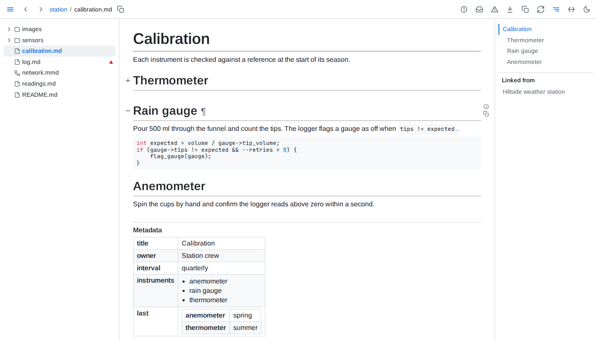

# Markdown



- **Syntax** - GitHub-flavoured markdown: tables, task lists, strikethrough, footnotes and bare links, plus `$...$` and `$$...$$` math, and GitHub's ``$`...`$`` form of inline math, which reads a dollar sign written `\$` inside it; a ``$`...`$`` broken across lines is a dollar sign, code and a dollar sign, neither of which opens a formula. Fenced code is highlighted for the language named after the fence.
- **Colours** - inline code that is wholly one colour - `#RRGGBB`, `rgb(R, G, B)` with each part 0 to 255, or `hsl(H, S%, L%)` with H 0 to 360 and S and L 0 to 100 - is followed by a small swatch of it. Short hex, names and alpha forms stay plain code, as does code in a block.
- **Maps** - a ` ```geojson ` fence holding GeoJSON, or a ` ```topojson ` fence holding a TopoJSON topology, draws as a map of its shapes, fitted to them: areas and lines in the accent colour, points as dots, a shape's properties listed when it is clicked. The map asks the network for nothing until *Load map* adds OpenStreetMap's tiles under the shapes, with their attribution; a map keeps its tiles until the page reloads. A fence that is not JSON, or holds no GeoJSON or topology, shows its source under a line saying why.
- **3D models** - a ` ```stl ` fence holding an ASCII STL model (`solid ... endsolid`) draws as the model, turned by dragging, with zoom in, zoom out and a reset to the first view. A fence that is not ASCII STL, or a browser without WebGL, shows the source under a line saying why.
- **Alerts** - a quote at the top level of the page whose first line is only `[!NOTE]`, `[!TIP]`, `[!IMPORTANT]`, `[!WARNING]` or `[!CAUTION]`, in any case, shows as a callout: the kind's icon and name over the rest of the quote, its edge in the kind's colour. A marker followed by text on its line, an unknown kind, or a quote inside a list or another quote stays a plain quote.
- **Headings** - anchors are named as GitHub names them, and GitHub's `#user-content-` form also works.
- **Title** - a document's one h1 outside `<details>` is its title: the browser tab reads the title, then the file name, as `October report | report.md`, and *Linked from* and `folio.documents` name the document by it. With no h1, an empty one or several, the tab reads the file name.
- **Blocks** - `#^<id>` names any block by its identity, as the ¶ in its margin gives it. Such a link lands only in Folio.
- **Links** - a link to another site opens in a new tab.
- **Line breaks** - a line breaks at a space; a word holding a hyphen or dash - `PO-4471`, `2026-11-05`, `2020–2026` - moves to the next line whole, and breaks at its hyphen only when it is wider than the line can be, in a table wider than its column can be with the table no wider than the page. This holds on every page Folio draws and in the panels beside it, code blocks, diagrams and math aside; copied text and the browser's find see the word as written.
- **HTML** - `<details>`, `<kbd>`, `<mark>`, `<sub>`, `<sup>`, `<abbr>`, `<u>`, `<small>`, `<cite>`, `<dfn>`, definition lists, figures and tables with merged cells render as elements, and may carry `class` and `style`. Scripts, event handlers and `javascript:` links are removed.
- **Frontmatter** - shows at the page's end, after the footnotes, under a *Metadata* title drawn like *Linked from*'s: one table row per key, each value as YAML reads it - quotes and escapes gone, numbers and dates as written - a list as a bulleted list, a map as rows of its own, and a list whose every entry is a map as one table - an entry a row, a column per key in the order keys first appear, empty where an entry lacks one. A markdown link written in a value is a link shown by its text, and a value starting with one is quoted, as YAML reads a leading `[` as a list; it counts as a link in the page does - under *Linked from*, in `folio.links` at its own line, and in health. Frontmatter that is not a valid YAML map shows as a YAML block under *Metadata*, and health lists it under *Frontmatter that is not YAML* as an error: frontmatter that does not parse at the line the parser stopped at, with its reason; a list or a bare value at its opening line, as not a map of keys. Its keys are then no field and no row of `folio.frontmatter`. The title is neither an anchor nor a block: no fold reaches it, the outline leaves it out, and a heading of the document named Metadata keeps `#metadata`.
- **Loose tables** - extra cells widen the table under empty header cells, missing cells are left empty, and two or more lines starting or ending with a pipe form a table even without a divider line - headerless when there is none. A single pipe line, and pipes in code, stay as written.
- **Table views** - every table but frontmatter sorts, filters, hides columns and folds in the view. Sorting up puts numbers - thousands set apart in groups of three by commas, spaces or underscores, a sign, `%` or a currency sign allowed; `3 4` and `1,5` are text - before text and compares text with its digits as numbers; sorting down reverses that order; empty cells stay last either way. A click on a header, or on its sort button in the panel, sorts by that column alone, and on the column sorted alone steps to descending, then back to the order as written; <kbd>Alt</kbd>+click adds the column as the sort's last level, ordering the rows the levels before it leave equal, and on a level steps it to descending, then out of the sort, the levels after it moving up. Each sorted header shows its arrow and, from two levels on, its level's number; the line above the table names the levels in order, as `sorted by station, then rain_mm, descending`. Filters match text anywhere in a visible cell, ignoring case. Text in quotes, `"open"`, matches only a cell equal to it, `*` and `?` included as characters, ignoring case and the spaces around it. Text holding `*` or `?` outside quotes is a pattern the whole cell must match, `*` standing for any run of characters and `?` for exactly one: `no*` keeps the cells starting with no, `*th` those ending in th. `|` separates values, the spaces around it ignored, and a cell matching any of them is kept: `"open" | clo`. A backslash makes the next `"`, `\`, `*`, `?` or `|` a plain character, so `\"id` finds `"id`; before any other character it stays, so `C:\Users` is found as written. A quote not yet closed is left out, and text with quotes inside, such as a piece of JSON, is found as written. The panel's note sums these up. A table's filters show as badges on a strip between its count line and its rows, each `station: north`, or `Any column: north` for Filter rows' text, joined pair by pair by `and` or `or`, and binding first, so `station: north and rain_mm: "0" or station: south` keeps the north rows without rain and every south row. A click on a word flips it; a click on a badge opens its text for editing in place, the rows following as it changes, until <kbd>Enter</kbd>, <kbd>Escape</kbd> or a click elsewhere, a badge left empty going; its x removes it with the word before it, or after it for the first; dragging it moves it between the words, which stay where they are; the + at the end adds one for a column chosen from a list. A column's field in the panel shows and edits that column's first badge, and typing into an empty one adds a badge at the end, joined by `and`. A body cell shows a filter button in its top-right corner while the pointer is on it: a click sets its column's first badge to the cell's value in quotes, a backslash before each character a filter would read otherwise, and <kbd>Alt</kbd>+click adds the value to that badge after a `|`; a merged cell filters the first column it spans that is shown. A list of records' filter reads every character as itself, and shows no strip and no button in its cells. A click into a column's filter lists the column's values, when it holds 12 or fewer among the rows the rest of the strip keeps, each with how many of those rows hold it, most common first, values differing only in case or the spaces around them as one; typing narrows the list to the values the text matches, the arrow keys move through it, and a click or <kbd>Enter</kbd> writes the value in quotes, a backslash before each character a filter would read otherwise, and closes it; <kbd>Alt</kbd>+click or <kbd>Alt</kbd>+<kbd>Enter</kbd> adds the value after a `|` to those already in the field, once, and leaves the list open. A list of records' filters list no values. *Show as written*, at the foot of the panel, puts the table back as its file writes it: no sort, no filter and every column shown. A table of more than 100 rows shows its first 50 until asked for the rest, except a data page's table of a longer file, which loads 200 at a time. A table drawn with a header row, unless it sits inside another table, keeps that row in sight just below the toolbar while its rows scroll past beneath it, its cells over their columns when the table scrolls sideways, until the header leaves with the last row; the sort and filter button, its panel and a filter's list of values stay beside it, and a frozen page pins it to the window's top edge. Printed, or in a browser without scroll-driven animations, the header stays in place. Columns are counted through merged cells, a cell spanning several standing in each, so sorting and hiding pick the column it shows under. A view lasts through saves of the file, the panel of the table being changed staying open and its field keeping focus, and lives in the page's address as `?view=`: every change of view is a new history entry, except keys typed into a filter within a second of each other, which share one. An address naming a table or column that no longer exists restores what still applies.
- **Includes** - `\{include: path}` resolves against the including file's folder, or the served folder when the path starts with `/`, and expands at any depth. It is replaced everywhere: in prose, inline code, code blocks and diagram fences alike. A page updates when any file it includes is saved or created.
- **Part includes** - `\{include: path#anchor}` brings in the section under that heading, up to the next heading of the same or a higher level; `\{include: path#^id}` brings in one block, by the id its ¶ link carries. A document may include a section of itself.
- **Unresolved** - an include whose file, section or block is not there, whose path leads outside the served folder, or that would hold itself stays exactly as written, marked red, wherever it stands - code included; pointing at it says which. One in a link's address or an HTML attribute is shown, marked, just after its element, and the address keeps it as written; a diagram, chart or formula holding one is not drawn, so its source shows with the mark, and a figure holding one is left unchecked. Each mark is named by the file, line and column of the include, and a file included twice names its second mark apart. Each is listed in health, whose entry lands on the mark.
- **Path** - an include's path holds no brackets, braces, quotes or commas, so a YAML flow map such as `{include: ["a.*"], exclude: []}` is text, not an include.
- **Escaped** - a backslash before the brace, `\\{include: path}`, shows `\{include: path}` as written: never resolved, never marked, never listed. On GitHub the backslash shows in code.
