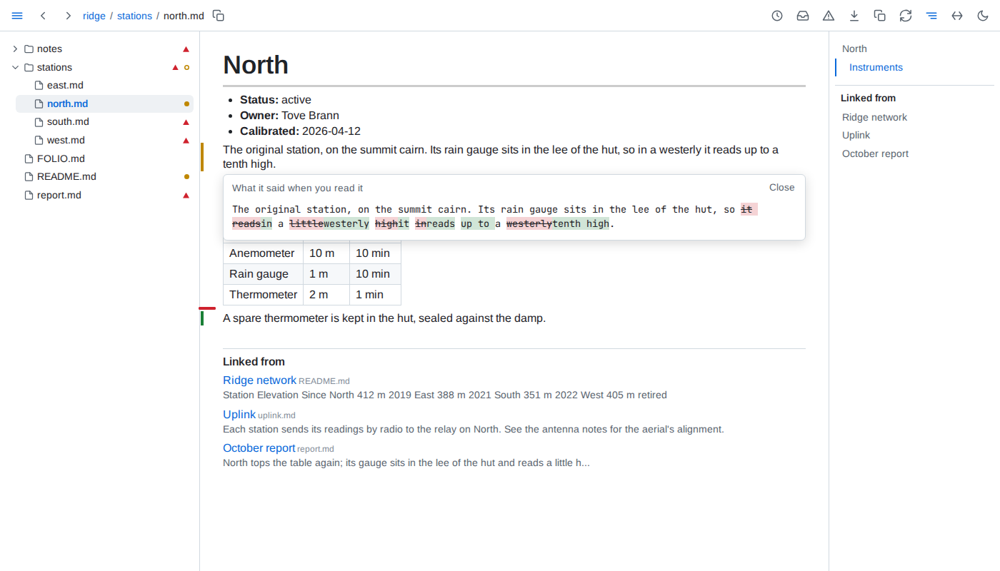

# Reading

- **Read** - a block counts as read once at least half of it, or half the window for a taller block, has stayed on screen for 1.5 seconds while the tab is shown. A block scrolled past sooner is not read, and nothing counts as read across a sleep of the machine. A block taller than the window that is marked changed counts as read only once the part of it holding the change has been on screen. A block marked by its rows, items or lines is read a part at a time: each counts as read once its own mark has been on screen for 1.5 seconds, the others stay marked, and a reload brings none back.
- **Versions** - Folio keeps the version read of each block. In prose a run of whitespace counts as one space, so rewrapping a paragraph keeps its version, and a table's cell padding and divider widths count for nothing, so compacting or repadding a table keeps it too; a list's indentation counts only where it changes how its items nest, its numbering only in the number an ordered list starts at, and code inside an item counts every character but trailing spaces; in code, diagrams and frontmatter every character counts. Line endings, LF or CRLF, never count.
- **Marks** - on a page whose file was read before, a green bar beside a block added since, an amber bar beside a block whose version changed since it was read, and a red tick where a read block was removed. A block never read is not marked when it changes. A table written in markdown, a list and a code block shown as code are marked by their parts instead: a bar beside each row, each item - the innermost whose own text changed - or each run of adjacent lines added or changed, a changed row's changed cells tinted until its bar fades, and a tick where a row, item or line read was removed; a row or item that only moved is not marked. A change no part tells - rows only reordered, a code fence's language, the number a list starts at - marks the block whole, as do diagrams, charts, maps, models, math, query results and tables drawn from data. The marks follow their rows through sorting, a row filtered out shows none, and the fold button of a long table counts the marked rows it hides. A folded section or a closed `
` keeps its marks to itself: one amber bar beside its heading or summary - beside the outermost, when one folded section holds another - says something inside changed, the bars and ticks inside showing once it is unfolded or opened; the blocks written inside a `
` are marked, read and linked as blocks of their own. A mark inside a fold does not count as on screen, nor its block as read, while the fold hides it. A mark fades once its block, or the tick, counts as read and the mark has been on screen 5 seconds in all - half of what it marks shown, or half the window, the tab shown - a changed row's tinted cells with it; a block whose earlier text is open does not count meanwhile, and its bar stays. Clicking an amber bar shows the text as read against the text now, words removed struck through and words added highlighted; clicking a tick shows the removed text. <kbd>Escape</kbd> closes it.
- **Catch up** - a document counts as changed once any block it shows is marked. The tree puts a dot after each such document and an outlined dot after each folder holding one, expanded or not; the toolbar's inbox button, which carries no count, says how many in its tooltip. The catch-up list orders them by when their latest marked change happened, newest first - a save that changes no block moves nothing - each with how many blocks are marked and that time, under the first of these that holds it: *Since yesterday*, from the midnight that began yesterday in the browser's time zone, then *Past week*, *Past month*, *Past quarter* and *Past year*, within 7, 30, 90 and 365 days, and *Older*; a period with no change is left out. What needs you groups the documents changed since you read them the same way. A document never read, or created since, is not listed. The list and the marks follow every change and every read live.
- **Through what a page depends on** - a block brought in by an include is marked by the file it lives in, and its change also lists the including page in the catch-up. A block holding an embed, chart or query result is changed when the data it showed changed since it was read; its mark says which embeds. A note at the top of the outline names each included, embedded or queried file whose content changed since the page was last read - one put back with an older time counts, one only touched does not - with when the change reached the folder. A link to a block or heading whose target changed since the linking block was read is underlined in a wavy amber line, and one whose target is gone in a wavy red line; reading the linking block again clears it. A change to a file nothing depends on marks nothing elsewhere.
- **Linked from** - below a page, every markdown link to it from another document of the folder, reference links included, one entry each, by the linking document's path and then its order: the document by its h1 when it has exactly one outside `
`, its file name beside it in small, faint type, else by its path; the heading or block the link points at, when it names one, as the page names it, as small and faint; and the words around the link as a reader sees them, an embedded value or an include standing as `...`. Each entry leads to the block holding the link. The outline lists each linking document once - by its h1, else its file name - leading to its first linking block. A link with a scheme or a host is never listed. The list follows every save.
- **Related by meaning** - below a `FOLIO.md` whose `related` asks for it, the outline lists under Linked from the blocks of the other documents its declaration places closest in meaning to the section in view - the text under its heading, or under the first heading below it when it has none - or to the block pointed at or holding the selection: up to eight, closest first, each with its document, lines, its first words and how close it is. A click opens that document at that block. A heading, code, a block of fewer than six words, a lead-in line ending in a colon and a block written word for word in more than one document are never related; pointing at one, or at a section nothing comes close to, says *Nothing close enough*. The relations come from EmbeddingGemma, a small embedding model run on this machine: the first folder that asks for it makes Folio install the model's runtime - `onnxruntime-node` and `@huggingface/tokenizers`, through npm - and download the model, 1.3 GB, once into `~/.cache/folio`, then relate the folder in the background while the list shows how far it has got; every page reads normally meanwhile. A save has its changed blocks related again within seconds. While no declaration asks for it, nothing is downloaded and nothing related.
- **Used by** - the page of a document, a data file or a query file lists below it the documents including it, at any depth, and those whose embeds or queries read it. While Folio is still reading the folder after it starts, the list is not known: `?used-by` says so, and the page shows no list until it is, asking again every 2 seconds.
- **Provenance** - the ⓘ below a block's clock, shown while the pointer is level with the block, anywhere from the tree to the outline - a heading, which keeps its own link mark, shows the ⓘ alone, level with the top of its first line - opens where the block came from: its file, lines and when its text last changed; for a block an include brought in, the section of the file it came from, or that it is the whole file, told apart for each place the same block is included; for a table, chart, value or query, every data file it reads, with when each last changed, and its query; for a block tying figures to data, each figure as matching, contradicted or unchecked, with the data's value or why it could not be read. A block holding a contradicted figure, data or a query that cannot be read, a diagram that cannot be drawn or an include that is missing carries a red warning sign in that place instead, shown without pointing at it; it opens the same. Either opens on the click, in a pop-up to the left of its button and level with it - ending level with it when the window has no room below - over the page, the tree and the outline: at most 600 px wide, scrolling inside past half the window's height, moving with its block, and saying what it waits for until Folio answers. <kbd>Escape</kbd>, its close button or the same button again closes it; a click anywhere else leaves it open.
- **Health** - the warning button in the toolbar opens everything wrong in the folder, in every document whether opened or not: figures their data contradicts; links to a file that is not there, or to a heading or block a document no longer has, a link out of the served folder or to the web never counted; includes that find nothing, and includes that lead back to themselves, listed at each include of the loop; diagrams that do not parse, or parse but cannot be laid out - a diagram of a kind the check cannot lay out without a browser is parsed only; charts that cannot be drawn; queries that fail; data an embed, chart or tied figure reads that is missing or cannot be read, a figure left unchecked on purpose - a range, or one holding a missing include, which is listed once, as an include - never counted; declarations that cannot be read, values that do not fit their field, saved views not written as asked, and the violations of the folder's rules, grouped by severity. A data file no document reads is not checked. Each kind lists its documents by folder, a kind with more than 20 folding them; each entry opens its document at the block holding the problem. The view follows every save and every change to the data its documents read. The tree marks every file health lists a problem for, and every folder holding one, with a warning sign - pointing at a file gives the count - and a document's outline lists its own problems after its headings, the first five and then how many more, each opening the problem's line, or the document showing it when another does; the button carries no count.
- **Outline** - beside a document, the note on what its page depends on, then its headings - those inside a `
` left out - its problems, *Linked from* and *Related by meaning*; beside Folio's own pages, their sections, health's kinds with their counts; beside a data page, its fields. With no heading it says *No headings*. The heading being read is highlighted, and the outline scrolls itself to keep it in view until it is scrolled by hand - the wheel, a touch, its scrollbar or a scroll key inside it - then stays where it was left until one of its entries is clicked or another page opens.
- **Where** - the record is shared by every browser and kept in Folio's own state, never in the folder, so it survives restarts. A document moved or renamed - the same text leaving one place and appearing in another, while Folio runs or while it is stopped - keeps its record.
