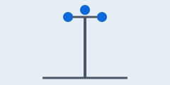
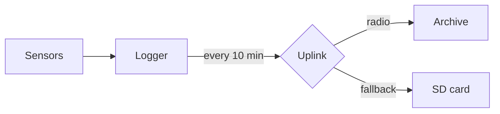

# Hillside weather station

The station sits on the north ridge at 412 m and reports every ten minutes. This handbook covers the instruments, the **daily checks** and the *calibration* schedule. Press <kbd>F5</kbd> on the logger to force a reading; values marked <mark>provisional</mark> are not yet checked.

## Instruments

| Instrument | Model | Height | Interval |
|---|---|---|---|
| Anemometer | Cup, three-arm | 10 m | 10 min |
| Rain gauge | Tipping bucket, 0.2 mm | 1 m | 10 min |
| Thermometer | Platinum resistance | 2 m | 1 min |



## Daily checks

- [x] Clear the rain gauge funnel
- [x] Read the logger battery
- [ ] Compare the thermometer against the hand reading

<details><summary>Station history</summary>

The mast went up on the ridge in its first spring; the radio uplink replaced weekly visits with a laptop.

</details>

> A reading that jumps by more than 5 °C in ten minutes is almost always a loose connector, not the weather.

## Wind chill

Wind chill combines air temperature $T$ in °C and wind speed $v$ in km/h:

$$W = 13.12 + 0.6215\,T - 11.37\,v^{0.16} + 0.3965\,T\,v^{0.16}$$

```python
def wind_chill(t: float, v: float) -> float:
    return 13.12 + 0.6215 * t - 11.37 * v**0.16 + 0.3965 * t * v**0.16
```

## Data flow



Readings are kept for ten years.[^retention] See [calibration](calibration.md) for the schedule.

[^retention]: Older readings move to the regional archive.
